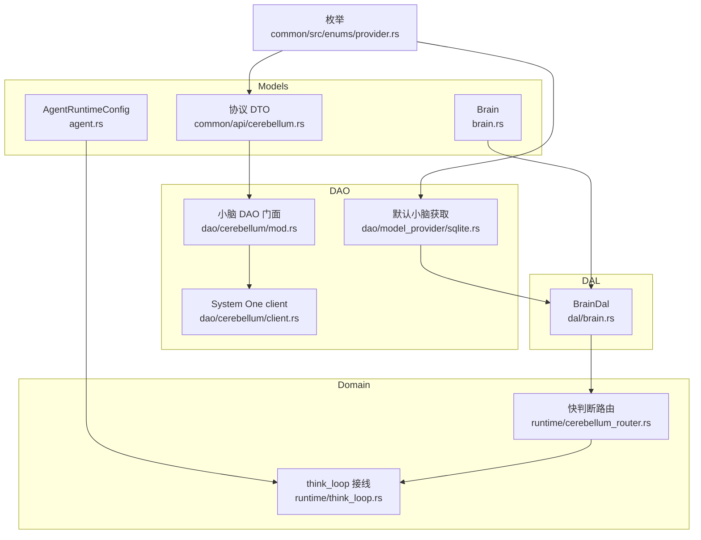
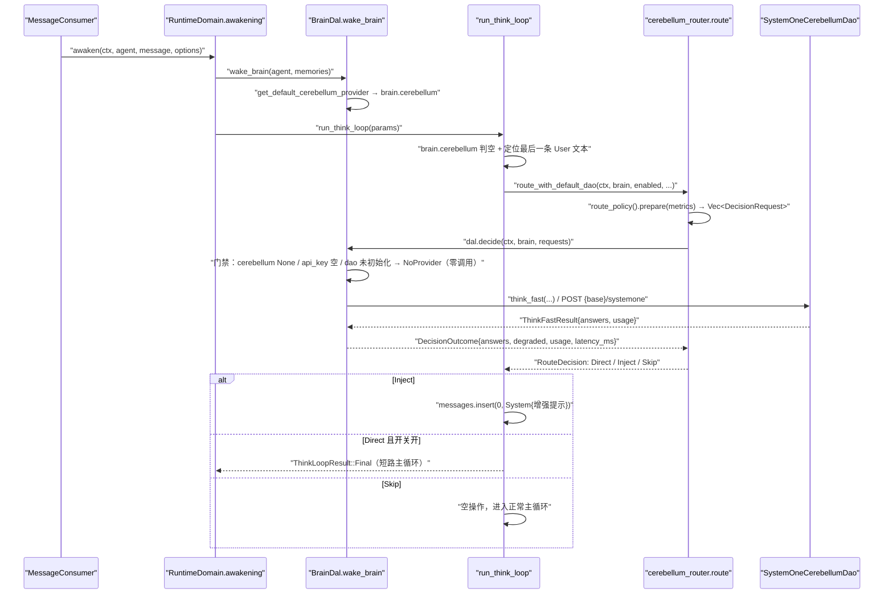
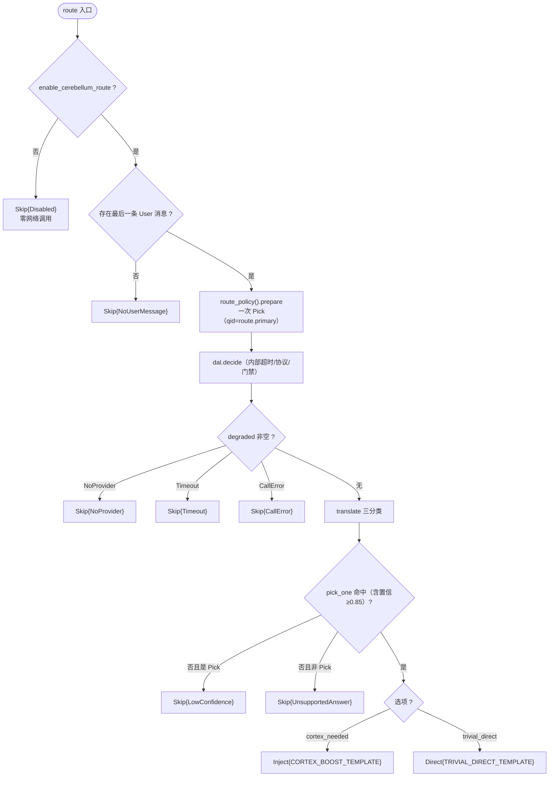
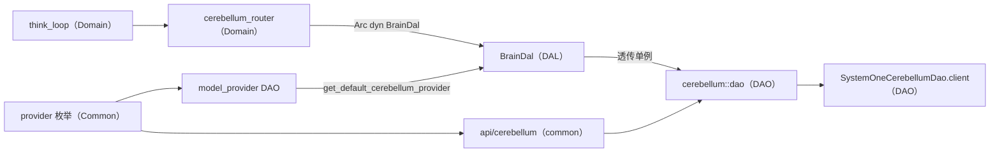
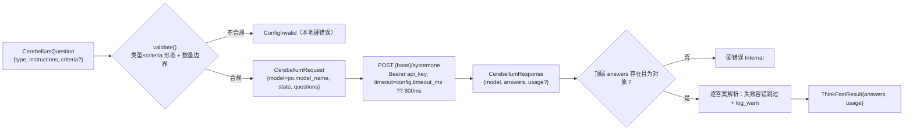
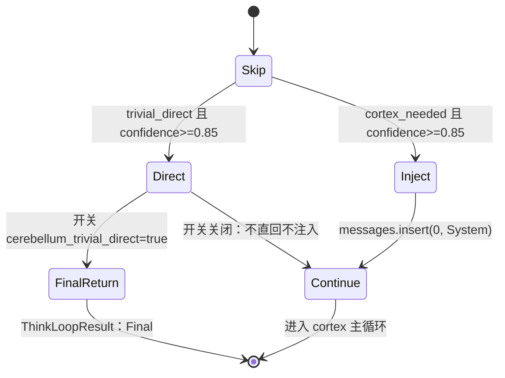

# 小脑快判断（System One）

<cite>
**本文引用的文件**
- [common/src/api/cerebellum.rs](common/src/api/cerebellum.rs) — System One 协议 DTO（QuestionType/QuestionCriteria/CerebellumQuestion::validate/CerebellumRequest/CerebellumAnswer/CerebellumResponse）+ 降级口径 DegradedReason
- [src/service/dao/cerebellum/mod.rs](src/service/dao/cerebellum/mod.rs) — CerebellumDao trait + SystemOneCerebellumDao 单例 + dao()/init()
- [src/service/dao/cerebellum/client.rs](src/service/dao/cerebellum/client.rs) — resolve_endpoint / resolve_timeout_ms / think_fast 编解码 + 错误分类
- [src/service/dal/brain.rs](src/service/dal/brain.rs) — BrainDal::decide（批量执行决策请求，永不 Err）+ wake_brain Local 分支注入 brain.cerebellum
- [src/service/domain/runtime/cerebellum_router.rs](src/service/domain/runtime/cerebellum_router.rs) — 常量集中 + RouteDecision / route() / translate() / route_with_default_dao()（问什么交给 PickOnePolicy）
- [src/pkg/policy/forms/mod.rs](src/pkg/policy/forms/mod.rs) — PickOnePolicy（一次单选形态，本模块的生产用例）
- [src/service/domain/runtime/think_loop.rs](src/service/domain/runtime/think_loop.rs) — run_think_loop 首轮前单点接线
- [src/service/dao/model_provider/sqlite.rs](src/service/dao/model_provider/sqlite.rs) — get_default_cerebellum_provider
- [src/models/brain.rs](src/models/brain.rs) — Brain 的 cerebellum 字段与构造器
- [src/models/agent.rs](src/models/agent.rs) — AgentRuntimeConfig 运行开关
- [common/src/enums/provider.rs](common/src/enums/provider.rs) — ProviderType::Jev=8 / ModelCapability::Decision=2

**更新摘要（2026-11-02，本轮）**：小脑从「快判断专用通道」泛化为「决策策略引擎的一个场景」。协议 DTO 从 `src/models/cerebellum_types.rs` 迁到 `common/src/api/cerebellum.rs`（跨进程共享，`DegradedReason` 也随之下沉）；`BrainDal::think_fast` 换成 `BrainDal::decide`（接 `Vec<DecisionRequest>`，批量、永不 `Err`）；`cerebellum_router` 退化为薄壳——「问什么」交给 `PickOnePolicy`，「答了什么」交给 `translate`，自己只管门禁与三分类；qid 由 `route` 变为 `route.primary`（场景前缀统一）。同时新增第二个生产场景「检索结果精选」（`RankPolicy`，默认关）。

**更新摘要（2026-09-30，base b82d3f7f→8fa050d0）**：本次区间引入「小脑快判断（Cerebellum）」能力全链路。新增 System One 协议 DTO 与 `SystemOneCerebellumDao` client（`src/service/dao/cerebellum/`），新增 `ProviderType::Jev=8` / `ModelCapability::Decision=2` 两个尾部追加枚举变体，新增默认小脑获取（`get_default_cerebellum_provider`）与 Brain 注入（`brain.cerebellum`），并在 think 循环首轮前落地运行时快判断路由三分类（`cerebellum_router.rs` 的 Direct/Inject/Skip + `think_loop.rs` 单点接线）。这是本主题首篇长文。

**本文关联三类文档**
- 【① Design 决策快照】
  - [runtime_design.md](docs/modules/02-Agent运行时/A-设计/runtime_design.md) — Agent 唤醒 + 工具二分整体设计，本能力的宿主运行时设计
- 【② Plan 落地快照】
  - 暂无（本次同步区间未落地对应的 `docs/plan/` 快照件）
- 【④ RAG 原子知识卡】
  - [小脑快判断（Cerebellum）：System One 协议 DTO + SystemOneCerebellumDao client + 默认小脑获取 + 运行时快判断路由三分类](docs/modules/02-Agent运行时/C-知识/小脑快判断（Cerebellum）：System One 协议 DTO + SystemOneCerebellumDao client + 默认小脑获取 + 运行时快判断路由三分类/小脑快判断（Cerebellum）：System One 协议 DTO + SystemOneCerebellumDao client + 默认小脑获取 + 运行时快判断路由三分类.md) — 同主题原子卡，含 §4 硬约束 12 条与三分类决策表
- 【③ 关联 Wiki 长文】
  - [运行时领域.md](docs/modules/02-Agent运行时/C-知识/运行时领域.md) — think_loop 宿主运行时全貌
  - [数据模型.md](docs/modules/13-数据模型/C-知识/数据模型.md) — ModelProvider 实体与枚举口径
</cite>

## 目录
1. [简介](#简介)
2. [项目结构](#项目结构)
3. [核心组件](#核心组件)
4. [架构总览](#架构总览)
5. [详细组件分析](#详细组件分析)
6. [依赖关系分析](#依赖关系分析)
7. [性能与并发](#性能与并发)
8. [故障排查指南](#故障排查指南)
9. [结论](#结论)
10. [附录：协议编解码与关键流程](#附录协议编解码与关键流程)

## 简介
本章节面向「AI Agent 运行时」的读者，介绍 AI Orz 的「System One 快判断」能力（代号小脑 Cerebellum）。核心语义是：在进入大脑（cortex）主循环之前，让小脑（`jev` / TypeSafe AI System One 决策模型）用一次亚秒级调用给出「琐碎直回 / 需完整思考」的路由结论，从而为寒暄、客套、简单确认类请求省掉完整多轮 cortex 主循环的 token 与延迟成本。

小脑不兼容 OpenAI 的 `chat/completions` 协议，走独立的 `POST {base}/systemone`（`base` 自带版本前缀，如 `https://api.typesafe.ai/v1`；Bearer 鉴权）；系统为此新增 `ProviderType::Jev = 8` 与 `ModelCapability::Decision = 2` 两个用途枚举，二者均为 `#[repr(i32)]` 尾部追加变体，免 DB migration。整条链路由「协议 DTO → System One client → 默认小脑获取 → Brain 注入 → 运行时路由三分类 → think_loop 单点接线」六段构成，任何异常都收敛为「静默跳过 = 现状」，并可通过管理面停用默认小脑实现一键全局回滚（零代码、零重启）。

> 📌 源码口径说明：本能力的 System One 协议口径依据官方公开文档多来源交叉实证，**未经真实端点实测**；连通性 Spike 顺延至凭据到位后二期启动前集中纠偏（见 [common/src/api/cerebellum.rs](common/src/api/cerebellum.rs) 模块头注释）。

## 项目结构
小脑相关代码按分层架构分布：

- **Models 层**：`common/src/api/cerebellum.rs`（协议 DTO 单一事实源，跨进程共享）、`src/models/brain.rs`（Brain 的 `cerebellum` 字段）、`src/models/agent.rs`（运行开关）。
- **DAO 层**：`src/service/dao/cerebellum/`（`mod.rs` 门面 + `client.rs` HTTP client）、`src/service/dao/model_provider/sqlite.rs`（默认小脑获取）。
- **DAL 层**：`src/service/dal/brain.rs`（Brain 装配注入 + `decide` 批量执行：门禁 → 协议 → 答案）。
- **策略层**：`src/pkg/policy/{decision,forms}/`（决策契约 + 四种形态）；本场景用 `PickOnePolicy`。
- **Domain 层**：`src/service/domain/runtime/cerebellum_router.rs`（门禁 + 三分类翻译）。
- **Common 枚举**：`common/src/enums/provider.rs`（`ProviderType::Jev` / `ModelCapability::Decision`）。

**图表来源**
- [common/src/api/cerebellum.rs](common/src/api/cerebellum.rs)
- [src/service/dao/cerebellum/mod.rs#L29-L87](src/service/dao/cerebellum/mod.rs#L29-L87)
- [src/service/domain/runtime/cerebellum_router.rs](src/service/domain/runtime/cerebellum_router.rs)
- [src/service/dal/brain.rs](src/service/dal/brain.rs)

## 核心组件
- **协议 DTO（`common/src/api/cerebellum.rs`）**：三类问题/答案一一对应——`noul`（可选 `{true,false}` 判据对象，输出 0~1 概率，无 confidence）/ `choice`（≤255 选项，输出 choice + confidence + probabilities）/ `score`（2~255 级有序等级，输出 score + probabilities + legend + confidence，`legend` 为「等级序号 → 描述」对象）。⚠️ `score` 是**服务端已加权的 0-based 等级序号期望值**（值域 `[0, levels-1]`，不是 0~1、也不是 0~255），客户端只经 `score_to_unit(score, level_count)` 归一到 0~1 再乘业务上限，禁止拿 `probabilities` 再加权一次。`CerebellumQuestion::validate` 前置执行「类型 × criteria 形态 + 数量边界」硬校验。放 `common` 而非 `src/models`：它是跨进程线格式，前端以后也要用；引擎侧的进程内契约（`DecisionRequest` 等）在 `pkg/policy/decision`，两者在 DAL 一处互相映射。
- **System One client（`dao/cerebellum/`）**：`CerebellumDao` trait + `SystemOneCerebellumDao` 单例（`OnceLock`）。无状态、全配置随 `&ModelProviderPo` 传入；`client.rs` 负责端点/超时解析、请求编解码、响应结构校验与错误分类。
- **默认小脑获取（`get_default_cerebellum_provider`）**：与 embedding 版同构，查询 `capability = Decision AND status = Normal AND api_key 非空` 取第一条；语义即「status 单启用即默认」。
- **Brain 注入（`dal/brain.rs` + `models/brain.rs`）**：`wake_brain` 在 Local 分支注入 `brain.cerebellum`；无启用记录则为 `None`，行为与现状逐字节一致。
- **决策执行（`BrainDal::decide`）**：唯一执行点。收 `Vec<DecisionRequest>`（引擎契约），在 DAL 内转成协议 DTO、取 provider/dao、包超时、发请求、再转回 `DecisionAnswers`。**永不返回 `Result`**——把 `degraded: Option<DegradedReason>` 写在 `DecisionOutcome` 里，让「可选增强失败」在类型上无法升级为主流程错误。
- **运行时路由（`cerebellum_router.rs`）**：`route_policy()` 用 `PickOnePolicy` 声明一次单选（场景 `route`、两选项 `trivial_direct` / `cortex_needed`、阈值 0.85、`with_state_keys` 限定三铁律字段）；`route()` 只管门禁 → `dal.decide` → `translate()` 三分类。
- **think_loop 接线（`think_loop.rs`）**：`run_think_loop` 首轮前单点接线，四场景（awaken/sleep_and_settle/summary/intent_analyze）自动全覆盖。

**章节来源**
- [common/src/api/cerebellum.rs](common/src/api/cerebellum.rs)
- [src/service/dao/cerebellum/mod.rs#L29-L87](src/service/dao/cerebellum/mod.rs#L29-L87)
- [src/service/dao/model_provider/sqlite.rs#L236-L262](src/service/dao/model_provider/sqlite.rs#L236-L262)
- [src/models/brain.rs#L16-L76](src/models/brain.rs#L16-L76)
- [src/service/domain/runtime/cerebellum_router.rs](src/service/domain/runtime/cerebellum_router.rs)

## 架构总览
下图展示一次 Agent 唤醒中，小脑快判断如何嵌在 cortex 主循环之前。

**图表来源**
- [src/service/dal/brain.rs](src/service/dal/brain.rs)
- [src/service/dal/brain.rs](src/service/dal/brain.rs)
- [src/service/domain/runtime/cerebellum_router.rs](src/service/domain/runtime/cerebellum_router.rs)
- [src/service/domain/runtime/think_loop.rs#L288-L337](src/service/domain/runtime/think_loop.rs#L288-L337)

## 详细组件分析

### 协议 DTO：三类型问题与答案
`QuestionType` 定义 `Noul` / `Choice` / `Score` 三型；`QuestionCriteria` 用 `#[serde(untagged)]` 承载双形态（choice→选项对象、score→有序等级数组），`CerebellumQuestion::validate` 强制「类型与 criteria 形态匹配」并校验数量边界（choice ∈ [1,255]、score ∈ [2,255]、noul 可选 `{true,false}` 判据对象且不允许数组），不合规直接 `ConfigInvalid`。响应侧 `CerebellumAnswer` 用 `#[serde(tag = "type")]` 区分三型，并提供 `as_noul` / `as_choice` / `as_score` 取值器；`CerebellumResponse` 的 `usage` 缺失时容错为零值。量纲换算的单一真相是 `common::api::cerebellum::score_to_unit(score, level_count)`：`score` 是 0-based 等级序号的加权期望（实测 3 级 → 1.27、11 级 → 6.95、101 级 → 31.38），分母取 `level_count - 1` 而非固定的 255；再乘业务上限即可映射到任意刻度（`thinking_strength` 用 11 级**相对偏移**锚点 × 100 分力度分，减中位 50 得 `delta`，再按配置基准的剩余空间折算回 0–100 绝对强度；见 2026-11-12 更新摘要）。

**章节来源**
- [common/src/api/cerebellum.rs](common/src/api/cerebellum.rs)

### System One client：编解码与错误分类
`resolve_endpoint` 中 `provider.base_url` 非空即优先（支持自建 relay），缺省走 `DEFAULT_SYSTEM_ONE_BASE_URL`（`https://api.typesafe.ai`）；**`api_key` 为空的硬错误**（与 cortex `validate_provider_for_request` 口径一致）。`resolve_timeout_ms` 以 `config.timeout_ms` 优先，缺省/脏 config 兜底 `DEFAULT_CEREBELLUM_TIMEOUT_MS = 800`。`think_fast` 先做 questions 非空 + 逐个 validate 的硬校验，再发请求；响应结构校验「顶层必须携带对象形态的 answers」（硬错误），而单个答案解析失败走容错跳过并 `log_warn!`（协议版本演进容忍）。错误分类与 cortex 同口径：429 → `ModelRateLimited`、401|403 → `ModelAuth`、4xx → `ModelBadRequest`（含内容过滤 → `ModelContentFiltered`）、5xx → `ModelServerError`。

**章节来源**
- [src/service/dao/cerebellum/client.rs#L23-L219](src/service/dao/cerebellum/client.rs#L23-L219)
- [src/service/dao/cerebellum/mod.rs#L24-L87](src/service/dao/cerebellum/mod.rs#L24-L87)

### 默认小脑获取与 Brain 注入
默认小脑与 embedding 版同构：`get_default_cerebellum_provider` 查询 `capability = Decision AND status = Normal` 取候选列表后过滤 `api_key` 非空项（limit 100 足以覆盖绝大多数组织规模）。`wake_brain` 在 Local 分支调用该查询并写入 `brain.cerebellum`（查询失败向上传播、无启用记录 → `None`）；Cli/Remote 外部 Agent 维持 `None`。`BrainDal::decide` 收引擎契约（`Vec<DecisionRequest>`），在 DAL 内做四道门禁（空请求 / 未装配 / `api_key` 空 / DAO 未初始化 → `NoProvider` 且零调用）、转协议 DTO、包超时、调 `dao::cerebellum::dao()` 单例（快判断无状态、全配置随 `&ModelProviderPo` 传入），再把答案转回 `DecisionAnswers`。这条路径使 domain 层 `cerebellum_router` 只依赖 `BrainDal` trait（测试可注入 mock），也让「问什么」与「怎么发包」彻底解耦。

**章节来源**
- [src/service/dao/model_provider/sqlite.rs#L236-L283](src/service/dao/model_provider/sqlite.rs#L236-L283)
- [src/service/dal/brain.rs](src/service/dal/brain.rs)
- [src/service/dal/brain.rs](src/service/dal/brain.rs)
- [src/models/brain.rs#L16-L76](src/models/brain.rs#L16-L76)

### 运行时路由三分类
`route()` 先判总开关与用户消息是否存在，再用 `Metrics` 装入**轻量上下文**（只带 `agent_id` / `agent_name` / `last_user_message` 三项，不取全量记忆与完整会话历史），交给 `PickOnePolicy::prepare` 产出请求，调 `dal.decide`；`translate()` 纯函数把答案翻译为 `Direct` / `Inject` / `Skip` 三分类。超时、协议转换、provider 判空全在 DAL（`provider.config.timeout_ms` 优先，缺省 800ms），本层不再包 timeout。

所有降级原因走 `common::api::cerebellum::DegradedReason`（`Disabled` / `NoProvider` / `NoUserMessage` / `Timeout` / `CallError` / `LowConfidence` / `UnsupportedAnswer`），由 `as_str()` 统一为观测口径。两个容易混淆的：

- `Disabled` 由 Domain 判（`enable_cerebellum_route=false`），`NoProvider` 由 DAL 判（`brain.cerebellum=None` / `api_key` 空 / DAO 未初始化），后者零网络调用；
- `LowConfidence`（`Pick` 但置信不足）与 `UnsupportedAnswer`（没答 / 题型不符 / 模型编造选项）必须分开——两者在排查时含义不同。

**图表来源**
- [src/service/domain/runtime/cerebellum_router.rs](src/service/domain/runtime/cerebellum_router.rs)

**章节来源**
- [src/service/domain/runtime/cerebellum_router.rs](src/service/domain/runtime/cerebellum_router.rs)

### think_loop 接线与结果处理
`run_think_loop` 在首轮前做单点接线：`brain.cerebellum` 为 `Some` 时，取 messages 中最后一条 `User` 文本 → `route_with_default_dao`；`Direct` + `cerebellum_trivial_direct=true` → 提前 `return ThinkLoopResult::Final`；`Inject` → `messages.insert(0, ChatMessage::System{增强提示})`；`Skip` → 空操作。因接线位于 `run_think_loop`（而非各调用点），四场景自动全覆盖。结果只增强不替代：`Inject` 只是在消息序列头部追加一条 System 提示，cortex 主循环照常执行；只有显式打开 `cerebellum_trivial_direct` 才会短路主循环。

**章节来源**
- [src/service/domain/runtime/think_loop.rs#L288-L337](src/service/domain/runtime/think_loop.rs#L288-L337)
- [src/models/agent.rs#L80-L148](src/models/agent.rs#L80-L148)

### 枚举与运行开关
`ProviderType::Jev = 8`（Display `"jev"`）与 `ModelCapability::Decision = 2`（含 `is_decision()`，Display `"decision"`）均为 `#[repr(i32)]` 尾部追加变体，避免存量 DB 判别值错位。`AgentRuntimeConfig` 新增两个开关：`enable_cerebellum_route`（serde default `true`，有启用小脑即自动参与路由）与 `cerebellum_trivial_direct`（serde default `false`，TRIVIAL 直回默认关闭，需 Spike 实测 + 灰度后另行拍板放开）。

**章节来源**
- [common/src/enums/provider.rs#L14-L56](common/src/enums/provider.rs#L14-L56)
- [common/src/enums/provider.rs#L126-L151](common/src/enums/provider.rs#L126-L151)
- [src/models/agent.rs#L80-L148](src/models/agent.rs#L80-L148)

## 依赖关系分析
- 严格单向：Adapter → Domain → DAL → DAO → Models，禁止跨层/同层互调。小脑链路中 `cerebellum_router`（Domain）只依赖 `BrainDal`（DAL trait）+ `pkg/policy` 的形态（纯框架），DAL 转协议并透传 DAO 单例，DAO 依赖 `ModelProviderPo`（Models）。
- ⚠️ `pkg/policy/decision` 是**进程内**契约（`Pick/Grade/Presence` 只有引擎认识），与 `common` 的线格式 DTO 各管一段，映射只在 DAL 一处发生——两者不合并，否则引擎会被绑死在 common 版本上。
- `cerebellum_router` 通过 `Arc<dyn BrainDal>` 注入依赖，生产入口 `route_with_default_dao` 绑定 `dal::brain::dal()`，测试注入 `MockBrainDal`（见 `cerebellum_router.rs` 单测）。
- 枚举 `ProviderType` / `ModelCapability` 贯穿 Models、DAO 与展示层，保证用途过滤（Decision 与 Agent/Embedding 隔离）类型一致。

**图表来源**
- [src/service/domain/runtime/cerebellum_router.rs](src/service/domain/runtime/cerebellum_router.rs)
- [src/service/dal/brain.rs](src/service/dal/brain.rs)
- [src/service/dao/cerebellum/mod.rs#L45-L87](src/service/dao/cerebellum/mod.rs#L45-L87)

**章节来源**
- [src/service/domain/runtime/cerebellum_router.rs](src/service/domain/runtime/cerebellum_router.rs)
- [src/service/dal/brain.rs](src/service/dal/brain.rs)

## 性能与并发
- **亚秒预算单点**：超时只在 DAL 一处设（`provider.config.timeout_ms` 优先，缺省 `DEFAULT_CEREBELLUM_TIMEOUT_MS = 800`），整批请求共享；不再有「router 包一层、DAO 再包一层」的双保险——两层重叠只会让两层口径慢慢分叉，而真正的超时源只有网络往返一处。超时收敛为 `Skip{Timeout}`，不阻塞主循环。
- **单次请求并行评估**：System One 协议在单次请求内并行独立评估多个类型化问题（`CerebellumRequest.questions` 为 qid → question 映射），路由目前只发一个 `route.primary` 问题，成本与延迟可控。
- **轻量上下文铁律**：`state` 只携带三项轻量信息，保证调用是「亚秒快判断」而非「第二个大脑」，避免把记忆检索/历史拼装成本引入快判断路径。
- **零调用降级**：无启用小脑或总开关关闭时不发起任何网络调用，既省成本也保住「停用即回滚」语义。
- **单例复用**：`SystemOneCerebellumDao` 通过 `OnceLock` 全局单例，`reqwest::Client` 复用连接池（`pkg::http::presets::llm()`）。

**章节来源**
- [src/service/domain/runtime/cerebellum_router.rs](src/service/domain/runtime/cerebellum_router.rs)
- [src/service/dal/brain.rs](src/service/dal/brain.rs)
- [src/service/dao/cerebellum/client.rs#L23-L38](src/service/dao/cerebellum/client.rs#L23-L38)
- [src/service/dao/cerebellum/mod.rs#L45-L57](src/service/dao/cerebellum/mod.rs#L45-L57)

## 故障排查指南
- **症状一：小脑路由完全未生效（日志中无 `cerebellum_route` 记录，请求行为与未接入时一致）**
  - 起始锚点：[src/service/domain/runtime/think_loop.rs](src/service/domain/runtime/think_loop.rs) 的 `brain.cerebellum` 判空分支（未装配直接不进路由）。
  - 次级排查：确认默认小脑是否真的装配成功——查 `get_default_cerebellum_provider`（[src/service/dao/model_provider/sqlite.rs](src/service/dao/model_provider/sqlite.rs)）的条件：`capability=Decision` + `status=Normal` + `api_key` 非空。⚠️ 生产路径外层已判 `brain.cerebellum.is_some()`，所以现场看不到 `NoProvider` 里的「未装配」分支；能看到的只有「已装配但 `api_key` 为空 / DAO 单例未初始化」。其次确认 `enable_cerebellum_route` 是否被显式关为 `false`（Agent 级回滚开关，日志会写 `degraded_reason=disabled`），以及 `wake_brain` 是否走了 Local 分支（Cli/Remote 恒为 `None`）。

- **症状二：路由频繁 `Skip{CallError}` / `Skip{Timeout}`（小脑结果从不被采纳）**
  - 起点锚点：[src/service/dal/brain.rs](src/service/dal/brain.rs) 的超时/失败分级（`Timeout` / `CallError` 在 DAL 判定）+ [src/service/domain/runtime/cerebellum_router.rs](src/service/domain/runtime/cerebellum_router.rs) 的降级日志。
  - 次级排查：① 检查 provider 配置——`api_key` 为空会在 `resolve_endpoint` 直接硬错误（[src/service/dao/cerebellum/client.rs#L45-L58](src/service/dao/cerebellum/client.rs#L45-L58)），`base_url` 缺省走默认端点；② 检查 `config.timeout_ms` 是否被设得过小而频繁触发超时，或默认端点连通性/鉴权问题（`skip` 日志的 `degraded_reason=timeout` vs `call_error` 可区分）；③ 关注 `model_call_error` 映射的 401/403（鉴权）与 5xx（服务端）提示。

- **症状三：小脑返回正常但始终 `Skip{UnsupportedAnswer}`（决策永不生效）**
  - 起点锚点：[src/service/domain/runtime/cerebellum_router.rs](src/service/domain/runtime/cerebellum_router.rs) 的 `translate()` 纯函数。
  - 次级排查：① 响应 `answers` 的键必须等于 `route_policy().primary_qid()` 的返回值，即 **`route.primary`**（`{scene}.primary` 约定，scene 常量 = `ROUTE_SCENE`）——键字面量漂移会被 `pick_one` 当成「没答」；选项 id 必须是 `trivial_direct` / `cortex_needed`，否则落入 `_ => Skip{UnsupportedAnswer}`；② 确认答案类型为 `choice`（`score`/`noul` 会被判为不支持）；③ 若顶层缺 `answers` 或 `answers` 非对象，client 会直接硬错误（[src/service/dao/cerebellum/client.rs](src/service/dao/cerebellum/client.rs)）。

- **症状四：`trivial_direct` 高置信结论不直回（仍进入完整主循环）**
  - 起点锚点：[src/service/domain/runtime/think_loop.rs#L308-L324](src/service/domain/runtime/think_loop.rs#L308-L324) 的 `Direct` 分支。
  - 次级排查：`Direct` 只有当 `cerebellum_trivial_direct=true` 才会短路主循环；该开关默认 `false`（[src/models/agent.rs#L80-L86](src/models/agent.rs#L80-L86)），开关关闭时「既不直回也不注入」属保守口径而非故障。

- **症状五：`Inject` 未按预期改变回答质量（增强提示似乎没生效）**
  - 起点锚点：[src/service/domain/runtime/think_loop.rs#L326-L333](src/service/domain/runtime/think_loop.rs#L326-L333) 的 `Inject` 分支。
  - 次级排查：`Inject` 只向消息序列头部插入一条 `ChatMessage::System`（`CORTEX_BOOST_TEMPLATE`），cortex 主循环照常执行——若误期望其「替代主循环」则属认知偏差；`Direct` 与 `Inject` 的阈值同为 `CEREBELLUM_ROUTE_CONFIDENCE_THRESHOLD = 0.85`，低置信两向都不动作。

**章节来源**
- [src/service/domain/runtime/cerebellum_router.rs](src/service/domain/runtime/cerebellum_router.rs)
- [src/service/domain/runtime/think_loop.rs#L288-L337](src/service/domain/runtime/think_loop.rs#L288-L337)
- [src/service/dao/cerebellum/client.rs#L45-L58](src/service/dao/cerebellum/client.rs#L45-L58)
- [src/service/dao/model_provider/sqlite.rs#L236-L262](src/service/dao/model_provider/sqlite.rs#L236-L262)
- [src/models/agent.rs#L80-L86](src/models/agent.rs#L80-L86)

## 结论
小脑快判断以「协议 DTO（common）→ client → 默认小脑获取 → Brain 注入 → 决策执行（`BrainDal::decide`）→ 运行时三分类」六段实现了一次几乎零成本的意图快判断。它自 2026-11 起同时是「决策策略引擎」的第一个信号型场景：问什么由 `PickOnePolicy` 声明，执行在 DAL，翻译在 Domain。它让寒暄/简单确认类请求不必付出完整多轮 cortex 主循环的 token 与延迟成本，同时保持绝对安全——三层降级（无小脑 / 调用失败或超时 / 低置信）全部收敛为「静默跳过 = 现状」，且可通过管理面停用默认小脑一键全局回滚（`brain.cerebellum` 变 `None` 即断链，零代码零重启）。结果默认只增强不替代（`Inject` 插 System 提示、`Direct` 直回默认关），把「是否放开直回」的决策留给 Spike 实测与灰度。协议口径当前未经真实端点实测，连通性 Spike 顺延至凭据到位后集中纠偏。

## 附录：协议编解码与关键流程

### System One 协议编解码链路

**图表来源**
- [common/src/api/cerebellum.rs](common/src/api/cerebellum.rs)
- [src/service/dao/cerebellum/client.rs#L60-L157](src/service/dao/cerebellum/client.rs#L60-L157)

### 路由决策三分类与 think_loop 动作对照

**图表来源**
- [src/service/domain/runtime/cerebellum_router.rs](src/service/domain/runtime/cerebellum_router.rs)
- [src/service/domain/runtime/think_loop.rs#L308-L337](src/service/domain/runtime/think_loop.rs#L308-L337)

---

### 本文关联的文档
- 📐 Design: docs/design/runtime_design.md
- 🎴 RAG 卡: docs/wiki/knowledge/zh/小脑快判断（Cerebellum）：System One 协议 DTO + SystemOneCerebellumDao client + 默认小脑获取 + 运行时快判断路由三分类/小脑快判断（Cerebellum）：System One 协议 DTO + SystemOneCerebellumDao client + 默认小脑获取 + 运行时快判断路由三分类.md
- 📄 关联长文: docs/wiki/zh/content/核心模块/服务层/领域层/运行时领域.md

---

### 更新摘要（2026-09-30，base b82d3f7f→8fa050d0）
**主题**：小脑快判断（Cerebellum / System One）能力首次落地
**关键变更**：
1. 新增 System One 协议 DTO 与 client（`src/models/cerebellum_types.rs` + `src/service/dao/cerebellum/{mod,client}.rs`）
2. 新增枚举 `ProviderType::Jev=8` / `ModelCapability::Decision=2`（尾部追加免 migration）
3. 新增默认小脑获取 `get_default_cerebellum_provider` + `Brain.cerebellum` 字段与 `wake_brain` 注入
4. 新增运行时路由三分类 `cerebellum_router.rs`（Direct/Inject/Skip + 三层降级）与 `think_loop.rs` 首轮前单点接线
5. `AgentRuntimeConfig` 新增 `enable_cerebellum_route`(默认 true) / `cerebellum_trivial_direct`(默认 false) 双开关
**涉及 RAG 卡**：小脑快判断（Cerebellum）卡（本次新建）

---

### 更新摘要（2026-11-12，思考强度改「相对偏移」）
**主题**：`thinking_strength` 不再让小脑凭空给 0–100 绝对分，改为以当前配置基准为锚判相对偏移
**触发**：线上实测（2026-11-12）73 次选中全部落在 19–58、中位 46、置信中位 0.81，连 34K token 的长任务也只给 58；且 `runner::resolve_call_options` 把小脑绝对分排在显式配置前面，管理员配的 `thinking_intensity=100` 被静默换成 46（实际下发中位 56）。绝对值题的语义锚点上端太重 + `score` 概率加权向中回归 ⇒ 判别力被压平。**这是「判据与量纲」的错配，与下一条摘要的「state 信息不足」是两件独立的事，两处都要修**
**关键变更**：
1. `common/src/enums/thinking_intensity.rs`——新增 `offset_with_headroom(delta, max_delta)`：`shift = clamp(delta, ±max_delta) × min(1, headroom/max_delta)`，朝上的 headroom=`100-base`、朝下=`base`。基准越近极值越难朝该方向动（base=100 正向不动、反向不放大），结果恒在 0–100
2. `src/service/domain/runtime/thinking_strength.rs`——`LEVELS` 换成 11 条相对偏移锚点（-50…0…+50）；`instructions(base)` 动态生成判据，写明**当前配置基准值**、**0–100 值域 / 100 是最大值**、偏移按剩余空间折算；`strength_base(brain)` 成为配置基准唯一取值口（Agent 覆盖 → Provider → DEFAULT=50）；力度分减 50 得 `delta`，折算后产出 `ThinkingIntensity`，日志新增 `delta` / `base` / `force`。**state 的块序见下一条摘要**（本次提交时的「当前场景」单键已被多块装配取代）
3. `src/pkg/policy/forms/mod.rs`——`ScorePolicy.instructions` 从 `&'static str` 放宽为 `String`（`new` 收 `impl Into<String>`），让判据可携带本次运行事实；其余形态仍是编译期常量
4. `src/service/domain/runtime/think_round/runner.rs`——`resolve_call_options` 的基准降级路径改走 `strength_base`，能力开关 / 场景偏移 / 动态偏移 / 绝对强度通道全部不动
**口径**：`base=50` 时新映射与旧线性偏移逐位等价（旧断言不变）；`base=100` 时正向 `delta` 完全不动、负向一个量程最多减 50 分。相对判断下 `score` 的向中回归变成 `delta≈0` ⇒ 保持配置基准，判不准则不动（旧链路是拉到 46）
**护栏**：common 3 条（中位 1:1 / 极值不越界 / 力度钳制）+ `thinking_strength_tests.rs` 6 条（量程对齐、题面带基准与上限、配置 100 正反方向、中位 1:1、同力度近上限压缩、基准取值链）
**边界**：只改强度判据与折算，不动题型（`score`）、不动超时 / 配额 / 降级链、不动轨迹 `decision`（仍是折算后的绝对分，看板不用改）；生产库里显式配的 100 不改数据

---

### 更新摘要（2026-11-12，思考强度小脑补齐节点上下文）
**主题**：`thinking_strength` 的 state 从「只塞最后一条 User 文本」升级为「节点现场 + 强度原值 + 输入要点」的多块装配，判据以节点目标与输入要点为主要依据
**触发**：上一条改造只换了判据量纲，输入面没动。旧 `select` 把 `last_user_text` 单独塞进单键 `context`，五个 `ThinkingScene` 共用「请判断用户这条消息需要多深的思考」题面；而 `summary` / `compact` / `settle` 根本没有「用户这条消息」——那条 User 是整份拼装 Prompt（工作摘要 / 完整对话 / 待沉淀队列），34K token 的长输入就是这么来的。没有节点位置、目标、原值与背景，模型只能按文本长短给分，五个 phase 中位全是 46
**关键变更**：
1. `src/service/domain/runtime/think_loop.rs`——新增 `StrengthNodeContext<'a>` 透传节点现场：`messages`（大脑实际看到的整个序列，含 System / Tool / 历史）、`tool_count`、`start_round` / `max_rounds`（跨压缩累计的轮次进度）、`dynamic_offset`、`force_intensity`。全是借用 / 标量，`select` 只在本次决策期间读，不改消息
2. `src/service/domain/runtime/thinking_strength.rs`——新增**专用装配** `render_strength_context(...)`，不复用 `context::render_for`：其余五个通用决策点只要「有没有价值 / 要不要回」，一条用户消息够用；强度要判「这个节点这一次该多深」，块序不同，硬塞进通用装配会把新块排到最先被砍的尾部。块序固定为 ①「当前节点」②「强度原值」③「节点输入要点」④「当前用户消息」（带语义标注）⑤「会话身份」⑥「最近对话」
3. 同文件新增 `node_goal(thought)`：五个场景各自写清「节点位置 + 真实目标 + 预期产出」（awaken 多轮执行 / intent-analyze 单轮轻量 / summary 覆盖与忠实 / compact 信息保全、规模是主要负担 / settle 关联与抽象且已有 +30 偏移）；`user_message_semantics(thought)` 逐场景标注那条 User 到底是不是用户原话
4. 同文件新增 `baseline_block(...)`：相对判断的锚点**不是裸 `base`**，而是「不调整时的下发值」`base.offset(场景固定偏移 + 意图动态偏移)`——只报 base 会拿一个永远不会真正出现的值当参照（settle 的 +30 上尤其失真）。块内同时给出基准来源（Agent 覆盖 / Provider / 平台默认 50，与 `strength_base` 同一条取值链）、可调空间、可用工具数、`force_intensity` 覆盖时「本次判断不会下发、仅留痕」
5. `src/service/domain/runtime/cerebellum_context.rs`——新增 `node_message_facts(messages, snippet_tokens)` + `collect_section_titles` / `section_excerpt`：从传入节点的消息序列结构化提取消息条数与角色分布、估算 token、大脑已注入的 `【…】` 背景区块标题、任务上下文 / 项目上下文 / 输入理解结果摘要、已发起的工具调用与工具名计数、最近动作（时间正序）。复用 `ChatMessage::to_summary_text`，**不把 base64 图片 / `encrypted_content` 带进小脑请求**
6. `src/service/domain/runtime/thinking_strength.rs`——`instructions(base)` 补上 state 各块的**优先级**与「以『当前节点的目标 + 节点输入要点』为主要依据，不要只看用户消息的文字长短或措辞」；少了优先级说明，模型会退回只看最后一条消息
7. 容量治理：`ContextBundle::render_within` 是**从尾部整块砍**，所以高价值块前置；但只靠它不够——过长的要点块会被连根砍掉，故 `node_facts_body` 先裁到「正文池的一半」、`truncated_user_message` 按 `PENDING_REPLY_BP` 份额自截，两者都带可见截断标注。容量未配（`None`）⇒ 不截，与 `render_within` / `node_message_facts` 同口径。日志新增 `context_tokens` / `node_messages` / `tool_count`
8. `select(...)` / `select_with_default_dao(...)` 增加 `node: StrengthNodeContext<'_>` 参数；`thinking_strength_tests.rs` / `cerebellum_log_tests.rs` 的调用点补 `StrengthNodeContext::default()`
**口径**：题型仍是 `score` + 11 条相对锚点，折算仍走 `offset_with_headroom`；`runner::resolve_call_options` 与轨迹 `decision` 不动。通用 `render_for` 继续服务其余五个决策点，本次只给强度开专用装配，不把新块塞进公共路径
**护栏**（`thinking_strength_tests.rs` +6）：`strength_context_puts_high_value_blocks_before_user_message` / `node_goal_differs_across_all_five_stages` / `baseline_block_reports_the_value_that_would_actually_be_sent` / `node_message_facts_extract_structure_without_secrets` / `tight_capacity_keeps_node_baseline_and_facts_and_truncates_long_prompt` / `instructions_prioritize_node_goal_and_input_facts`
**验证状态**（2026-11-12 放行后补齐，全绿）：`cargo test -p ai_orz --lib thinking_strength` **30 passed**（含本次 6 条新护栏）；`cargo test -p ai_orz --lib` **2848 passed**；`cargo test -p ai_orz` 全部 **38 个 target ok**（集成测试 + doctest，真实退出码 0、失败关键字 0）；`cargo test -p common --lib` **419 passed**；`make test-fe` **452 passed**；`make clippy` / `make clippy-fe` / `make fmt-check` 全部通过；`make docs-lint` 704 文件 0 违规；`make wiki-index && make wiki-check` 673 篇 / 192 篇元数据全绿
**clippy 修正**：首次 clippy 报出一处 `derivable_impls`——`StrengthNodeContext<'a>` 的手写 `Default`（`messages: &[]` 等）与 derive 逐字段等价，已改为 `#[derive(Debug, Clone, Copy, Default)]` 并删除手写 impl；行为不变，`thinking_strength_tests` 的 `StrengthNodeContext::default()` 调用点不受影响

---

### 更新摘要（2026-11-12，题面必须携带运行时裁决事实）
**主题**：把「题面讲原则、裁决按另一套数字」列为小脑判据的通用错配，并在 `chain_reply` 落地；`PickOnePolicy` 的题面同时放宽为可携带运行事实
**触发**：与上面两条强度改造同源的第二类事故。`chain_reply` 题面写「`window_depth` / `fatigue` 仅作辅助参考，不得仅因数字偏大选 close」，裁决层却把 `continue` 采纳门槛按窗口深度从 0.60 抬到 0.90 —— 模型看题面以为深度不重要，实际是深度决定它能不能 `continue`。同日生产两次 `close_default(low_confidence)` 都在 `window_depth=1` 且证据完整（`included=1, omitted=0`），不是裁剪误杀，而是「参照系缺失 + 题面裁决错位」
**关键变更**：
1. `src/pkg/policy/forms/mod.rs`——`PickOnePolicy.instructions` 从 `&'static str` 放宽为 `String`（`new` 收 `impl Into<String>`），与 2026-11-12 早些时候改过的 `ScorePolicy` 同一形态。至此**单选 / 分级两种形态都能把本次运行事实写进题面**；其余 6 个 `PickOnePolicy` 接入点仍传编译期字面量，逐字节不变
2. `src/service/domain/runtime/chain_reply.rs`——`decision_frame_note(facts)` / `instructions_for(facts)` 生成完整题面（常量判据 + 本次 `window_depth`、三档实际门槛、低于门槛会按 `close` 兜底收口、深度只决定置信要求）；`pressure_body` 补 `continue_threshold` 行，与题面同源走 `continue_threshold_at`
3. **总账必须跟着题面走**：`question_frame_tokens(instructions)` / `state_pool_tokens(input, instructions)` / `chain_budget_tokens(..., instructions)` 全部按本次题面现算。题面变长后仍按常量段（@4000 实测 573 token）算，会让 `state + 题面` 静默越过 provider 容量 —— 这是「题面动态化」最容易漏的一步
4. state 侧同步补 `## 已交付信息`（全链要点索引 + 重复正文）与 `## 对端视角`（对端身份 / 已收到 / 最新诉求 / 判断主语），给「上文没有的新事实」建立对照面、给 `close` vs `silent` 补上主语；两块按 `VIEWS_BP=5%` 同池分账并计入固定开销。详细块序、容量派生与 6 条护栏见 [消息领域.md](<../../04-对话与消息/C-知识/消息领域.md>) 同日最后一条更新摘要
**口径**：与强度场景 `instructions(base)` 是同一手法，但事实类型不同 —— `base` 是**判据锚点**（判相对偏移必须知道基准），`continue_threshold` 是**裁决参数**（判据不变，只决定采纳要求）。两者都写进题面，state 里再放一份便于模型直接读
**边界**：题型仍是 `PickOne` 三选项、门槛阶梯仍是 0.60→0.90、降级链与 `decision` 值域不动；本次只统一「上下文里写了什么」与「最终按什么裁决」
**验证状态**（2026-11-12，全绿）：`chain_reply` **65 passed**（含 6 条新护栏）；`make ci` 真实退出码 0（后端 lib 2853 / common 419 / 前端 452，`inline_test_lint` 0 违规）；`make wiki-check` 673 篇 / 192 元数据；`dx check` No issues
