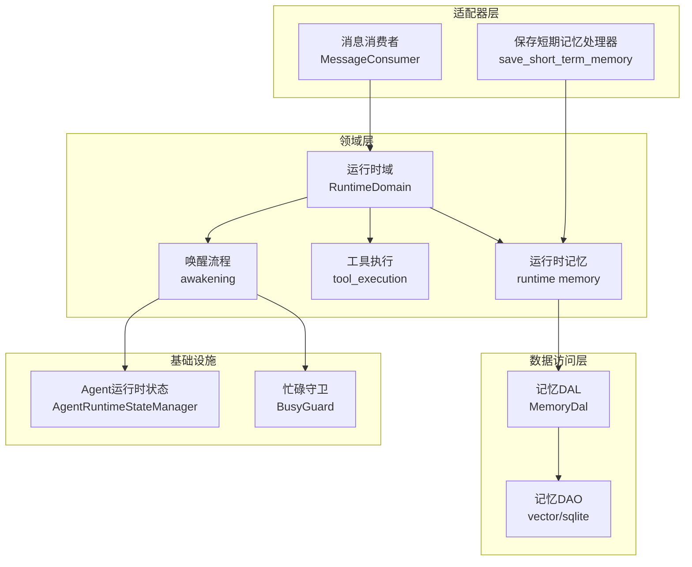
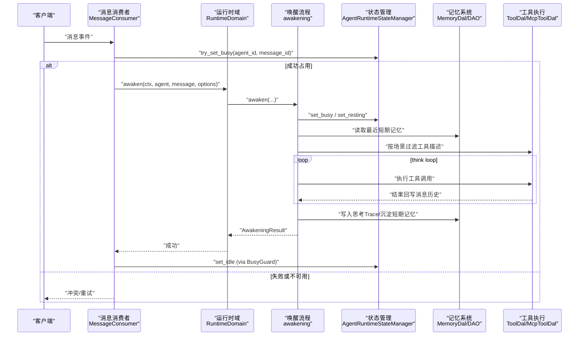
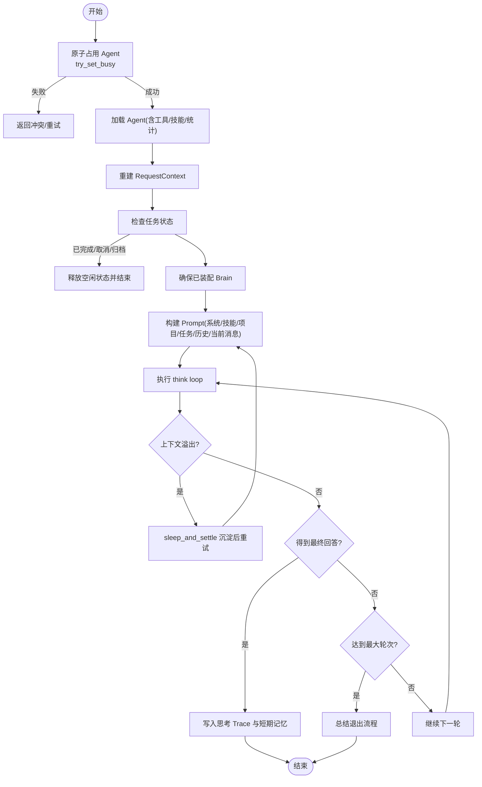
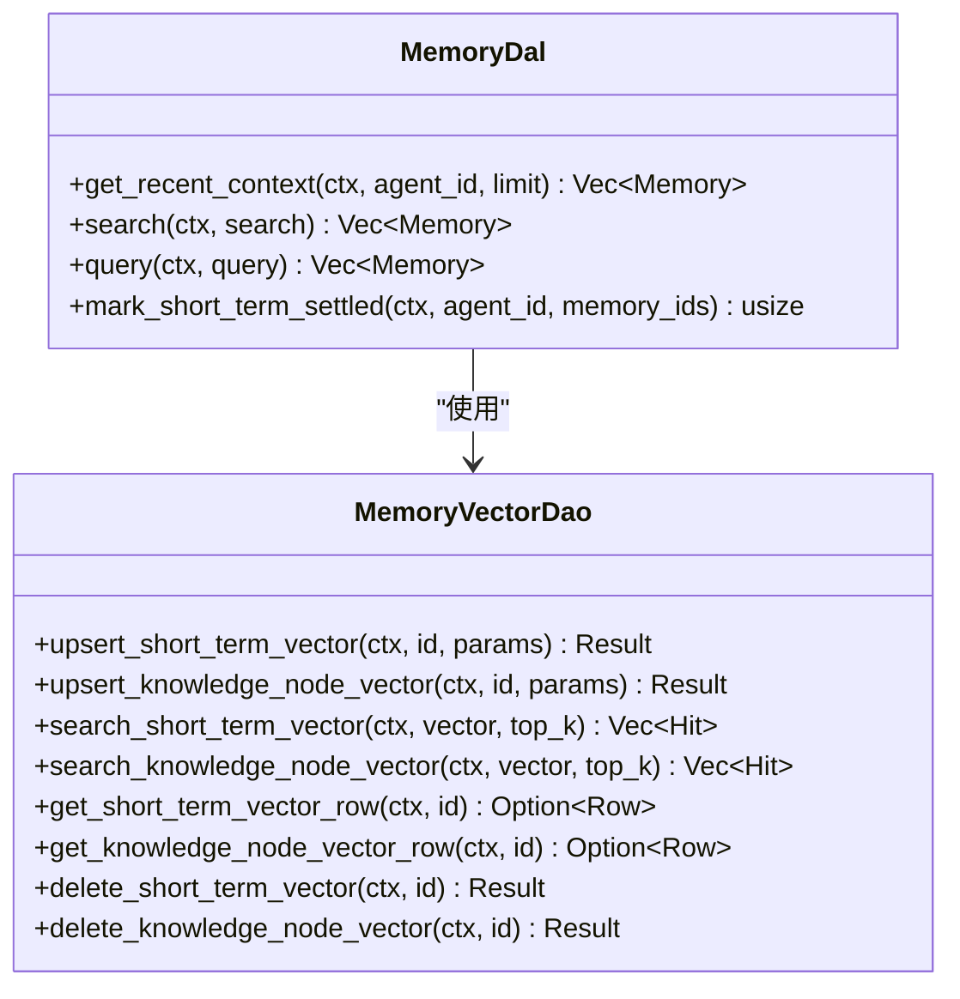
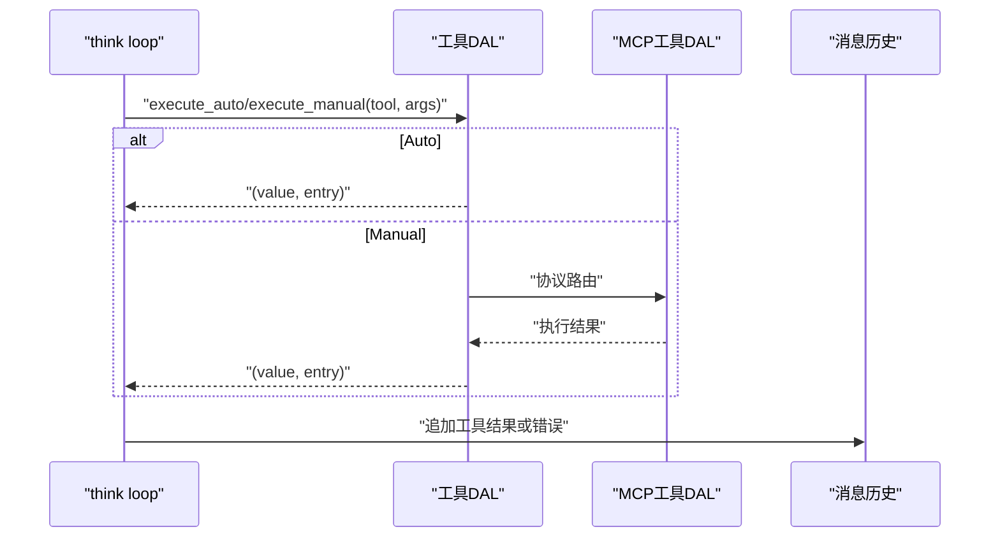
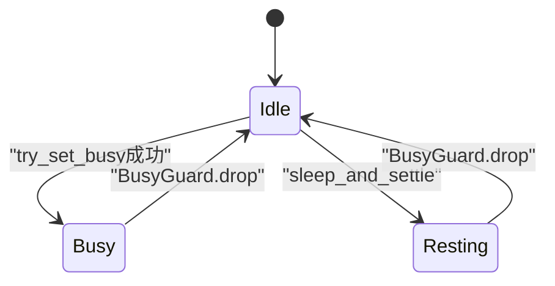
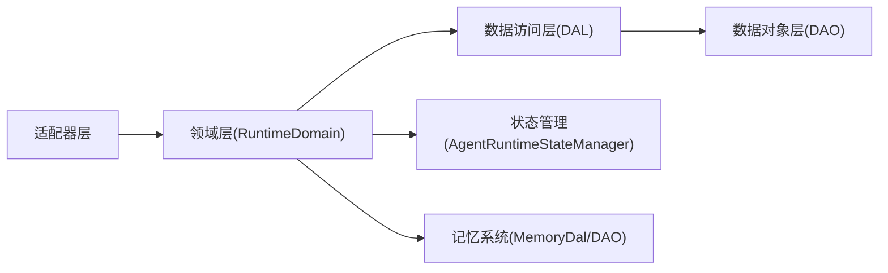
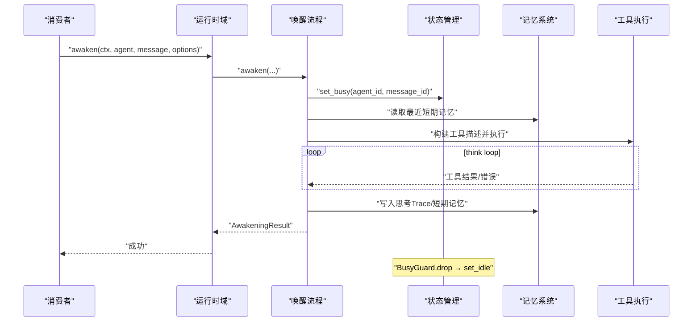
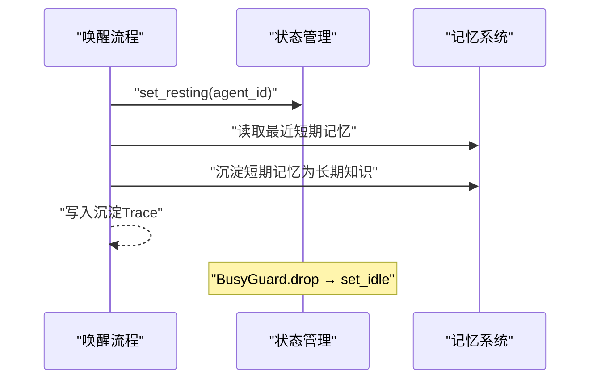

# 运行时领域

<cite>
**本文引用的文件**
- [src/consumer/message.rs](src/consumer/message.rs)
- [src/service/domain/runtime/mod.rs](src/service/domain/runtime/mod.rs)
- [src/service/domain/runtime/awakening.rs](src/service/domain/runtime/awakening.rs)
- [src/service/domain/runtime/think_loop.rs](src/service/domain/runtime/think_loop.rs)
- [src/service/domain/runtime/busy_guard.rs](src/service/domain/runtime/busy_guard.rs)
- [src/service/domain/runtime/compaction.rs](src/service/domain/runtime/compaction.rs)
- [src/pkg/agent_runtime_state.rs](src/pkg/agent_runtime_state.rs)
- [src/pkg/policy/mod.rs](src/pkg/policy/mod.rs)
- [src/pkg/policy/builtin.rs#L1-L361](src/pkg/policy/builtin.rs#L1-L361)
- [src/pkg/policy/tests.rs](src/pkg/policy/tests.rs)
- [src/pkg/tool_registry/shell_policy.rs](src/pkg/tool_registry/shell_policy.rs)
- [common/src/enums/thinking_scene.rs](common/src/enums/thinking_scene.rs)
- [src/models/cortex_types.rs#L135-L195](src/models/cortex_types.rs#L135-L195)
- [src/models/events/think_round.rs](src/models/events/think_round.rs)
- [src/consumer/think_round_stats_consumer.rs](src/consumer/think_round_stats_consumer.rs)
- [src/handlers/hr/agent/runtime_status.rs](src/handlers/hr/agent/runtime_status.rs)
- [src/handlers/hr/agent/runtime_list.rs](src/handlers/hr/agent/runtime_list.rs)
- [src/handlers/hr/agent/cancel_thinking.rs](src/handlers/hr/agent/cancel_thinking.rs)
- [src/models/tool.rs](src/models/tool.rs)
- [src/service/dal/memory/mod.rs](src/service/dal/memory/mod.rs)
- [src/service/dal/agent/mod.rs](src/service/dal/agent/mod.rs)
- [src/service/dal/agent/builder/default.rs](src/service/dal/agent/builder/default.rs)
- [src/service/dao/memory/vector.rs](src/service/dao/memory/vector.rs)
- [src/handlers/hr/agent/save_short_term_memory.rs](src/handlers/hr/agent/save_short_term_memory.rs)
- [tests/integration/memory_test.rs](tests/integration/memory_test.rs)
- [src/service/domain/runtime/inbox.rs](src/service/domain/runtime/inbox.rs#L59-L342) — 新输入统一收集器：锚点 / 游标 / 合并判据 / 批量预算
- [src/service/domain/runtime/legacy_awaken/poll_node.rs](src/service/domain/runtime/legacy_awaken/poll_node.rs#L31-L251) — `poll_front` / `poll_exit` 挂点与回退/转向信号
- [src/service/domain/runtime/legacy_awaken/blueprint.rs](src/service/domain/runtime/legacy_awaken/blueprint.rs) — 三处挂点接线 + 激活预算同步上调
- [src/service/domain/runtime/legacy_awaken/runner.rs](src/service/domain/runtime/legacy_awaken/runner.rs) — PollNode 注册与 `injected_ids` 回传
- [src/service/domain/runtime/intent_analyze.rs#L31-L189](src/service/domain/runtime/intent_analyze.rs#L31-L189) — Phase 1 入口：base 装配 + 意图指令尾插 + 全量工具 + seed 回写
- [src/service/domain/runtime/awakening.rs#L702-L930](src/service/domain/runtime/awakening.rs#L702-L930) — base 唯一取数（workspace_path_args / fill_prompt_base / fetch_message_business_blocks）+ 消息链锚点上界与最近 K 条
- [src/service/domain/runtime/legacy_awaken/nodes.rs#L308-L400](src/service/domain/runtime/legacy_awaken/nodes.rs#L308-L400) — Prepare 三路装配：续跑追加 / seed 续接 / 重建
- [src/service/domain/runtime/inbox.rs#L118-L245](src/service/domain/runtime/inbox.rs#L118-L245) — `resume_append` 一次性续跑标记
- [src/service/domain/runtime/legacy_awaken/poll_node.rs#L214-L226](src/service/domain/runtime/legacy_awaken/poll_node.rs#L214-L226) — `poll_exit` rethink 置续跑标记
- [src/service/domain/runtime/think_round/nodes.rs#L670-L700](src/service/domain/runtime/think_round/nodes.rs#L670-L700) — 场景级工具调用时拦截
- [src/service/domain/runtime/think_round/nodes.rs#L854-L873](src/service/domain/runtime/think_round/nodes.rs#L854-L873) — `scene_blocks_tool` + 场景化拦截文案
- [src/service/dal/agent/builder/default.rs#L553-L560](src/service/dal/agent/builder/default.rs#L553-L560) — 意图 Prompt = base + tail
- [src/service/dal/agent/builder/default.rs#L1279-L1330](src/service/dal/agent/builder/default.rs#L1279-L1330) — 执行段渲染
- [src/models/prompt_builder.rs#L233-L240](src/models/prompt_builder.rs#L233-L240) — `build_execution_segment` 契约
- [src/service/domain/runtime/abort_summary.rs](src/service/domain/runtime/abort_summary.rs#L1-L505)
- [src/service/domain/runtime/cerebellum_router.rs#L31-L293](src/service/domain/runtime/cerebellum_router.rs#L31-L293) — 小脑快判断路由（B3）：常量集中 + DegradedReason 六值 + RouteDecision 三分类 + route/translate/route_with_default_dao
- [src/service/domain/runtime/think_loop.rs#L288-L337](src/service/domain/runtime/think_loop.rs#L288-L337) — 小脑单点接线（Direct 短路 / Inject 插 System / Skip 空操作）
- [src/service/dal/brain.rs#L208-L215](src/service/dal/brain.rs#L208-L215) — wake_brain Local 分支注入 brain.cerebellum（get_default_cerebellum_provider）
- [src/models/brain.rs#L31-L33](src/models/brain.rs#L31-L33) — Brain.cerebellum: Option<ModelProviderPo>
- [src/models/agent.rs#L82-L86](src/models/agent.rs#L82-L86) — AgentRuntimeConfig 双开关 enable_cerebellum_route / cerebellum_trivial_direct
- [src/models/cerebellum_types.rs](src/models/cerebellum_types.rs) — System One 协议 DTO（QuestionType / CerebellumAnswer / ThinkFastResult）
- [common/src/enums/provider.rs#L32-L37](common/src/enums/provider.rs#L32-L37) — ProviderType::Jev=8（System One 决策模型）
- [common/src/enums/provider.rs#L51-L55](common/src/enums/provider.rs#L51-L55) — ModelCapability::Decision=2

**更新摘要 2026-11-03**：两阶段唤醒 Prompt 改为「同一 base + 尾部追加」——Phase 1 与 Phase 2 共用 [`fill_prompt_base`](src/service/domain/runtime/awakening.rs#L797) 装配的 System/base user，意图指令只尾插同一条 user；Phase 2 以 Phase 1 初始消息为 seed，追加 `assistant(Intent JSON)` + 执行段。工具描述符两阶段全量一致，白名单判定挪到 `run_dispatch` 调用前；`poll_exit` rethink 改为显式续跑追加（`InboxState.resume_append`），压缩回环仍是唯一重建路径；消息链查询加锚点上界并改为「链头 + 最近 6 条」；Cli/Remote 因扁平化协议统一退回重建。

**更新摘要 2026-11-02**：新增唤醒期「新输入收集 + 意图增量修订」链路——`domain/runtime/inbox.rs` 统一收集器（同发送者 / 同上下文 / Text 白名单 / `thread_id` 仅否决 / 游标分页），`legacy_awaken/poll_node.rs` 三处挂点（`poll_front` 意图后、`poll_exit` 落地前、轮级 `poll_round`），收集结果成功后才由消费者批量置 `Processed`；失败保持 `Pending` 交由后续独立唤醒。

**更新摘要 2026-09-04**：新增 `abort_summary.rs`（完全不依赖 LLM 的规则化兜底总结），为 think 循环异常退出（429/5xx/超时/用户取消）提供保底记忆落库路径——避免循环因 LLM 不通而蒸发已完成进度；think_loop 进度快照位置调整为「每轮工具执行完后立即落袋」，为兜底摘要提供数据源；`attach_abort_notice` 把进度概览挂到 Error.field.extra.abort_notice 传递给消费者，消息失败通知里告知用户「工作没白做」。

**更新摘要 2026-09-07**：策略引擎迭代——新增 `PolicyAction` 三值枚举（Deny/Confirm/Audit）+ trait `action()` 默认 None 向后兼容 + PolicyGroup 自动上浮首个命中策略的动作；think_loop 全策略化重构：`build_policy_for_scene` 统一 8 策略 OR 组（含 FinalAnswerPolicy 正常完成裁决 + ConsecutiveLlmErrorsPolicy 错误路径裁决），Final 和工具调用统一经 `policy_exit`；错误路径（brain_dal think 失败）也过策略，预算内立即重试。Shell 拦截层（`shell_policy.rs`）落地通用 Policy trait——ShellRulePolicy + 5 条静态规则表（scope 越界 Confirm / 身份边界越界 Confirm / 破坏性命令 Confirm / git push-reset-clean Confirm / git commit Audit）。废弃 mixed.rs（PolicyMixed 硬软分层）和 TokenCostPolicy（替换为 TokenBudgetPolicy）。

**更新摘要 2026-11-07**：git 子命令拦截放开（AMan 决策）——shell_policy RULE_DEFS 中 git push/reset/clean 由 Confirm 降级为 Audit（规则 id 改为 `git_mutating_ops_audit`），git 相关仅保留审计留痕；远端仓库保护改由 GitHub 分支保护（PR-only）兜底，Deny / scope / 破坏性 fs 规则不变。

**更新摘要 2026-08-29**：策略引擎卡同步 NoProgressPolicy + PromptBuilder 升级为 System/User 消息分层；agent.rs 拆分为 agent/mod.rs + builder 子模块；summary.rs 删除，新增 compaction.rs 上下文压缩模块。

**本文关联三类文档**
- 【① Design 决策快照】
  - [thinking_task_policy_engine_design.md](docs/modules/02-Agent运行时/A-设计/thinking_task_policy_engine_design.md) — 策略引擎与思考运行时的设计动机、关键决策表
  - [runtime_design.md](docs/modules/02-Agent运行时/A-设计/runtime_design.md) — Agent 唤醒、沉睡沉淀、三态 FSM 整体设计
  - [intent_aware_two_stage_awaken_design.md](docs/modules/02-Agent运行时/A-设计/intent_aware_two_stage_awaken_design.md) — 两阶段唤醒：IntentAnalyze Phase1 + Awaken Phase2 串联设计
  - [two_stage_append_only_prompt_design.md](docs/modules/02-Agent运行时/A-设计/two_stage_append_only_prompt_design.md) — 两阶段 Prompt 追加化与前缀缓存设计（I1–I6 不变量）
- 【② Plan 落地快照】
  - [两阶段唤醒Prompt追加化.md](docs/modules/02-Agent运行时/B-落地方案/两阶段唤醒Prompt追加化.md) — base 唯一装配 / 意图尾插 / 工具调用时拦截 / 续跑追加 / 消息链上界
  - [唤醒上下文与睡眠约束.md](docs/modules/02-Agent运行时/B-落地方案/唤醒上下文与睡眠约束.md) — ThinkingOptions 统一选项 + PromptBuilder 内聚 + 双层工具过滤（真实定稿）
  - [运行时问题修复.md](docs/modules/02-Agent运行时/B-落地方案/运行时问题修复.md) — BusyGuard RAII 状态泄漏修复 + try_set_busy CAS TOCTOU 修复（真实定稿）
  - （2026-09-04 清理：原 superpowers/plans/ 已归档，相关 policy_engine plan 尚未落地到 plan-archive，待 doc-maintainer 跟进）
- 【④ RAG 原子知识卡】
  - [策略引擎：Policy trait + PolicyGroup 嵌套组合 + policy_set! 宏声明式写法 + PolicyAction 动作上浮 + Shell 拦截层](docs/modules/02-Agent运行时/C-知识/策略引擎：Policy trait + PolicyGroup 嵌套组合 + policy_set! 宏声明式写法 + PolicyAction 动作上浮 + Shell 拦截层/策略引擎：Policy trait + PolicyGroup 嵌套组合 + policy_set! 宏声明式写法 + PolicyAction 动作上浮 + Shell 拦截层.md) — 策略引擎框架硬约束
  - [Agent 思考运行时 AgentThinkRuntime：挂载清理取消与每轮快照上报](docs/modules/02-Agent运行时/C-知识/Agent 思考运行时 AgentThinkRuntime：挂载清理取消与每轮快照上报/Agent 思考运行时 AgentThinkRuntime：挂载清理取消与每轮快照上报.md) — think_runtime 生命周期与幂等约束
  - [思考退出原因 exit_reason 统计与 ThinkRoundEvent AOP 事件链路](docs/modules/10-异步基建(AOP)/C-知识/思考退出原因 exit_reason 统计与 ThinkRoundEvent AOP 事件链路/思考退出原因 exit_reason 统计与 ThinkRoundEvent AOP 事件链路.md) — exit_reason 归一化与 AOP 事件统计链路
  - [思考循环异常退出兜底总结与错误上报结构化](docs/modules/02-Agent运行时/C-知识/思考循环异常退出兜底总结与错误上报结构化/思考循环异常退出兜底总结与错误上报结构化.md) — abort_summary.rs 纯规则化兜底摘要 + 进度快照 + attach_abort_notice 错误上报（2026-09-04 新增）
  - 【Batch4 新增 2 张】
  - [两阶段唤醒：IntentAnalyze Phase1 意图分析 + Awaken Phase2 正式执行串联（IntentAnalysis 7 字段 + 6 级 JSON 降级）](docs/modules/02-Agent运行时/C-知识/Intent 感知两阶段唤醒：IntentAnalyze Phase1 七字段意图分析 + 6 级 JSON 降级兜底 + Awaken Phase2 正式执行串联/Intent 感知两阶段唤醒：IntentAnalyze Phase1 七字段意图分析 + 6 级 JSON 降级兜底 + Awaken Phase2 正式执行串联.md) — Phase1 IntentAnalyze 子循环 + 7 字段结构化结果 + Phase2 Prompt 注入
  - [AgentRuntimeInfo 三态状态机 + BusyGuard RAII：Idle Busy Resting 转换 + task_id project_id 业务上下文透视](docs/modules/05-任务与项目/C-知识/AgentRuntimeInfo 三态状态机 + BusyGuard RAII：Idle Busy Resting 转换 + task_id project_id 业务上下文透视/AgentRuntimeInfo 三态状态机 + BusyGuard RAII：Idle Busy Resting 转换 + task_id project_id 业务上下文透视.md) — try_set_busy CAS + BusyGuard RAII 零泄漏 + task_id/project_id 过滤
  - 【2026-09-07 新增】
  - [策略引擎：Policy trait + PolicyGroup 嵌套组合 + policy_set! 宏声明式写法 + PolicyAction 动作上浮 + Shell 拦截层 + PolicyAction 动作上浮 + Shell 拦截层](docs/modules/02-Agent运行时/C-知识/策略引擎：Policy trait + PolicyGroup 嵌套组合 + policy_set! 宏声明式写法 + PolicyAction 动作上浮 + Shell 拦截层/策略引擎：Policy trait + PolicyGroup 嵌套组合 + policy_set! 宏声明式写法 + PolicyAction 动作上浮 + Shell 拦截层.md) — PolicyAction 三值枚举 + think_loop 全策略化 + Shell 拦截层落地
  - [Shell 工具全链路：shell_exec 内置执行 + shell_policy 策略拦截 + shell_tool 声明式注册](docs/modules/06-工具与技能/C-知识/Shell 工具全链路：shell_tool 注册 + shell_policy 拦截 + shell_exec 执行/Shell 工具全链路：shell_tool 注册 + shell_policy 拦截 + shell_exec 执行.md) — shell_exec 与 shell_tool 双执行通道同策略管线
- 【③ Wiki 关联长文】
  - [Runtime 领域编排.md](docs/modules/00-总览与架构/C-知识/Runtime 领域编排.md) — trait 聚合与 Domain 接口编排
  - [思考轮次统计消费者.md](docs/modules/12-基础设施与部署/C-知识/思考轮次统计消费者.md) — ThinkRoundEvent 消费与 DuckDB 入库链路
  - [思考运行时面板观测接口.md](docs/modules/11-前端应用/C-知识/思考运行时面板观测接口.md) — 前端 runtime 面板 + 3 个 HTTP Handler 观测链路
  - [Agent 生命周期管理.md](docs/modules/02-Agent运行时/C-知识/Agent 生命周期管理.md) — 唤醒/沉睡完整生命周期管理流程

**【本次 2026-08-16 增量追加互引】**
#### ④ RAG 原子知识卡（本次追加 T1 新版 policy_set! + T2 runtime 工具化）：
- [策略引擎：Policy trait + PolicyGroup 嵌套组合 + policy_set! 宏声明式写法 + PolicyAction 动作上浮 + Shell 拦截层](docs/modules/02-Agent运行时/C-知识/策略引擎：Policy trait + PolicyGroup 嵌套组合 + policy_set! 宏声明式写法 + PolicyAction 动作上浮 + Shell 拦截层/策略引擎：Policy trait + PolicyGroup 嵌套组合 + policy_set! 宏声明式写法 + PolicyAction 动作上浮 + Shell 拦截层.md) — §红线 2 禁止 awakening 中手工 if/else 判断策略；§红线 6 PolicyMixed hard_hit 必须强制退出
- [运行时诊断工具注册为 Agent 可调用工具：runtime-status cancel-thinking runtime-list 三接口工具化](docs/modules/02-Agent运行时/C-知识/运行时诊断工具注册为 Agent 可调用工具：runtime-status cancel-thinking runtime-list 三接口工具化/运行时诊断工具注册为 Agent 可调用工具：runtime-status cancel-thinking runtime-list 三接口工具化.md) — §红线 3 runtime_list 禁止返回已退出 runtime；工具化与 HTTP Handler 复用同一 Domain 方法
#### ② 落地计划（Plan，本次追加占位）：
#### ① 设计文档（Design，本次追加占位）：
- [Intent 感知两阶段唤醒：IntentAnalyze Phase1 七字段意图分析 + 6 级 JSON 降级兜底 + Awaken Phase2 正式执行串联](docs/modules/02-Agent运行时/C-知识/Intent 感知两阶段唤醒：IntentAnalyze Phase1 七字段意图分析 + 6 级 JSON 降级兜底 + Awaken Phase2 正式执行串联/Intent 感知两阶段唤醒：IntentAnalyze Phase1 七字段意图分析 + 6 级 JSON 降级兜底 + Awaken Phase2 正式执行串联.md)
</cite>

## 目录
1. [简介](#简介)
2. [项目结构](#项目结构)
3. [核心组件](#核心组件)
4. [架构总览](#架构总览)
5. [详细组件分析](#详细组件分析)
6. [依赖关系分析](#依赖关系分析)
7. [性能与并发](#性能与并发)
8. [故障排查指南](#故障排查指南)
9. [结论](#结论)
10. [附录：关键流程时序图](#附录：关键流程时序图)

## 更新摘要
**2026-11-03 增量同步**：区分「上下文压缩」与「总结」——`compact_context` 的入口收敛为 `CompactMode`（`Overflow` 记 `compact`；`TurnArchive` / `ForcedReply` 记 `summary`），并写入轨迹、AOP 事件与记忆 `log_id`；同时把压缩循环的工具 schema 对齐主循环（`Awaken`），修复前缀缓存失配（命中率个位数 → 应对齐到主循环量级），执行白名单改由 `scene_blocks_tool` 调用时判定。
**Batch1 2026-08-17 增量同步**：针对策略引擎 pkg/policy 新增、AgentThinkRuntime 挂载清理、runtime-status/cancel-thinking/runtime-list 三接口接入、AgentAwakeEvent.exit_reason 统计、ThinkRoundEvent AOP 链路 5 个增量模块完成增量更新。新增 §5 下两个子章节「策略引擎集成」「思考运行时挂载」，§8 故障排查补 2 条。cite 区补三类文档（Design + Plan superpowers 占位 + 3 张 RAG 卡），并建立四类互引闭环。
**2026-08-16 增量更新**：追加 T1（policy_set! 宏声明式写法 + PolicyMixed 硬软分层）与 T2（runtime 三接口 Agent 可调用工具化）2 张 RAG 卡互引；cite 区补对应 design/plan 规范占位；§5 策略引擎集成章节来源 awakening.rs/think_loop.rs 行号范围降级（因 policy_set! 宏 + mixed.rs 新增文件导致行号漂移，优先降级为无行号范围引用）。

## 简介
本章节面向“AI Agent 运行时”的读者，聚焦唤醒机制、策略引擎控制、思考运行时观测、内存管理、工具执行与忙闲状态控制。文档基于仓库中运行时域（Runtime Domain）、策略引擎（pkg/policy/）、AgentThinkRuntime（pkg/agent_runtime_state.rs 扩展）、消息消费者（MessageConsumer）、Agent 状态管理器（AgentRuntimeStateManager）、AOP 事件链路（ThinkRoundEvent + exit_reason 统计）、3 个观测 Handler 以及记忆系统（短期/长期记忆、向量检索）的实现进行系统化说明，帮助读者理解 Agent 从被唤醒到完成一轮思考、沉淀记忆、退出原因统计的完整生命周期，并给出监控、指标与故障恢复的实践建议。

## 项目结构
运行时相关代码主要分布在以下层次：
- Adapter 层：HTTP Handler 与 AOP Consumer（如消息消费者）。
- Domain 层：运行时域（awakening、tool_execution、memory），负责动态执行逻辑。
- DAL 层：记忆 DAL、大脑 DAL、工具 DAL 等。
- DAO 层：SQLite/LanceDB/HNSW 等存储实现。



**图表来源**
- [src/consumer/message.rs:147-357](src/consumer/message.rs#L147-L357)
- [src/service/domain/runtime/mod.rs:36-49](src/service/domain/runtime/mod.rs#L36-L49)
- [src/service/domain/runtime/awakening.rs:415-748](src/service/domain/runtime/awakening.rs#L415-L748)
- [src/pkg/agent_runtime_state.rs:31-107](src/pkg/agent_runtime_state.rs#L31-L107)
- [src/service/dal/memory/mod.rs](src/service/dal/memory/mod.rs)
- [src/service/dao/memory/vector.rs:36-124](src/service/dao/memory/vector.rs#L36-L124)

**章节来源**
- [src/consumer/message.rs:147-357](src/consumer/message.rs#L147-L357)
- [src/service/domain/runtime/mod.rs:36-49](src/service/domain/runtime/mod.rs#L36-L49)

## 核心组件
- 消息消费者（MessageConsumer）：订阅消息事件，按目标角色分发；对 Agent 消息进行唤醒编排，包含原子占用、上下文重建、任务状态检查、ThinkingOptions 组装与调用 awaken。
- 运行时域（RuntimeDomain）：聚合 awakening、tool_execution、memory 能力，提供统一入口与状态查询。
- 唤醒流程（awakening）：装配 Brain、构建 Prompt、执行 think loop（含超时、轮次限制、上下文压缩）、写 Trace、统计与事件发布。
- 忙碌守卫（BusyGuard）：RAII 模式确保 Busy/Resting 状态在任意返回路径释放为 Idle。
- Agent 运行时状态管理器（AgentRuntimeStateManager）：全局单例维护每个 Agent 的 Idle/Busy/Resting 状态，支持 try_set_busy 原子占用，避免 TOCTOU 竞态。
- 记忆系统：短期记忆（FTS + 向量）、长期知识节点（FTS + 向量）、沉淀流程（load_and_settle → settle_pending → legacy_settle 三节点，DAL 仅 mark_short_term_settled）。

**章节来源**
- [src/consumer/message.rs:147-357](src/consumer/message.rs#L147-L357)
- [src/service/domain/runtime/mod.rs:36-49](src/service/domain/runtime/mod.rs#L36-L49)
- [src/service/domain/runtime/awakening.rs:415-748](src/service/domain/runtime/awakening.rs#L415-L748)
- [src/service/domain/runtime/busy_guard.rs:1-32](src/service/domain/runtime/busy_guard.rs#L1-L32)
- [src/pkg/agent_runtime_state.rs:31-107](src/pkg/agent_runtime_state.rs#L31-L107)
- [src/service/dal/memory/mod.rs](src/service/dal/memory/mod.rs)

## 架构总览
运行时以“事件驱动 + 领域编排”的方式组织：
- 外部消息进入后由 MessageConsumer 消费，根据 to_role 路由到不同 Domain。
- Agent 消息走 RuntimeDomain.awakening()，内部通过 run_think_loop 驱动模型推理与工具调用，并在上下文溢出时就地压缩（`compact_context`）后继续、轮次耗尽时进入总结退出。
- 记忆系统在 awaken/sleep_and_settle 中读写短期/长期记忆，并通过向量索引支持语义检索。
- 状态管理贯穿始终，BusyGuard 保证状态一致性。



**图表来源**
- [src/consumer/message.rs:147-357](src/consumer/message.rs#L147-L357)
- [src/service/domain/runtime/awakening.rs:415-748](src/service/domain/runtime/awakening.rs#L415-L748)
- [src/pkg/agent_runtime_state.rs:73-107](src/pkg/agent_runtime_state.rs#L73-L107)
- [src/service/dal/memory/mod.rs](src/service/dal/memory/mod.rs)

## 详细组件分析

### 唤醒机制与上下文恢复
- 唤醒入口：MessageConsumer.handle_agent_message 先尝试原子占用 Agent（try_set_busy），再加载 Agent（含 tools/skills/stats），构造 ThinkingOptions（注入 project/task 上下文），最后调用 RuntimeDomain.awakening().awaken。
- 上下文恢复：awaken 内会读取最近短期记忆，使用 PromptBuilder 拼装系统提示、技能、项目/任务上下文、历史与当前消息，形成最终 prompt。
- 大脑装配：若 Agent 未装配 Brain，则调用 wake_agent_brain 获取 ModelProvider 信息并 enrich ctx，确保后续统计与追踪字段完整。
- 循环控制：run_think_loop 内置超时（300s）、轮次上限（`max_thinking_rounds`，默认取系统配置 `[agent].max_thinking_rounds` = 365）、上下文溢出检测（input_tokens 阈值），并在溢出时走 `compact_context` 就地压缩后继续。



**图表来源**
- [src/consumer/message.rs:147-357](src/consumer/message.rs#L147-L357)
- [src/service/domain/runtime/awakening.rs:415-748](src/service/domain/runtime/awakening.rs#L415-L748)

**章节来源**
- [src/consumer/message.rs:147-357](src/consumer/message.rs#L147-L357)
- [src/service/domain/runtime/awakening.rs:415-748](src/service/domain/runtime/awakening.rs#L415-L748)

### 新输入收集与意图增量修订（2026-11-02）

**目的**：用户在 Agent 思考过程中继续发消息时，不丢弃、不并发开第二次唤醒，而是把这批同源消息吸收进当前唤醒：能回退就让意图识别做增量修订，不能回退就尾插为转向消息继续思考。

**统一收集器（`domain/runtime/inbox.rs`）**：
- **锚点**：记录当前消息的 `agent_id / from_id / from_role / project_id / task_id / thread_id / message_type / created_at / id`。
- **合并判据**：`from_id` + `from_role` 相等即可（不限于 User，同发送者的工具/系统消息也可合并）；`project_id` / `task_id` 用 `Option` **相等比较**——`None` 也是取值，默认对话（无项目/无任务）同样参与匹配；`message_type` 必须同类型，v1 白名单只收 `Text`；附件（`file_type` 非空）不收。
- **`thread_id` 仅作否决项**：两端都有且不等才拒绝，任一端缺失不否决；SQL 侧表达为 `thread_id IS NULL OR thread_id = ?`，避免异线程消息先占满查询配额。
- **游标与批量**：`(created_at, id)` 复合游标防重复；单批最多 5 条 / 2000 字，窗口 5 分钟；查询只收 `Pending`。单条超预算时跳过该条，不阻塞后续短消息（被跳过者保持 `Pending`，由自身事件触发独立唤醒）。
- **状态提交**：收集阶段只读；`advance` 记录已吸收 ID，唤醒成功后由 `consumer/message.rs` 批量置 `Processed`。失败时保持 `Pending`，消息不会丢，只是会各自再触发一次唤醒（幂等守卫兜底）。**用户取消唤醒时也不提交**，避免把没处理完的补充消息静默吞掉。

**三处挂点（`legacy_awaken/poll_node.rs` + `think_round`）**：
| 挂点 | 位置 | 有可回退预算且尚未检索 | 已检索 / 已执行 |
|------|------|----------------------|----------------|
| `poll_front` | 意图后、检索前 | 暂存修订输入并 `new_input` 回边到 `intent`（≤2 次） | 尾插进本轮 Prompt（`pending_turn`，消费即清空） |
| `poll_exit` | `final` / `direct` / `clarify` 落地前 | `new_input` 回边到 `intent`（≤2 次） | `rethink` 回边到 `prepare`，保留已完成工作（≤3 次） |
| `poll_round` | 轮级环图每轮边界 | — | 直接把编号输入追加进当前会话消息，继续下一轮 |

**意图增量修订**：`IntentRevision { previous, inputs }` 只重写 `intent_type / confidence / key_terms / resolutions / summary`；`direct_answer / need_clarification / retrieved_context` 针对旧消息，必须强制重算。修订 Prompt 拼在 `current_message` **之后**（尾部），保持静态前缀缓存。修订失败时保留旧理解、清空终态字段，新输入降级为尾插转向消息。

**预算护栏**：`poll_front` 3 次、`poll_exit` 为 `1 + 回退 + 转向`（最坏 6 次）、`prepare/deliberate` 叠加 `MAX_INJECTIONS_PER_WAKE`、`retrieve/discover` 叠加 `MAX_INTENT_REWINDS`；图 `max_steps` 上调到 96。漏算任一预算都会在「无合法候选」处报错，而不是优雅降级。

**章节来源**
- [src/service/domain/runtime/inbox.rs#L59-L342](src/service/domain/runtime/inbox.rs#L59-L342)
- [src/service/domain/runtime/legacy_awaken/poll_node.rs#L31-L251](src/service/domain/runtime/legacy_awaken/poll_node.rs#L31-L251)
- [src/service/domain/runtime/legacy_awaken/blueprint.rs](src/service/domain/runtime/legacy_awaken/blueprint.rs)
- [src/consumer/message.rs](src/consumer/message.rs)
- [src/service/domain/runtime/legacy_awaken/nodes.rs#L296-L312](src/service/domain/runtime/legacy_awaken/nodes.rs#L296-L312)

### 两阶段唤醒 Prompt 追加化（2026-11-03）

**目的**：Phase 1（意图识别）与 Phase 2（正式执行）不再各拼一套 Prompt，而是共用同一段 base，只在尾部追加，让 Phase 2 的请求前缀与 Phase 1 逐字节一致，从而命中 provider 的 prompt cache。

**消息契约**：
```
Phase 1  system = base system；user = base user + 意图指令尾部
Phase 2  system = 同一份；user = 同一份
         assistant = IntentAnalysis JSON
         user = 执行段（切换语 + 当前消息/吸收批次 + 检索知识 + 执行要求）
```

**唯一 base 装配**：`awakening.rs` 的 `workspace_path_args` / `PromptBaseInput` / `fill_prompt_base` / `fetch_message_business_blocks` 是意图节点与装配节点共同的取数与挂载入口；base 只含人设/全量技能/工作空间/项目任务/画像/本体/历史/压缩/消息链/资源行/视觉/trace/当前消息，**不含**意图结果、检索知识或执行指令。

**三条装配路径（`PrepareNode`）**：
| 路径 | 条件 | 行为 |
|------|------|------|
| 续跑追加 | `poll_exit` 置 `resume_append` 且 `Artifacts.messages` 非空 | 既有消息 + 尾部一条 user（只描述新输入，不重复意图 JSON） |
| seed 续接 | 存在 `intent_seed` 且未压缩 | seed + `assistant(Intent JSON)` + `user(执行段)` |
| 重建 | 压缩回环 / 无 seed / 外部 Agent / `Artifacts` 为空 | 原 `build()` + `build_initial_messages()` |

**外部 Agent 例外**：Cli/Remote 使用 `FlatPromptBuilder`，初始消息被压成单条 user，执行层只取最后一条 user；追加会把 base 原文整体丢掉，且它们没有 provider 级缓存，因此统一退回重建。重建路径仍要带上修订与追加输入：`FlatPromptBuilder` 把 `intent_revision` / `injected_inputs` 转发给内层 `DefaultPromptBuilder`，否则 `poll_front` 吸收新输入后的意图重跑、以及对话中追加的批次都进不了扁平 Prompt。

**工具白名单时机**：两阶段使用完全相同的全量工具描述符（I3）；`run_dispatch` 在执行前经 `scene_blocks_tool` 按场景白名单判定，不通过时只追加一条场景相关的 tool message，不产生任何副作用。该判定同时覆盖复用主循环上下文的「压缩 / 总结退出」场景（见下节）。

**消息链边界**：查询加 `created_at <= 锚点` 上界（同毫秒按 `id` 裁定），晚于锚点的消息只能由收集器进入执行段；长链改为「链头 + 尾部按页 `DESC` 扫描直到凑满 K 再反转」。单页 `K + 1` 不够：页内可能夹着当前消息、同毫秒 id 更大的消息或 `Recalled`，过滤后不足 K；按 `offset` 继续向更早翻页才能保证「最近 6 条」严格凑满。

**章节来源**
- [src/service/domain/runtime/awakening.rs#L702-L930](src/service/domain/runtime/awakening.rs#L702-L930)
- [src/service/domain/runtime/intent_analyze.rs#L31-L189](src/service/domain/runtime/intent_analyze.rs#L31-L189)
- [src/service/domain/runtime/legacy_awaken/nodes.rs#L308-L400](src/service/domain/runtime/legacy_awaken/nodes.rs#L308-L400)
- [src/service/domain/runtime/inbox.rs#L118-L245](src/service/domain/runtime/inbox.rs#L118-L245)
- [src/service/domain/runtime/legacy_awaken/poll_node.rs#L214-L226](src/service/domain/runtime/legacy_awaken/poll_node.rs#L214-L226)
- [src/service/domain/runtime/think_round/nodes.rs#L670-L700](src/service/domain/runtime/think_round/nodes.rs#L670-L700)
- [src/service/domain/runtime/think_round/nodes.rs#L854-L873](src/service/domain/runtime/think_round/nodes.rs#L854-L873)
- [src/service/dal/agent/builder/default.rs#L553-L560](src/service/dal/agent/builder/default.rs#L553-L560)
- [src/service/dal/agent/builder/default.rs#L1279-L1330](src/service/dal/agent/builder/default.rs#L1279-L1330)
- [src/models/prompt_builder.rs#L233-L240](src/models/prompt_builder.rs#L233-L240)

### 上下文压缩与总结退出（2026-11-03）

**一条执行路径，两个场景**：上下文溢出、正常结束后的存档、以及「思考轮次耗尽后的收尾回复」都走 `compact_context`（追加指令 + 复用主循环 `work_messages`）。入口由 `CompactMode` 指定，场景与是否产出用户回复绑在一起，杜绝不一致组合：

| 入口（CompactMode） | scene | 用途 |
|------|-------|------|
| `Overflow`：上下文溢出回环 | `compact` | 腾出上下文，存档后继续 |
| `TurnArchive`：正常结束、分流判据命中 | `summary` | 总结本轮工作，写成短期记忆存档 |
| `ForcedReply`：轮次耗尽的收尾 | `summary` | 总结本轮工作，并作为用户回复交付 |

只有**上下文溢出**才是「压缩」；正常结束与轮次耗尽都是「总结」。

**分流判据（2026-11-05 改）**：正常收尾时是否调用模型总结，由 OR 策略组按「实际链路规模」裁决，两条维度任一命中即压缩：

| 维度 | 策略 | 事实来源 |
|------|------|----------|
| 首尾文本规模 | `CompactionThresholdPolicy`（`turn_tokens >= compaction_threshold_tokens`，默认 1024） | 用户原文 + 最终回复 |
| 链路复杂度 | `CompactionChainPolicy`（轮次 >= 3 / 工具调用 >= 2 / 工具结果字符 >= 1200，任一命中） | `measure_turn_chain` 量主循环完整 `messages` |

⚠️ 早先只看 `turn_tokens` 是有缺陷的：它与「这轮到底干了多少活」脱节，短回复 + 长工具链会被判成「无需总结」，而 `quick_turn` 只保留首尾两侧，中间查到的路径 / ID / 参数 / 报错整段丢失。`measure_turn_chain` 刻意只统计 `ChatMessage::Tool` 与 `Assistant.tool_calls`，System 人设 / User 通用上下文这类每轮重拼的样板不计入（否则每轮都会超阈值）。

各维度都不达标时走 `persist_turn_memory` 原文记账（`quick_turn`，无 LLM 调用、不产生思考轨迹），不经过压缩。⚠️ 不压缩 ≠ 不写记忆：下一轮唤醒注入的近期对话读的就是短期记忆。

策略组保留 OR 形态是为「小脑」留位：`cerebellum_decision_strategy_design.md` 已把「记忆压缩阈值」列为 `Grade` 题型替换位，届时加第三条 `DecisionPolicy` 即可，`ConsolidateNode` 只管喂 Metrics。

`scene` 如实写进思考轨迹、`AgentLoopEvent` 与记忆轨迹 `log_id` 前缀（`compact-` / `summary-`），统计口径不再把总结调用的轮次与 token 混进压缩。

**前缀缓存不变量**：压缩/总结复用主循环的 `messages`，因此工具描述符必须与主循环（`Awaken`）**逐字节一致**。早期按 `Compact` 白名单裁剪 schema，`tools` 段就与缓存前缀分叉，实测命中率只有个位数（主循环 90%+）。现在统一取 `build_scene_tool_descriptors(agent, Awaken)`，允许集合改由 `scene_blocks_tool` 在**调用时**判定（与意图阶段同一套机制）；`Summary` 场景的工具白名单同时纳入 `settle_memory` 递归拦截。

**章节来源**
- [src/service/domain/runtime/compaction.rs](src/service/domain/runtime/compaction.rs) — `TurnChainMetrics` / `measure_turn_chain` / `compaction_policy_for`（链路规模事实桶 + OR 分流策略组）
- [src/service/domain/runtime/compaction.rs#L73-L100](src/service/domain/runtime/compaction.rs#L73-L100) — `CompactMode`（入口 → 场景 / 回复形态）
- [src/service/domain/runtime/compaction.rs#L460-L527](src/service/domain/runtime/compaction.rs#L460-L527) — 场景派生 / log_id 前缀 / 工具 schema 对齐
- [src/service/domain/runtime/think_round/nodes.rs#L670-L700](src/service/domain/runtime/think_round/nodes.rs#L670-L700)
- [src/service/domain/runtime/think_round/nodes.rs#L854-L873](src/service/domain/runtime/think_round/nodes.rs#L854-L873)
- [src/service/domain/runtime/think_loop.rs](src/service/domain/runtime/think_loop.rs) — `is_recursive_settle_call` 覆盖 `Summary`

### 策略引擎集成：Policy trait + policy_set! 声明宏
- **框架职责**：策略引擎作为 pkg 层纯框架（不感知业务 action），把原本硬编码在 think_loop 中的轮次上限/超时/上下文溢出/取消判断抽象为 Policy trait 组合判断。每轮 think_loop 构造 Metrics（rounds/elapsed/cancel/tokens 等），调用 Policy.evaluate(metrics) → Vec<String>（命中策略 id 列表）；空列表继续下一轮，非空列表通过 awakening.map_triggered_to_result 映射 ThinkLoopResult 退出或沉淀变体。
- **组合模式**：5 个内置策略（MaxRoundsPolicy/TimeoutPolicy/ContextOverflowPolicy/UserCancelPolicy/TokenCostPolicy，见 pkg/policy/builtin.rs）通过 PolicyGroup（PolicyRelation And/Or）嵌套组合；PolicyGroup 自身也实现 Policy trait，满足组合模式。PolicyBuilder 提供 with_policy/or/and 链式构造 API（pkg/policy/mod.rs）。
- **声明宏 policy_set!**：对 4 个 ThinkingScene 场景（Awaken/IntentAnalyze/Summary/Settle，common/src/enums/thinking_scene.rs）分别一套策略装配入口，默认 5 个内置策略 Or 组（任一命中触发），严禁直接在 awakening 里手写组合条件。
- **退出 reason 归一**：所有策略命中 → awakening.map_triggered_to_result → ThinkLoopResult 变体 → 最后统一输出 6 种 exit_reason 字符串（final/user_cancel/max_rounds_exceeded/timeout/context_overflow/summary_exit），该字符串是 AgentAwakeEvent.exit_reason 与 ThinkRuntimeSnapshot.last_exit_reason 与 DuckDB exit_reason 统计维度的单一事实源。
- **测试强约束**：每个 Policy 至少 3 个测试（命中/未命中/required_metrics 声明完整性），参见 pkg/policy/tests.rs。

**章节来源**
- [src/pkg/policy/mod.rs:1-Lm](src/pkg/policy/mod.rs#L1-L260)
- [src/pkg/policy/builtin.rs:1-Lm](src/pkg/policy/builtin.rs#L1-L180)
- [src/pkg/policy/tests.rs:1-Lm](src/pkg/policy/tests.rs#L1-L120)
- [common/src/enums/thinking_scene.rs:1-Lm](common/src/enums/thinking_scene.rs#L1-L40)
- [src/service/domain/runtime/awakening.rs:Ln-Lm](src/service/domain/runtime/awakening.rs#L415-L748)

### 思考运行时挂载：AgentThinkRuntime、cancel 信号、每轮快照
- **挂载时机与生命周期**：AgentThinkRuntime 是 AgentRuntimeInfo 的扩展 Option 字段，仅 Busy 时 Some（非 Busy 严格 None）。MessageConsumer.awaken() try_set_busy 成功 → StateManager.set_busy_with_think_runtime(agent_id) 挂载（写入 scene、初始化 cancel_token=Arc<AtomicBool> false、round=0 快照）→ BusyGuard RAII 包裹。
- **清理路径（双保险 + 幂等）**：awaken() 成功退出路径显式 StateManager.clear_think_runtime(agent_id)；同时 BusyGuard.drop 无条件再次清理（幂等：二次调用 no-op）。即使 think_loop 发生 panic，也确保清理不泄漏。
- **cancel 信号机制**：取消信号为 Arc<AtomicBool>（零新增依赖，等价替代 tokio_util CancellationToken）。POST /agents/{id}/cancel-thinking → Handler → RuntimeDomain.awakening().cancel_think() → StateManager.cancel_think() → 原子 store(true, Ordering::SeqCst)。下一轮 UserCancelPolicy evaluate 读到 true → 返回 vec!["user_cancel"] → 映射 ThinkLoopResult.UserCancel → exit_reason="user_cancel" 并退出。cancel 路径只做原子置位，不阻塞等待（异步生效），不做任何 DAL/DAO 事件发布（事件由 think_loop 命中路径统一 publish）。
- **每轮快照上报（think_loop 尾部一次写入）**：run_think_loop 每轮末尾统一 `think_runtime.write().unwrap().update_snapshot(round, elapsed, tokens, current_tool, None)`；退出时再写一次 last_exit_reason。RwLock write guard 不跨越任何 await 点，避免死锁（Handler cancel 读锁 + think_loop 写锁交叉）。
- **3 个观测 Handler DTO 协议**：common/src/api/runtime.rs 是 DTO 单一事实源，定义 RuntimeStatusResponse（单 Agent 状态 + think_snapshot Option）、RuntimeListResponse（分页 PagedResult<RuntimeListItem>，按 organization_id 过滤）、CancelThinkingResponse{ success, was_thinking }。DTO 字段名与 ThinkRuntimeSnapshot 内存结构体一一对应，禁止前后端手工字段映射。

**章节来源**
- [src/pkg/agent_runtime_state.rs:Ln-Lm](src/pkg/agent_runtime_state.rs#L31-L157)
- [src/service/domain/runtime/busy_guard.rs:1-33](src/service/domain/runtime/busy_guard.rs#L1-L33)
- [src/service/domain/runtime/awakening.rs:Ln-Lm](src/service/domain/runtime/awakening.rs#L415-L748)
- [src/service/domain/runtime/think_loop.rs:Ln-Lm](src/service/domain/runtime/think_loop.rs#L1-L280)
- [src/handlers/hr/agent/runtime_status.rs](src/handlers/hr/agent/runtime_status.rs)
- [src/handlers/hr/agent/runtime_list.rs](src/handlers/hr/agent/runtime_list.rs)
- [src/handlers/hr/agent/cancel_thinking.rs](src/handlers/hr/agent/cancel_thinking.rs)
- [common/src/api/runtime.rs](common/src/api/runtime.rs)
- [src/models/events/think_round.rs](src/models/events/think_round.rs)
- [src/consumer/think_round_stats_consumer.rs](src/consumer/think_round_stats_consumer.rs)

### 内存管理：短期记忆与长期记忆
- 短期记忆：
  - 创建：通过 save_short_term_memory 处理器调用 runtime_domain.memory().create，持久化为 ShortTerm 类型，并建立 FTS 与向量索引。
  - 检索：get_recent_context 用于唤醒时注入历史；search/query 支持关键词与语义混合检索。
- 长期记忆：
  - 沉淀：Domain settle_pending（legacy_settle 三节点）将 Active 短期记忆聚合成知识节点、建立引用关系，最后经 DAL mark_short_term_settled 标记 Settled。
  - 向量检索：MemoryVectorDaoImpl 提供 upsert/search/get/delete 接口，命名空间区分 short_term 与 knowledge_node。
- 测试覆盖：集成测试验证了短期记忆查询、搜索与向量检索行为。



**图表来源**
- [src/service/dal/memory/mod.rs](src/service/dal/memory/mod.rs)
- [src/service/dao/memory/vector.rs:36-124](src/service/dao/memory/vector.rs#L36-L124)

**章节来源**
- [src/handlers/hr/agent/save_short_term_memory.rs:30-57](src/handlers/hr/agent/save_short_term_memory.rs#L30-L57)
- [src/service/dal/memory/mod.rs](src/service/dal/memory/mod.rs)
- [src/service/dao/memory/vector.rs:36-124](src/service/dao/memory/vector.rs#L36-L124)
- [tests/integration/memory_test.rs:179-219](tests/integration/memory_test.rs#L179-L219)

### 工具执行流程：参数验证与结果处理
- 工具描述：awaken 中从 agent.tools 派生 ToolDescriptor 列表，供模型 function calling。
- 执行分发：run_think_loop 根据 tool.po.control_mode 选择 auto/manual 执行路径，分别调用 ToolDal.execute_auto/execute_manual。
- 结果处理：工具执行结果以 ChatMessage::tool 形式追加到消息历史；错误路径记录错误信息并继续循环。
- 手动工具调用：consumer.handle_tool_call_request 解析 ToolCallRequest，构建 RequestContext，调用 call_manual_tool_for_agent，并将结果通过 MessageDomain 回写。



**图表来源**
- [src/service/domain/runtime/awakening.rs:248-323](src/service/domain/runtime/awakening.rs#L248-L323)
- [src/consumer/message.rs:402-477](src/consumer/message.rs#L402-L477)

**章节来源**
- [src/service/domain/runtime/awakening.rs:248-323](src/service/domain/runtime/awakening.rs#L248-L323)
- [src/consumer/message.rs:402-477](src/consumer/message.rs#L402-L477)
- [src/models/tool.rs:48-88](src/models/tool.rs#L48-L88)

### 忙闲状态管理与并发控制
- 状态枚举：Idle/Busy/Resting，分别表示空闲、忙碌、休息（沉淀）。
- 原子占用：try_set_busy 在同一临界区判断并设置 Busy，避免 TOCTOU 竞态。
- RAII 清理：BusyGuard 在 drop 时自动 set_idle，确保任何返回路径（包括 panic）都释放状态。
- 消费者并发：MessageConsumer 设置 concurrency=4，空队列休眠 100ms，错误重试休眠 1000ms。



**图表来源**
- [src/pkg/agent_runtime_state.rs:73-107](src/pkg/agent_runtime_state.rs#L73-L107)
- [src/service/domain/runtime/busy_guard.rs:1-32](src/service/domain/runtime/busy_guard.rs#L1-L32)
- [src/consumer/message.rs:130-141](src/consumer/message.rs#L130-L141)

**章节来源**
- [src/pkg/agent_runtime_state.rs:73-107](src/pkg/agent_runtime_state.rs#L73-L107)
- [src/service/domain/runtime/busy_guard.rs:1-32](src/service/domain/runtime/busy_guard.rs#L1-L32)
- [src/consumer/message.rs:130-141](src/consumer/message.rs#L130-L141)

## 依赖关系分析
- 单向依赖：Adapter → Domain → DAL → DAO，禁止跨层与同层互调。
- 运行时域依赖：BrainDal、ToolDal、McpToolDal、AgentDal、CodexAgentDal、A2aAgentDal、ToolCallLogger。
- 记忆系统依赖：MemoryDal 组合 MemoryDao 与 MemoryVectorDao，后者对接向量存储后端。



**图表来源**
- [src/service/domain/runtime/mod.rs:251-304](src/service/domain/runtime/mod.rs#L251-L304)
- [src/service/dal/memory/mod.rs](src/service/dal/memory/mod.rs)

**章节来源**
- [src/service/domain/runtime/mod.rs:251-304](src/service/domain/runtime/mod.rs#L251-L304)
- [src/service/dal/memory/mod.rs](src/service/dal/memory/mod.rs)

## 性能与并发
- 超时与轮次：`run_think_loop` 统一控制 300s 超时与 `max_thinking_rounds` 轮次上限（默认取系统配置 `[agent].max_thinking_rounds` = 365），防止无限循环。
- 上下文压缩：当 input_tokens 超过阈值（recommended_context_length 或 max_context_length*60%）时中断循环，走 compact_context 就地压缩后继续循环。
- 并发控制：消费者并发度 4，空队列与错误重试退避策略降低资源竞争。
- 向量检索：短/长记忆均支持向量索引，提升语义检索效率；支持多后端降级（LanceDB/HNSW/InMemory/SqliteVss）。

[本节为通用指导，不直接分析具体文件]

## 故障排查指南
- Agent 永远 Busy：检查 awaken 中是否正确使用 BusyGuard；确认 try_set_busy 成功后所有失败路径均能释放状态；确认策略命中后的 map_triggered_to_result 分支不会遗漏 BusyGuard 作用域（比如新增退出分支要确保仍在 BusyGuard RAII 内）。
- 策略命中但 exit_reason 漏映射：新增 Policy 或新增 exit_reason 字符串时，需同步更新 3 处（① awakening.map_triggered_to_result ② ThinkRuntimeSnapshot.last_exit_reason 写入 ③ AgentAwakeEvent.exit_reason 写入），否则统计与面板展示不一致；可从 ThinkRoundEvent policy_hit_ids 列表反查漏映射的策略 id。
- cancel 成功但 Agent 仍显示 Busy（前端面板超过 5s 未变）：① 确认 cancel 路径只做原子 store，不阻塞；大概率是当前轮次的 brain_dal.think() LLM 调用未返回，下一轮 evaluate 检测前仍未退出（可看 trace_id 日志）；② 极端情况下 think_loop 已 panic 但 BusyGuard.drop 未执行——需检查 BusyGuard 的构造时机是否在 set_busy_with_think_runtime 之后、立即构造（不能中间有任何可能提前 return 的语句）。
- runtime-list 返回的 exit_reason 值是「空字符串/未知」：通常是 awakening 新增退出分支但忘记在退出前写 snapshot.last_exit_reason；检查 ThinkLoopResult 所有 6 个变体的退出路径是否都在 clear_think_runtime 之前写入了正确的 last_exit_reason 字符串。
- 消息无法投递：确认 handle_user_message 在所有渠道失败时返回错误以触发 nack 重试。
- 上下文溢出频繁：调整 recommended_context_length 或 max_context_length；优化 Prompt 与历史长度；可把 ContextOverflowPolicy 阈值与 run_think_loop 独立的溢出判断对齐（当前 run_think_loop 有独立判断，后续可整合进 ContextOverflowPolicy）。
- 工具执行失败：查看 ToolCallEntry 日志，确认 control_mode 与协议配置；必要时切换到 manual 模式进行调试。
- 记忆沉淀异常：检查 load_and_settle / settle_pending 是否找到 Active 短期记忆；验证向量索引是否成功 upsert。
- Phase 2 的 prompt cache 命中率接近 0：逐条核对 I1–I6——System / base user 是否逐字节一致（禁止在 base 里塞随时间变化的字段）、两阶段工具描述符是否全量一致、seed 是否被二次 render、意图结论是否只出现在 `assistant` 与执行段；可对比两次请求的 `cached_tokens` 定位首个差异点。
- 意图阶段仍在执行写操作工具：检查拦截是否在 `run_dispatch` **执行前**，而不是只在描述符层过滤；拦截后应回一条 tool message 并标记 trace `"blocked"`，不能静默丢弃。
- 长消息链里「最近 6 条」不是最近：检查查询是否仍残留 `created_at ASC + LIMIT 60`；正确实现是链头单独按 id 查 + 尾部 `created_at DESC` 按页扫描直到凑满 K 再反转。晚于当前消息的内容重复出现，检查是否缺少 `created_before = 锚点 + 1` 与同毫秒 `id` 裁定。
- 「最近 6 条」不足 6 条：单页 `LIMIT K + 1` 被当前消息 / 同毫秒 id 更大 / `Recalled` 消耗后没有继续翻页；确认 `fetch_message_thread` 在未凑满 K 且本页已满时按 `offset += batch_len` 继续向更早扫描。
- `poll_exit` 后意图 JSON 丢失或消息顺序被重排：确认 `InboxState.resume_append` 是否置位并一次性消费，`PrepareNode` 是否以 `Artifacts.messages` 为既有对话尾部追加；只有压缩回环允许重建。
- Cli/Remote 回显缺人设 / 当前消息 / 消息链：确认外部 Agent 误走了 seed 或续跑追加；`FlatPromptBuilder` 压成单条 user，执行层只取最后一条 user，必须统一走重建路径。
- Cli/Remote 的重建 Prompt 缺少意图修订或追加批次：检查 `FlatPromptBuilder` 是否转发了 `intent_revision` / `injected_inputs`；它只在初始消息阶段做扁平化，其余区块方法必须逐个转发给内层 `DefaultPromptBuilder`。

**章节来源**
- [src/service/domain/runtime/busy_guard.rs:1-32](src/service/domain/runtime/busy_guard.rs#L1-L32)
- [src/consumer/message.rs:359-389](src/consumer/message.rs#L359-L389)
- [src/service/dal/memory/mod.rs](src/service/dal/memory/mod.rs)

## 结论
运行时领域通过清晰的层次划分与严格的依赖约束，实现了 Agent 的可靠唤醒、上下文恢复、工具执行与记忆沉淀。借助 BusyGuard 与 try_set_busy 的状态管理，避免了状态泄漏与竞态问题；通过 think loop 的超时、轮次与上下文压缩控制，保障了稳定性与可扩展性。结合向量检索与 FTS 的记忆系统，Agent 能够在长对话中保持高效的知识利用与沉淀。

[本节为总结性内容，不直接分析具体文件]

## 附录：关键流程时序图

### 唤醒主流程（awaken）


**图表来源**
- [src/service/domain/runtime/awakening.rs:415-748](src/service/domain/runtime/awakening.rs#L415-L748)
- [src/pkg/agent_runtime_state.rs:73-107](src/pkg/agent_runtime_state.rs#L73-L107)

### 沉淀流程（sleep_and_settle）


**图表来源**
- [src/service/domain/runtime/awakening.rs:750-800](src/service/domain/runtime/awakening.rs#L749-L749)
- [src/service/dal/memory/store.rs](src/service/dal/memory/store.rs)

### 本文关联的三类文档（四类互引闭环，Batch11 精确对齐）
#### ① Design 决策快照
- [intent_aware_two_stage_awaken_design.md](docs/modules/02-Agent运行时/A-设计/intent_aware_two_stage_awaken_design.md) — 两阶段唤醒总纲：IntentAnalyze Phase1 7 字段 + Awaken Phase2 串联 + 6 级 JSON 降级兜底
#### ② Plan 落地快照
- [唤醒上下文与睡眠约束.md](docs/modules/02-Agent运行时/B-落地方案/唤醒上下文与睡眠约束.md) — ThinkingOptions 统一参数 + PromptBuilder 公共方法复用 + 双层工具过滤机制
#### ④ RAG 原子知识卡
- [Intent 感知两阶段唤醒：IntentAnalyze Phase1 七字段意图分析 + 6 级 JSON 降级兜底 + Awaken Phase2 正式执行串联](docs/modules/02-Agent运行时/C-知识/Intent 感知两阶段唤醒：IntentAnalyze Phase1 七字段意图分析 + 6 级 JSON 降级兜底 + Awaken Phase2 正式执行串联/Intent 感知两阶段唤醒：IntentAnalyze Phase1 七字段意图分析 + 6 级 JSON 降级兜底 + Awaken Phase2 正式执行串联.md) — 两阶段唤醒 §1-§4 速查 + §4.1 必守红线 8 条（IntentAnalysis Default、工具白名单、降级不阻塞等）

---

### 本文关联的文档（2026-09-13 增量）
- 📋 Plan: docs/plan/向量搜索Pre-Filter改造.md
- 🎴 RAG 卡: docs/wiki/knowledge/zh/向量存储抽象 VectorStore + 多后端 + Vectorizable trait 统一索引入口 + embed_entity/向量存储抽象 VectorStore + 多后端 + Vectorizable trait 统一索引入口 + embed_entity.md

---

### 更新摘要（2026-09-13，base 7519cacf→HEAD）
**主题**：向量 Pre-Filter 谓词下推 + Payload 落库 + 三态索引决策
**关键变更**：
1. VectorStore::search 新增 filter 参数（Option<VectorFilter>），4 后端统一对齐 + 新增 update_payload 方法
2. src/models/vector.rs 新增 VectorPayload/VectorFilter/ReindexDecision 三底座；Vectorizable trait 扩展 vector_payload/vector_id/reindex_decision
3. 7 域 Vector DAO 各自 DAO 层接收业务 Query → 内转译 VectorFilter（信息专家原则）
4. 消除"全局 Top-K 被其他 Agent/租户污染"的召回缺陷；默认会话哨兵 + @ 修复 + 气泡 chip + 入职 SSOT + hooks dx check 同步落地
**涉及 RAG 卡**：向量存储抽象卡 + 消息交互与SSE推送卡 + 种子配置卡 + 测试与质量工程卡
