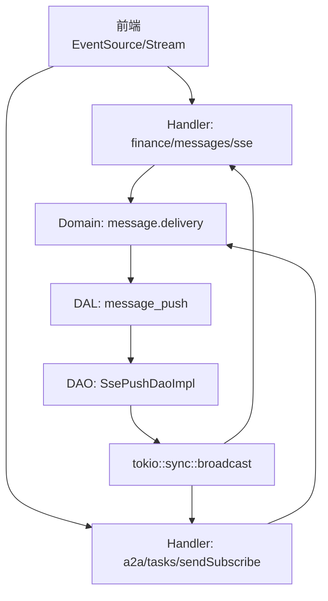
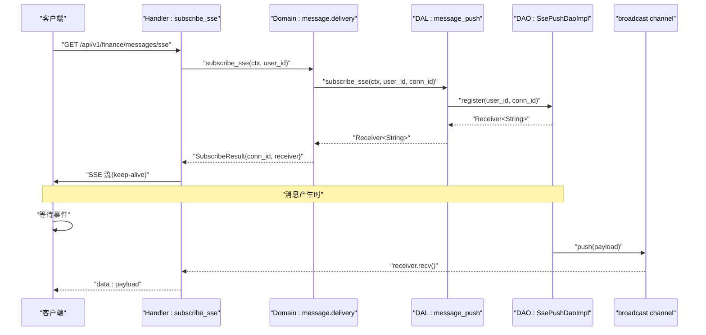
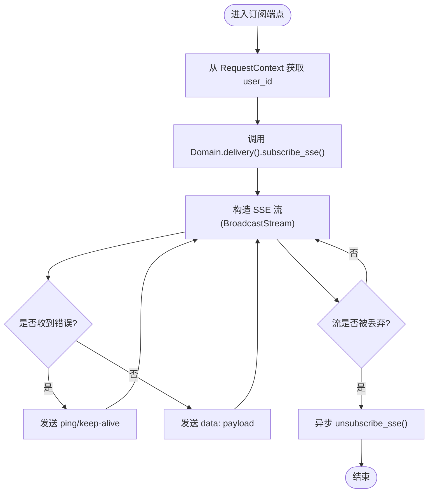
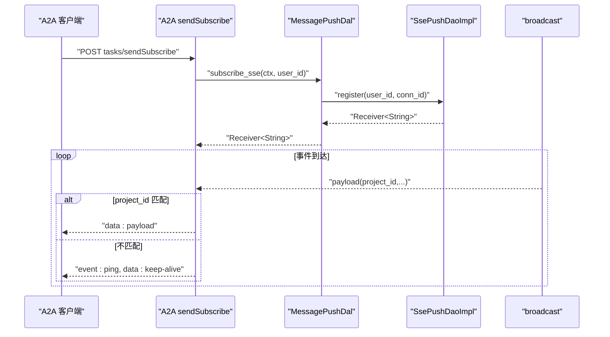
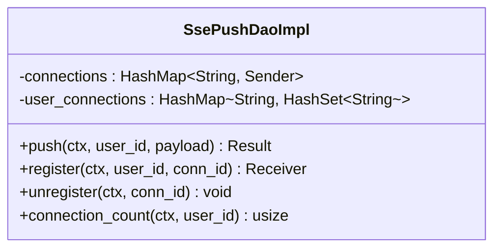
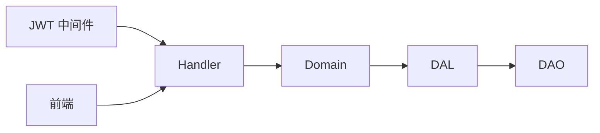

# 实时推送

<cite>
**本文引用的文件**
- [subscribe_sse.rs](src/handlers/finance/message/subscribe_sse.rs)
- [message_push DAL](src/service/dal/message_push.rs)
- [message_push DAO](src/service/dao/message_push.rs)
- [send_subscribe A2A](src/handlers/a2a/send_subscribe.rs)
- [JWT 认证中间件](src/middleware/jwt_auth.rs)
- [SSE 测试工具](tests/common/app.rs)
- [前端工作区 SSE 处理](frontend/src/pages/workspace.rs)
- （2026-09-04 清理：superpowers 目录已归档，待 doc-maintainer 跟进）
- [消息交互与SSE推送：MessageDomain delivery+management 双能力 + AgentLoopConsumer 循环驱动 + 多渠道出站（飞书/Slack/Email/Webhook/微信）](docs/modules/04-对话与消息/C-知识/消息交互与SSE推送：MessageDomain双能力 + AgentLoopConsumer循环 + 多渠道出站5类/消息交互与SSE推送：MessageDomain双能力 + AgentLoopConsumer循环 + 多渠道出站5类.md)
</cite>

## 目录
1. [简介](#简介)
2. [项目结构](#项目结构)
3. [核心组件](#核心组件)
4. [架构总览](#架构总览)
5. [详细组件分析](#详细组件分析)
6. [依赖关系分析](#依赖关系分析)
7. [性能与可靠性](#性能与可靠性)
8. [故障排查指南](#故障排查指南)
9. [结论](#结论)
10. [附录：集成示例与最佳实践](#附录：集成示例与最佳实践)

## 简介
本章节面向“基于 SSE（Server-Sent Events）的实时消息推送”能力，系统说明连接建立、订阅管理、事件流处理、断线清理、消息投递路径、鉴权与权限控制、以及可扩展性与监控指标。该能力以 Axum SSE 为核心，结合 tokio::sync::broadcast 实现用户级广播通道，将 SSE 作为消息投递渠道之一，无缝融入现有 deliver_message 流程。

## 项目结构
SSE 相关代码分布在 Handler、DAL、DAO 三层，遵循单向调用：Handler → Domain → DAL → DAO。其中：
- Handler 层提供 SSE 订阅端点与 A2A 流式任务订阅端点
- DAL 层负责消息加工与序列化
- DAO 层维护连接映射与广播通道
- JWT 中间件完成身份认证并注入 RequestContext
- 前端通过 EventSource 或原生 fetch + stream 消费 SSE 事件

图表来源
- [subscribe_sse.rs:53-92](src/handlers/finance/message/subscribe_sse.rs#L53-L92)
- [send_subscribe A2A:36-101](src/handlers/a2a/send_subscribe.rs#L36-L101)
- [message_push DAL:41-114](src/service/dal/message_push.rs#L41-L114)
- [message_push DAO:40-136](src/service/dao/message_push.rs#L40-L136)

章节来源
- [subscribe_sse.rs:1-93](src/handlers/finance/message/subscribe_sse.rs#L1-L92)
- [message_push DAL:1-163](src/service/dal/message_push.rs#L1-L163)
- [message_push DAO:1-173](src/service/dao/message_push.rs#L1-L172)
- [send_subscribe A2A:1-101](src/handlers/a2a/send_subscribe.rs#L1-L101)
- [JWT 认证中间件:1-156](src/middleware/jwt_auth.rs#L1-L156)
- [SSE 测试工具:199-263](tests/common/app.rs#L199-L263)
- [前端工作区 SSE 处理:387-415](frontend/src/pages/workspace.rs#L387-L415)
- （2026-09-04 清理：superpowers 目录已归档，待 doc-maintainer 跟进）

## 核心组件
- SSE 订阅端点（finance/messages/sse）
  - 从 RequestContext 中获取当前用户 ID（由 JWT 中间件注入）
  - 订阅用户级 broadcast channel，返回 SSE 流
  - 使用 keep-alive 维持长连接
  - 在流被丢弃时自动注销连接，避免内存泄漏
- A2A 流式任务订阅端点（tasks/sendSubscribe）
  - 复用同一用户级 broadcast channel
  - 按 project_id 过滤事件，非匹配事件发送 ping/keep-alive
- 消息推送 DAL
  - 将业务消息序列化为统一 payload
  - 委托 DAO 进行广播推送
- SSE 推送 DAO
  - 维护 connection_id -> sender 映射
  - 维护 user_id -> connection_ids 映射
  - 提供 push/register/unregister/connection_count 接口
- 认证与权限
  - JWT 中间件支持 Cookie/Bearer 双模式
  - 请求上下文携带用户信息，用于权限判断与路由隔离

章节来源
- [subscribe_sse.rs:53-92](src/handlers/finance/message/subscribe_sse.rs#L53-L92)
- [send_subscribe A2A:36-101](src/handlers/a2a/send_subscribe.rs#L36-L101)
- [message_push DAL:41-114](src/service/dal/message_push.rs#L41-L114)
- [message_push DAO:20-136](src/service/dao/message_push.rs#L20-L136)
- [JWT 认证中间件:25-87](src/middleware/jwt_auth.rs#L25-L87)

## 架构总览
SSE 推送整体流程如下：
- 客户端通过浏览器 EventSource 或后端测试工具发起 GET /api/v1/finance/messages/sse
- JWT 中间件校验 token，提取用户信息并写入请求头，后续中间件构建 RequestContext
- Handler 调用 Domain.delivery().subscribe_sse()，DAO 注册连接并返回 receiver
- 服务端将 receiver 包装为 SSE 流，持续向客户端推送消息
- 当任意消息产生时，deliver_message 会调用 DAL.push_to_sse()，DAL 序列化后交由 DAO.push() 广播到所有订阅者
- 客户端断开或服务关闭时，CleanupStream Drop 触发异步注销连接，释放资源

图表来源
- [subscribe_sse.rs:53-92](src/handlers/finance/message/subscribe_sse.rs#L53-L92)
- [message_push DAL:86-114](src/service/dal/message_push.rs#L86-L114)
- [message_push DAO:88-136](src/service/dao/message_push.rs#L88-L136)
- [send_subscribe A2A:62-101](src/handlers/a2a/send_subscribe.rs#L62-L101)

## 详细组件分析

### SSE 订阅端点（finance/messages/sse）
- 功能要点
  - 从 RequestContext 获取 user_id（由 JWT 中间件注入）
  - 调用 Domain.delivery().subscribe_sse() 获取 receiver
  - 将 receiver 转为 SSE 流，错误接收时发送 ping/keep-alive
  - 使用 keep_alive 保持连接活跃
  - 使用 CleanupStream 包装流，Drop 时异步注销连接，防止内存泄漏
- 关键实现位置
  - 订阅与流构造：[subscribe_sse.rs:53-92](src/handlers/finance/message/subscribe_sse.rs#L53-L92)
  - 连接清理逻辑：[subscribe_sse.rs:17-50](src/handlers/finance/message/subscribe_sse.rs#L17-L50)

图表来源
- [subscribe_sse.rs:53-92](src/handlers/finance/message/subscribe_sse.rs#L53-L92)
- [subscribe_sse.rs:17-50](src/handlers/finance/message/subscribe_sse.rs#L17-L50)

章节来源
- [subscribe_sse.rs:1-93](src/handlers/finance/message/subscribe_sse.rs#L1-L92)

### A2A 流式任务订阅端点（tasks/sendSubscribe）
- 功能要点
  - 复用用户级 broadcast channel，与消息推送共享基础设施
  - 解析 payload 中的 project_id，仅推送与当前任务匹配的事件
  - 非匹配事件发送 ping/keep-alive，保持连接活跃
- 关键实现位置
  - 订阅与过滤：[send_subscribe A2A:62-101](src/handlers/a2a/send_subscribe.rs#L62-L101)

图表来源
- [send_subscribe A2A:36-101](src/handlers/a2a/send_subscribe.rs#L36-L101)
- [message_push DAL:86-114](src/service/dal/message_push.rs#L86-L114)
- [message_push DAO:88-136](src/service/dao/message_push.rs#L88-L136)

章节来源
- [send_subscribe A2A:1-101](src/handlers/a2a/send_subscribe.rs#L1-L101)

### 消息推送 DAL（序列化与转发）
- 职责
  - 将业务消息序列化为统一 payload（包含 message_id、project_id、task_id、from/to、content、created_at 等）
  - 调用 DAO.push() 进行广播
  - 提供 subscribe/unsubscribe/connection_count 接口
- 关键实现位置
  - 结构与接口：[message_push DAL:12-59](src/service/dal/message_push.rs#L12-L59)
  - 实现与单例：[message_push DAL:61-114](src/service/dal/message_push.rs#L61-L114)

章节来源
- [message_push DAL:1-163](src/service/dal/message_push.rs#L1-L163)

### SSE 推送 DAO（连接管理与广播）
- 职责
  - 维护 connections: connection_id -> broadcast::Sender
  - 维护 user_connections: user_id -> HashSet<connection_id>
  - register：创建 channel，记录映射
  - push：遍历用户的所有连接，尝试发送
  - unregister：移除连接并从用户集合中删除
  - connection_count：统计用户连接数
- 关键实现位置
  - 数据结构与接口：[message_push DAO:12-38](src/service/dao/message_push.rs#L12-L38)
  - 实现细节：[message_push DAO:40-136](src/service/dao/message_push.rs#L40-L136)

图表来源
- [message_push DAO:40-136](src/service/dao/message_push.rs#L40-L136)

章节来源
- [message_push DAO:1-173](src/service/dao/message_push.rs#L1-L172)

### 认证与权限控制
- JWT 中间件支持 Cookie 与 Bearer 双模式
- 验证通过后，将用户信息写入请求头，供后续中间件构建 RequestContext
- SSE 订阅端点直接从 RequestContext 获取 user_id，无需显式路径参数传递
- 关键实现位置
  - 认证流程与响应策略：[JWT 认证中间件:25-87](src/middleware/jwt_auth.rs#L25-L87)
  - 未认证响应策略：[JWT 认证中间件:139-156](src/middleware/jwt_auth.rs#L139-L156)

章节来源
- [JWT 认证中间件:1-156](src/middleware/jwt_auth.rs#L1-L156)

### 前端集成与消息过滤
- 前端通过 EventSource 或原生流处理 SSE 事件
- 对收到的消息进行 JSON 反序列化，并按 project_id/agent_id 过滤
- 累计消息流量（按分钟桶），淘汰旧数据，控制内存占用
- 关键实现位置
  - 事件处理与过滤：[前端工作区 SSE 处理:387-415](frontend/src/pages/workspace.rs#L387-L415)

### 推送面：受众而不是收件人（2026-11-15）
SSE 的推送目标是消息的**受众**，不是它的 `to_id`：

| 场景 | 推送目标 | 出口 |
|------|----------|------|
| 收件人是 User | 该用户（`to_id`） | `handle_user_message → deliver_message → push_to_sse` |
| 发件人是 User（网页发 / 渠道入站） | 发信用户 | 前端乐观气泡（自带真实 `message_id`）；渠道入站由 `producer::message_channel` 立即推一次 |
| 双方都不是 User（Agent↔Agent、任务知会、工具调用） | 归属用户（`root_user_id`） | `delivery::push_message_to_audience`（只走 SSE） |

**前两行不归受众推送管**，函数里用 `to_role == User || from_role == User` 直接返回 0。
这条守卫不是可选的：三条路都推同一 `message_id` 时，前端虽然按 id 去重看不出来，
但**未读角标是按条计数的**，数字会凭空翻倍。

为什么必须有第三行：展示面 `list_messages` 按 `project_id` / `task_id` 过滤，项目里
**Agent 之间的横向交流、任务知会、工具调用**本来就在列表里（前端还给了
`.message-bystander` 旁听样式）。这些消息的 `to_role` 是 Agent/System，走不到
`deliver_message` —— 只按收件人推送时的症状就是「不推、刷新才有」。

⚠️ 受众推送**不能复用 `deliver_message`**：那条路会同时投递到飞书 / 微信等外部渠道，
把 Agent 之间的内部对话同步到用户的聊天软件里。

⚠️ 展示面按 `organization_id + project_id` 过滤、推送面按 `root_user_id` 扇出，
前者更宽 —— 因此本推送**不会推出展示面看不到的内容**（无新增泄露面）；代价是同一
项目里属于其他用户的消息只在他们自己的页面上实时，别人刷新才见。

⚠️ 前端收到面变宽之后，两个**计数型**状态必须按 `to_role == 0`（发给我的）收窄，
否则旁观消息会把它们带偏：
- 未读角标按条 `+= 1`（`chat.rs` 的 `unread_badges`）—— 不收窄就会暴涨；
- 「思考中」气泡 `is_typing` —— 不收窄会被 Agent 之间的中途交流提前清掉，看着像
  回复已经到了。
工作台的侧边栏红点是 `HashSet`（幂等），不受重复推送影响，无需收窄。

关键实现位置：
- 受众判定与推送：[delivery.rs:100-128](src/service/domain/message/delivery.rs#L100-L128)
- 消费侧调用点（dispatch 之前，消息已落库即为事实）：[message.rs:274](src/consumer/message.rs#L274)

### 轮询兜底
SSE 是尽力而为的实时通道：断线（休眠 / 换网）与内存 broadcast（容量 100）溢出都会
**静默丢事件且不补发**。前端因此在两个消息页各起一条 5s 低频轮询（页面不可见时休眠），
用 `after_timestamp` 拉当前会话的增量并按 `message_id` 去重 —— 把推送面重新对齐到
展示面，同时补上「同一账号在别的标签页 / 手机发的消息本页没有乐观气泡」。

**游标只认服务端时间戳**（上一拍响应里的最新一条），不拿本地列表推算：

- 乐观消息的 `created_at` 是本机时钟（`build_optimistic_user_msg → now_ms()`）。浏览器
  时钟快于服务端时，用它当基准会把游标推到「未来」，这段窗口内的消息**永久**拉不到
  —— 游标只前进、`.max()` 还会把虚高值钉住，没有自愈路径。
- 没有游标时（会话刚切换 / 空会话）传 `None`：接口退化成「取最新一页」，用响应里
  服务端的时间戳校准。代价是首次多一次整页查询，换来零时钟依赖。

因此轮询取回的**不是严格增量**（无游标那次含已有消息，甚至含列表里还没有的更早消息），
合并时必须去重 + 保持 `created_at` 正序 —— 只 push 到尾部会让时间线错乱。

关键实现位置：
- 工作台：[workspace.rs:952-1034](frontend/src/pages/workspace.rs#L952-L1034)
- 对话页：[chat.rs:641-711](frontend/src/pages/message/chat.rs#L641-L711)
- 增量合并（去重 + 排序）：[message.rs:44-60](frontend/src/utils/message.rs#L44-L60)

章节来源
- [前端工作区 SSE 处理:387-415](frontend/src/pages/workspace.rs#L387-L415)

## 依赖关系分析
- Handler 依赖 Domain.delivery() 进行订阅与推送协调
- Domain 依赖 DAL 进行消息序列化与转发
- DAL 依赖 DAO 进行连接管理与广播
- 认证中间件位于最外层，确保 RequestContext 可用
- 前端通过标准 SSE 协议消费事件，无需额外 SDK

图表来源
- [subscribe_sse.rs:53-92](src/handlers/finance/message/subscribe_sse.rs#L53-L92)
- [message_push DAL:61-114](src/service/dal/message_push.rs#L61-L114)
- [message_push DAO:40-136](src/service/dao/message_push.rs#L40-L136)
- [JWT 认证中间件:25-87](src/middleware/jwt_auth.rs#L25-L87)

章节来源
- [subscribe_sse.rs:1-93](src/handlers/finance/message/subscribe_sse.rs#L1-L92)
- [message_push DAL:1-163](src/service/dal/message_push.rs#L1-L163)
- [message_push DAO:1-173](src/service/dao/message_push.rs#L1-L172)
- [JWT 认证中间件:1-156](src/middleware/jwt_auth.rs#L1-L156)

## 性能与可靠性
- 连接生命周期管理
  - 使用 CleanupStream 在流丢弃时自动注销连接，避免内存泄漏
  - 参考修复说明：[subscribe_sse.rs:17-50](src/handlers/finance/message/subscribe_sse.rs#L17-L50)
- 心跳与保活
  - 使用 keep_alive 定期发送空事件，维持连接活跃
  - 参考实现：[subscribe_sse.rs:87-92](src/handlers/finance/message/subscribe_sse.rs#L87-L92)
- 消息去重与过滤
  - 前端按 project_id/agent_id 过滤，减少无关事件处理
  - A2A 端点在服务器侧按 project_id 过滤，非匹配事件发送 ping
  - 参考实现：[send_subscribe A2A:85-101](src/handlers/a2a/send_subscribe.rs#L85-L101)、[前端工作区 SSE 处理:387-415](frontend/src/pages/workspace.rs#L387-L415)
- 批量推送
  - 通过用户级 broadcast channel，一次消息可推送给多个连接
  - 参考实现：[message_push DAO:62-86](src/service/dao/message_push.rs#L62-L86)
- 连接数限制与扩展
  - 当前为进程内广播，适合单机；多实例需引入外部消息总线（如 Redis Pub/Sub）
  - 可通过 connection_count 指标监控连接规模
  - 参考实现：[message_push DAO:123-130](src/service/dao/message_push.rs#L123-L130)
- 可靠性保证
  - 使用 tokio::sync::broadcast，容量有限，若消费者滞后可能丢消息
  - 建议在业务层增加重试与幂等处理（例如基于 message_id 的去重）
  - 参考实现：[message_push DAL:73-84](src/service/dal/message_push.rs#L73-L84)

章节来源
- [subscribe_sse.rs:17-92](src/handlers/finance/message/subscribe_sse.rs#L17-L92)
- [send_subscribe A2A:85-101](src/handlers/a2a/send_subscribe.rs#L85-L101)
- [message_push DAL:73-84](src/service/dal/message_push.rs#L73-L84)
- [message_push DAO:62-130](src/service/dao/message_push.rs#L62-L130)
- [前端工作区 SSE 处理:387-415](frontend/src/pages/workspace.rs#L387-L415)

## 故障排查指南
- 常见问题
  - 连接未清理导致内存增长：检查 CleanupStream 是否正确包装流，确认 Drop 触发注销
    - 参考：[subscribe_sse.rs:17-50](src/handlers/finance/message/subscribe_sse.rs#L17-L50)
  - 事件丢失或延迟：检查 broadcast 容量与消费者处理速度，必要时增大容量或优化消费逻辑
    - 参考：[message_push DAO:88-106](src/service/dao/message_push.rs#L88-L106)
  - 认证失败：检查 JWT 中间件配置与 Cookie/Bearer 设置
    - 参考：[JWT 认证中间件:25-87](src/middleware/jwt_auth.rs#L25-L87)
- 诊断工具
  - 使用测试工具收集 SSE 事件，验证端到端链路
    - 参考：[SSE 测试工具:199-263](tests/common/app.rs#L199-L263)
  - 监控连接数与推送成功率，结合日志定位问题
    - 参考：[message_push DAO:123-130](src/service/dao/message_push.rs#L123-L130)

章节来源
- [subscribe_sse.rs:17-50](src/handlers/finance/message/subscribe_sse.rs#L17-L50)
- [message_push DAO:88-130](src/service/dao/message_push.rs#L88-L130)
- [JWT 认证中间件:25-87](src/middleware/jwt_auth.rs#L25-L87)
- [SSE 测试工具:199-263](tests/common/app.rs#L199-L263)

## 结论
本项目实现了基于 SSE 的实时消息推送机制，采用 Handler → Domain → DAL → DAO 的清晰分层，利用 tokio::sync::broadcast 实现用户级广播，并通过 CleanupStream 保障连接生命周期管理。认证与权限控制由 JWT 中间件统一处理，前端可按项目维度过滤事件。当前方案适用于单机场景，水平扩展需引入外部消息总线。建议在生产环境加强连接监控、消息去重与重试机制，以提升可靠性与可观测性。

## 附录：集成示例与最佳实践
- SSE 客户端集成
  - 浏览器：使用 EventSource 连接 /api/v1/finance/messages/sse，自动携带 Cookie
  - 后端测试：使用测试工具连接并收集事件，便于集成测试
  - 参考：[SSE 测试工具:199-263](tests/common/app.rs#L199-L263)
- 消息过滤
  - 前端按 project_id/agent_id 过滤，减少无关事件处理
  - 参考：[前端工作区 SSE 处理:387-415](frontend/src/pages/workspace.rs#L387-L415)
- 批量推送
  - 通过用户级 broadcast channel，一次消息推送给多个连接
  - 参考：[message_push DAO:62-86](src/service/dao/message_push.rs#L62-L86)
- 性能优化
  - 合理设置 broadcast 容量，避免消费者滞后导致丢消息
  - 使用 keep_alive 维持连接，降低网络中断概率
  - 参考：[subscribe_sse.rs:87-92](src/handlers/finance/message/subscribe_sse.rs#L87-L92)
- 安全与权限
  - 使用 JWT 中间件进行认证，确保 RequestContext 可用
  - 参考：[JWT 认证中间件:25-87](src/middleware/jwt_auth.rs#L25-L87)
- 水平扩展与负载均衡
  - 当前为进程内广播，多实例需引入外部消息总线（如 Redis Pub/Sub）
  - 通过 connection_count 指标监控连接规模
  - 参考：[message_push DAO:123-130](src/service/dao/message_push.rs#L123-L130)

章节来源
- [SSE 测试工具:199-263](tests/common/app.rs#L199-L263)
- [前端工作区 SSE 处理:387-415](frontend/src/pages/workspace.rs#L387-L415)
- [message_push DAO:62-130](src/service/dao/message_push.rs#L62-L130)
- [subscribe_sse.rs:87-92](src/handlers/finance/message/subscribe_sse.rs#L87-L92)
- [JWT 认证中间件:25-87](src/middleware/jwt_auth.rs#L25-L87)
