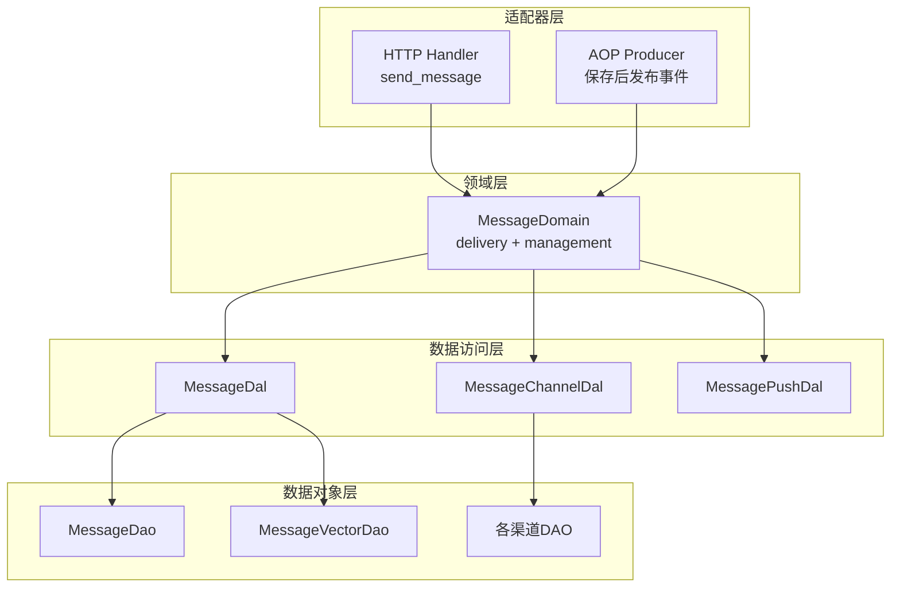
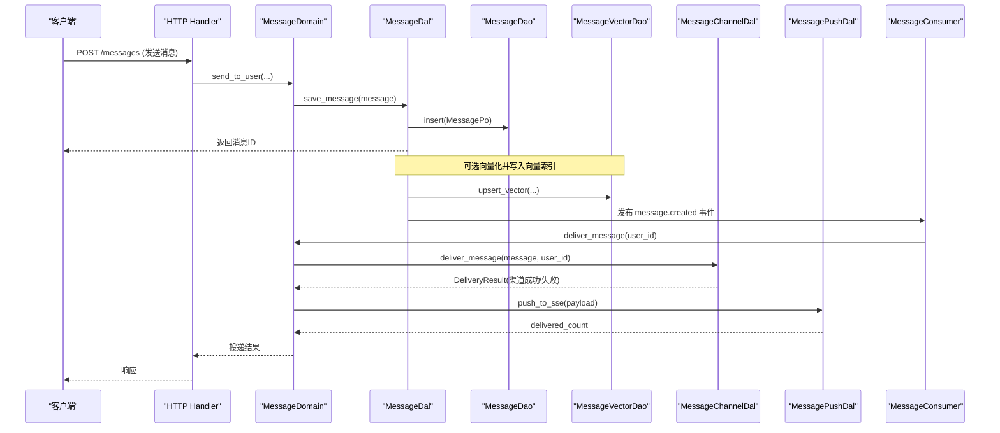
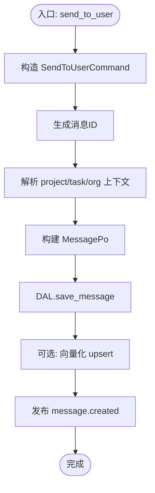
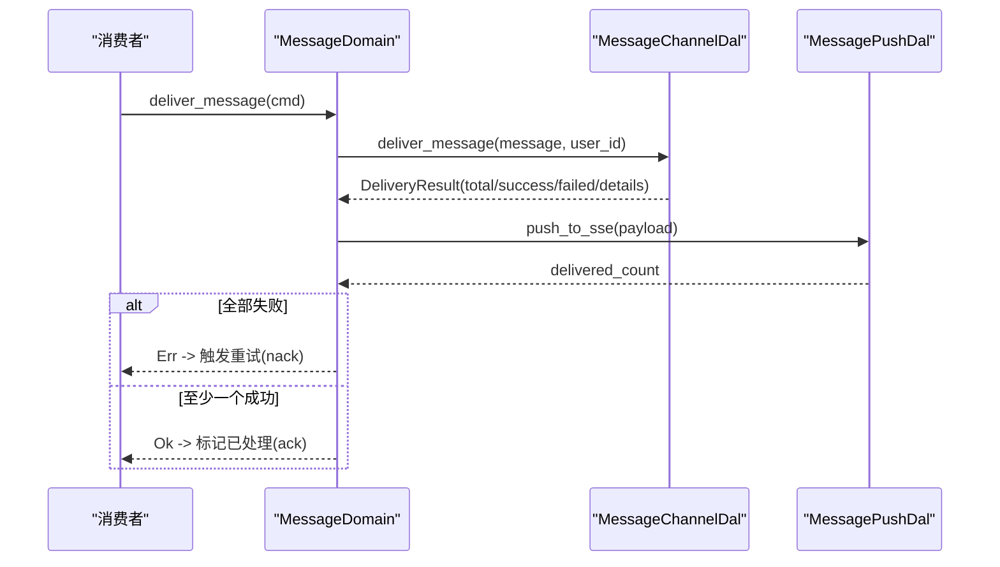
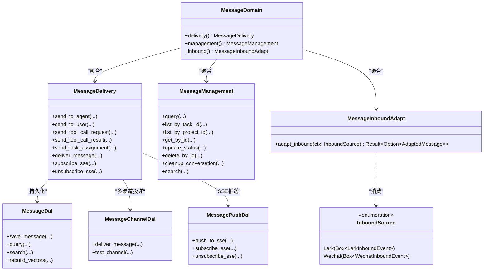

# 消息领域

<cite>
**本文引用的文件**
- [src/service/domain/message/mod.rs](src/service/domain/message/mod.rs)
- [src/service/domain/message/delivery.rs](src/service/domain/message/delivery.rs)
- [src/service/domain/message/management.rs](src/service/domain/message/management.rs)
- [src/models/message.rs](src/models/message.rs)
- [src/service/dal/message.rs](src/service/dal/message.rs)
- [src/service/dao/message/mod.rs](src/service/dao/message/mod.rs)
- [src/consumer/message.rs](src/consumer/message.rs)
- [src/service/domain/message/inbound.rs](src/service/domain/message/inbound.rs#L1-L66)
- [src/consumer/lark_inbound.rs](src/consumer/lark_inbound.rs)
- [src/consumer/wechat_inbound.rs](src/consumer/wechat_inbound.rs)
- [src/service/dal/message_channel.rs](src/service/dal/message_channel.rs)
- [src/service/dal/message_push.rs](src/service/dal/message_push.rs)
- [src/handlers/finance/message/send_message.rs](src/handlers/finance/message/send_message.rs)
- [common/src/enums/message.rs](common/src/enums/message.rs)
- [common/src/enums/message_channel.rs](common/src/enums/message_channel.rs)
- [src/router.rs](src/router.rs)
- [消息交互与SSE推送：MessageDomain delivery+management 双能力 + AgentLoopConsumer 循环驱动 + 多渠道出站（飞书/Slack/Email/Webhook/微信）](docs/modules/04-对话与消息/C-知识/消息交互与SSE推送：MessageDomain双能力 + AgentLoopConsumer循环 + 多渠道出站5类/消息交互与SSE推送：MessageDomain双能力 + AgentLoopConsumer循环 + 多渠道出站5类.md)
- [src/consumer/message_route_policy.rs](src/consumer/message_route_policy.rs) — Agent 间 Final 回发路由两段判定（防乒乓：静态规则表 + 协作压力裁决）
- [src/pkg/collaboration_pressure/mod.rs](src/pkg/collaboration_pressure/mod.rs) — 协作压力组件：链深度 + 疲劳度累积/回血、档位裁决、配套提示词、可记录快照
- [src/pkg/collaboration_pressure/policy.rs](src/pkg/collaboration_pressure/policy.rs) — 档位规则表（判据 / 动作 / 提示词 / 回血话术同行声明）
- [src/pkg/policy/builtin.rs](src/pkg/policy/builtin.rs) — 策略引擎通用抽象 ThresholdPolicy / FieldEqualsPolicy
- [src/service/domain/runtime/awakening.rs:1-L80](src/service/domain/runtime/awakening.rs#L1-L80) — Agent 唤醒注入 reply_to 上下文
- [src/service/dal/lark/impl.rs](src/service/dal/lark/impl.rs) — 飞书 thread_id ↔ external_key 映射
- [migrations/20260909000004_add_external_key_to_messages.sql](migrations/20260909000004_add_external_key_to_messages.sql) — external_key 话题关联字段
</cite>

## 目录
1. [简介](#简介)
2. [项目结构](#项目结构)
3. [核心组件](#核心组件)
4. [架构总览](#架构总览)
5. [详细组件分析](#详细组件分析)
6. [依赖关系分析](#依赖关系分析)
7. [性能与扩展性](#性能与扩展性)
8. [故障排查指南](#故障排查指南)
9. [结论](#结论)
10. [附录：API 与示例路径](#附录api-与示例路径)

## 简介
本文件围绕“消息领域”进行系统化文档化，覆盖消息管理系统与消息投递系统的领域模型、创建路由、存储检索、投递策略、重试与失败处理、队列管理、批量与异步投递、生命周期与状态管理、清理策略、序列化与协议适配，以及发送、接收、转发和监控的实现模式。整体遵循四层单向调用：Adapter（HTTP Handler / AOP Producer）→ Domain → DAL → DAO，禁止跨层与同层互调；所有公共方法首参为 RequestContext，跨层使用 ctx.clone()。

## 项目结构
消息领域由以下层次组成：
- Adapter 层：HTTP Handler 暴露消息发送、列表、搜索、SSE 订阅等接口；AOP Producer 在保存消息后发布事件。
- Domain 层：MessageDomain 聚合 delivery（投递）、management（管理）与 inbound（入站适配）能力，定义命令对象与业务编排。
- DAL 层：MessageDal 封装消息持久化、向量索引、搜索合并；MessageChannelDal 负责多渠道分发；MessagePushDal 负责 SSE 推送。
- DAO 层：MessageDao/MessageVectorDao 提供 SQL/向量索引的 CRUD 与查询；各渠道 DAO 实现具体推送。

**图表来源**
- [src/handlers/finance/message/send_message.rs:1-41](src/handlers/finance/message/send_message.rs#L1-L41)
- [src/service/domain/message/mod.rs:1-119](src/service/domain/message/mod.rs#L1-L119)
- [src/service/dal/message.rs:1-122](src/service/dal/message.rs#L1-L122)
- [src/service/dal/message_channel.rs:1-126](src/service/dal/message_channel.rs#L1-L126)
- [src/service/dal/message_push.rs:1-59](src/service/dal/message_push.rs#L1-L59)
- [src/service/dao/message/mod.rs:1-57](src/service/dao/message/mod.rs#L1-L57)

**章节来源**
- [src/router.rs:480-524](src/router.rs#L480-L524)
- [src/service/domain/message/mod.rs:1-119](src/service/domain/message/mod.rs#L1-L119)

## 核心组件
- 领域模型与实体
  - Message 业务实体与 MessagePo 持久化对象，承载消息元信息、内容、附件、回复链、根链、组织上下文等。
  - ToolCallMessage 统一工具调用请求/结果载荷，支持大结果附件与轻量追踪引用。
  - TaskAssignmentMessage 任务分配通知载荷。
- 领域接口
  - MessageDelivery：发送 Agent/用户消息、工具调用请求/结果、任务分配、分发消息到渠道、SSE 订阅/取消。
  - MessageManagement：通用查询、按任务/项目列表、按 ID 获取、状态更新、删除、对话清理、混合搜索。
  - MessageInboundAdapt：外部渠道事件（InboundSource 枚举收敛 Lark/Wechat）→ 内部 AdaptedMessage，Consumer 统一经 MessageDomain.inbound().adapt_inbound() 消费入站事件，不再持有渠道 DAL 弱引用。
- 数据访问接口
  - MessageDal：保存、查询、计数、状态更新、删除、搜索、重建向量索引。
  - MessageChannelDal：渠道配置管理与 deliver_message 分发。
  - MessagePushDal：SSE 推送、订阅、连接数统计。
- 消费者与事件
  - MessageConsumer 订阅 message.created 事件，按 to_role 分发至 RuntimeDomain 或 MessageDomain，完成唤醒、投递与工具执行。
  - 防乒乓回发路由（message_route_policy.rs，2026-09-18；2026-10-16 修复哨兵优先级；2026-11-04 协作压力组件化；2026-11-05 回复决策权归 Agent + 硬墙改知会收口）：Agent Final 自动回发前两段判定——`judge_static_reply_route` 静态段（NO_REPLY 哨兵 trim 后全等匹配置前，任何来源命中即 Discard；其后按声明序 user_origin→Peer / system_origin→Discard / self_trigger→Discard / agent_notify→Discard）零查库先行；跨 Agent 对等候选再走 `judge_chain_reply_route`——委托 `pkg/collaboration_pressure` 组件按「链深度 + 信息疲劳度」裁决四档，仅 Exhausted 档 `CloseChainAsNotify`（Final 作为 `AgentNotify` 知会送达来源方 + 通知归属用户，链靠知会语义终止，**不再丢弃最后一轮信息**），压力带仍 Peer 但唤醒前已注入施压提示词。知会是回溯边界（`is_chain_boundary`），收口后对端主动发新消息从第 1 跳重新计数。工具结果 / 新参与方 / 用户输入会回血并重置连续窗口，允许有新鲜感的协作超过硬窗口；阈值走 `[agent].collab_*` 可配，不再是编译期常量 5。**是否回复由 Agent 自决、Final 是唯一权威**：`ReplyObligation`（Expected / NotifyOnly）只按入口消息语义分类并经 `ThinkingOptions.turn_guidance_lines` 注入提示词（告知「可以回 NO_REPLY」，收尾语在有指引时改为「请输出本轮结果（无需回复时只输出 NO_REPLY）：」），`classify_reply_decision` 只解析 Final；**禁止反查「本轮是否已发过消息」做副作用推断**（发过 ≠ 已答复，且覆盖不全）。详见 [reply_arbitration_design.md](<../A-设计/reply_arbitration_design.md>)。
  - LarkInboundConsumer / WechatInboundConsumer：无状态化订阅渠道入站事件（lark.inbound.message / wechat.inbound.message），统一经 MessageDomain.inbound().adapt_inbound(InboundSource::Lark/Wechat) 适配，再通过 callback registry 回调投递，不再持有渠道 DAL 弱引用。

**章节来源**
- [src/models/message.rs:18-247](src/models/message.rs#L18-L247)
- [src/models/message.rs:402-612](src/models/message.rs#L402-L612)
- [src/service/domain/message/mod.rs:121-377](src/service/domain/message/mod.rs#L121-L377)
- [src/service/dal/message.rs:49-122](src/service/dal/message.rs#L49-L122)
- [src/service/dal/message_channel.rs:62-126](src/service/dal/message_channel.rs#L62-L126)
- [src/service/dal/message_push.rs:40-59](src/service/dal/message_push.rs#L40-L59)
- [src/consumer/message.rs:64-141](src/consumer/message.rs#L64-L141)

## 架构总览
消息从 Adapter 进入，经 Domain 编排，DAL 协调 DAO 完成持久化与投递，并通过 AOP 事件驱动异步消费。

**图表来源**
- [src/handlers/finance/message/send_message.rs:1-41](src/handlers/finance/message/send_message.rs#L1-L41)
- [src/service/domain/message/delivery.rs:160-208](src/service/domain/message/delivery.rs#L160-L208)
- [src/service/dal/message.rs:131-193](src/service/dal/message.rs#L131-L193)
- [src/consumer/message.rs:78-120](src/consumer/message.rs#L78-L120)
- [src/service/dal/message_channel.rs:226-284](src/service/dal/message_channel.rs#L226-L284)
- [src/service/dal/message_push.rs:71-84](src/service/dal/message_push.rs#L71-L84)

## 详细组件分析

### 领域模型与数据结构
- Message/MessagePo：包含项目/任务关联、角色、类型、状态、内容、附件、回复链 root_id、组织上下文、时间戳等。
- ToolCallMessage：统一请求/结果载荷，支持 result_file_meta 与 trace_ref，便于大结果与链路追踪。
- TaskAssignmentMessage：任务分配通知载荷。
- 枚举：
  - MessageRole：User/Agent/System。
  - MessageType：Text/Image/File/Audio/Video/ToolCallRequest/ToolCallResult/ConfirmRequest/ConfirmResponse/TaskAssignment/ProjectFollowupNotification 等。
  - MessageStatus：Recalled/Pending/Processing/Processed/Failed。
  - ChannelType：Lark/Wechat/Slack/Email/Webhook/A2aCallback。

这些类型贯穿 Domain/DAL/DAO/Handler，保证序列化一致性与跨层契约稳定。

**章节来源**
- [src/models/message.rs:18-300](src/models/message.rs#L18-L300)
- [src/models/message.rs:402-612](src/models/message.rs#L402-L612)
- [common/src/enums/message.rs:7-188](common/src/enums/message.rs#L7-L188)
- [common/src/enums/message_channel.rs:9-60](common/src/enums/message_channel.rs#L9-L60)

### 消息创建与路由
- 发送给用户：Handler 解析参数，构造 SendToUserCommand 调用 Domain.delivery().send_to_user，DAL 保存并可选向量化，随后通过 AOP 发布事件。
- 发送给 Agent：请求侧（站内前端 / 渠道适配层）已把附件以 `[文件名](attachment:id)` 写进正文；send_to_agent 校验声明附件的归属、为只传数组而漏写引用的调用方兜底补拼，按正文含资源引用归一为 Mixed(13)，并按 reply_to_id 继承 root_id，确保对话链可拉取。
- 工具调用：send_tool_call_request 生成 ToolCallMessage 请求，保存后由消费者触发工具执行，再 send_tool_call_result 回写结果。
- 任务分配：send_task_assignment 生成 TaskAssignmentMessage 并持久化。

**图表来源**
- [src/handlers/finance/message/send_message.rs:1-41](src/handlers/finance/message/send_message.rs#L1-L41)
- [src/service/domain/message/delivery.rs:160-208](src/service/domain/message/delivery.rs#L160-L208)
- [src/service/dal/message.rs:131-193](src/service/dal/message.rs#L131-L193)

**章节来源**
- [src/service/domain/message/delivery.rs:51-158](src/service/domain/message/delivery.rs#L51-L158)
- [src/service/domain/message/delivery.rs:210-330](src/service/domain/message/delivery.rs#L210-L330)
- [src/service/domain/message/delivery.rs:332-379](src/service/domain/message/delivery.rs#L332-L379)

### 消息投递策略与失败处理
- 多渠道投递：MessageChannelDal.deliver_message 查询用户活跃渠道并按 scope_project 过滤，逐个 push_to_channel，记录成功/失败详情。
- SSE 推送：MessagePushDal.push_to_sse 将消息推送到在线连接，返回 delivered_count。
- 失败重试：
  - 消费者 handle_user_message 在所有渠道失败且无 SSE 投递时返回错误，触发 nack 重试。
  - ack/nack 分别将消息状态置为 Processed/Pending，配合 AOP 队列的重试机制。
- 去重与限流：has_pending_message_for_agent 用于避免对同一 Agent 重复投递系统通知。

**图表来源**
- [src/service/dal/message_channel.rs:226-284](src/service/dal/message_channel.rs#L226-L284)
- [src/service/dal/message_push.rs:71-84](src/service/dal/message_push.rs#L71-L84)
- [src/consumer/message.rs:359-389](src/consumer/message.rs#L359-L389)

**章节来源**
- [src/service/dal/message_channel.rs:226-335](src/service/dal/message_channel.rs#L226-L335)
- [src/consumer/message.rs:114-141](src/consumer/message.rs#L114-L141)
- [src/consumer/message.rs:359-389](src/consumer/message.rs#L359-L389)

### 消息队列管理与异步投递
- AOP 事件中心：保存消息后发布 message.created，消费者以 Async 模式轮询消费，并发度与空队列休眠、错误重试间隔可配置。
- 消费者职责：仅做订阅与调度，业务逻辑委托给 Domain（RuntimeDomain 唤醒 Agent、MessageDomain 投递）。
- 上下文重建：消费者根据 MessagePo 重建 RequestContext，确保日志链路、模型上下文、租户隔离等完整。

**章节来源**
- [src/service/dal/message.rs:131-193](src/service/dal/message.rs#L131-L193)
- [src/consumer/message.rs:64-141](src/consumer/message.rs#L64-L141)
- [src/consumer/message.rs:479-514](src/consumer/message.rs#L479-L514)

### 批量处理与异步投递
- 批量查询：MessageQuery 支持 limit/offset/order_by/status_in 等组合条件，DAL 提供 list_by_* 语法糖。
- 批量向量重建：rebuild_vectors 清空集合后遍历消息逐条向量化，失败降级不影响主流程。
- 异步投递：消费者异步处理消息，结合 AOP 队列实现背压与重试。

**章节来源**
- [src/service/dao/message/mod.rs:9-57](src/service/dao/message/mod.rs#L9-L57)
- [src/service/dal/message.rs:398-445](src/service/dal/message.rs#L398-L445)
- [src/consumer/message.rs:74-141](src/consumer/message.rs#L74-L141)

### 消息生命周期、状态管理与清理策略
- 状态机：Recalled/Pending/Processing/Processed/Failed，由消费者 ack/nack 驱动状态迁移。
- 清理：cleanup_conversation 删除任务下所有消息；delete_by_id 物理删除单条消息；删除时同步清理向量索引。
- 会话链：reply_to_id 与 root_id 共同维护消息链，便于按根拉取完整对话。

**章节来源**
- [src/service/domain/message/management.rs:57-79](src/service/domain/message/management.rs#L57-L79)
- [src/service/dal/message.rs:338-355](src/service/dal/message.rs#L338-L355)
- [src/models/message.rs:281-299](src/models/message.rs#L281-L299)

### 序列化、格式转换与协议适配
- 统一载荷：ToolCallMessage 统一请求/结果结构，支持大结果附件与 trace_ref。
- Prompt 格式化：MessagePo.to_prompt 输出结构化文本，便于 LLM 理解。
- 协议适配：MessageChannelDal 通过 match 分发到 Lark/Wechat/Slack/Email/Webhook/A2aCallback 等渠道 DAO，新增渠道只需添加分支。

**章节来源**
- [src/models/message.rs:302-356](src/models/message.rs#L302-L356)
- [src/models/message.rs:402-571](src/models/message.rs#L402-L571)
- [src/service/dal/message_channel.rs:202-222](src/service/dal/message_channel.rs#L202-L222)
- [src/service/dal/message_channel.rs:299-313](src/service/dal/message_channel.rs#L299-L313)

### 实际代码示例（路径）
- 发送消息给用户：[src/handlers/finance/message/send_message.rs:1-41](src/handlers/finance/message/send_message.rs#L1-L41)
- 发送消息给 Agent：[src/service/domain/message/delivery.rs:51-158](src/service/domain/message/delivery.rs#L51-L158)
- 工具调用请求/结果：[src/service/domain/message/delivery.rs:210-330](src/service/domain/message/delivery.rs#L210-L330)
- 任务分配消息：[src/service/domain/message/delivery.rs:332-379](src/service/domain/message/delivery.rs#L332-L379)
- 多渠道投递：[src/service/dal/message_channel.rs:226-284](src/service/dal/message_channel.rs#L226-L284)
- SSE 推送：[src/service/dal/message_push.rs:71-84](src/service/dal/message_push.rs#L71-L84)
- 消费者处理：[src/consumer/message.rs:78-120](src/consumer/message.rs#L78-L120)

## 依赖关系分析
- 单向依赖：Adapter → Domain → DAL → DAO；Domain 不直接依赖 DAO，DAL 不暴露 PO 到 Domain。
- 关键耦合点：
  - Domain 依赖 DAL 抽象，解耦具体存储与渠道实现。
  - DAL 依赖 DAO 抽象，屏蔽 SQLite/LanceDB/各渠道 SDK 差异。
  - 消费者依赖 AOP 事件总线，与业务编排解耦。

**图表来源**
- [src/service/domain/message/mod.rs:255-377](src/service/domain/message/mod.rs#L255-L377)
- [src/service/dal/message.rs:49-122](src/service/dal/message.rs#L49-L122)
- [src/service/dal/message_channel.rs:62-126](src/service/dal/message_channel.rs#L62-L126)
- [src/service/dal/message_push.rs:40-59](src/service/dal/message_push.rs#L40-L59)

**章节来源**
- [src/service/domain/message/mod.rs:255-377](src/service/domain/message/mod.rs#L255-L377)
- [src/service/dal/message.rs:49-122](src/service/dal/message.rs#L49-L122)

## 性能与扩展性
- 向量搜索降级：当 Embedding Provider 不可用时，自动降级为关键词搜索；写入失败记录警告但不阻塞主流程。
- 并发与背压：消费者并发度、空队列休眠、错误重试间隔可调，避免资源争用。
- 可扩展性：新增渠道仅需在 MessageChannelDal 的 match 中添加分支；新增搜索后端可通过 MessageVectorDao 抽象接入。
- 批量重建：rebuild_vectors 支持全量重建向量索引，适合离线场景。

**章节来源**
- [src/service/dal/message.rs:150-193](src/service/dal/message.rs#L150-L193)
- [src/consumer/message.rs:130-141](src/consumer/message.rs#L130-L141)
- [src/service/dal/message.rs:398-445](src/service/dal/message.rs#L398-L445)

## 故障排查指南
- 投递失败重试：若所有渠道失败且无 SSE 投递，消费者返回错误触发 nack 重试；检查渠道配置与网络连通性。
- 向量索引异常：关注“向量索引写入失败/重建失败”的警告日志，确认 Embedding Provider 可用。
- 上下文丢失：检查 ToolCallMessage.from_log_id/from_user_id/from_model_provider_id/from_model_name 是否回填，确保异步路径上下文完整。
- 死锁与竞态：Agent 唤醒前 try_set_busy 原子占用，失败释放 Busy；确保异常路径正确 set_idle。

**章节来源**
- [src/consumer/message.rs:359-389](src/consumer/message.rs#L359-L389)
- [src/service/dal/message.rs:150-193](src/service/dal/message.rs#L150-L193)
- [src/consumer/message.rs:402-477](src/consumer/message.rs#L402-L477)
- [src/consumer/message.rs:147-196](src/consumer/message.rs#L147-L196)

## 结论
消息领域通过清晰的领域模型与分层架构，实现了高内聚的消息管理与投递能力。借助 AOP 事件驱动与多渠道适配，系统在可靠性、可扩展性与可观测性方面具备良好基础。建议在生产环境持续监控投递成功率、向量索引健康度与消费者延迟，并根据业务规模调整并发与重试策略。

## 附录：API 与示例路径
- HTTP 路由：
  - 消息相关：/messages、/messages/search、/messages/sse、/message-channels/*
  - 参考：[src/router.rs:480-524](src/router.rs#L480-L524)
- Handler 示例：
  - 发送消息给用户：[src/handlers/finance/message/send_message.rs:1-41](src/handlers/finance/message/send_message.rs#L1-L41)
- Domain 示例：
  - 投递与 SSE 订阅：[src/service/domain/message/delivery.rs:381-459](src/service/domain/message/delivery.rs#L381-L459)
- DAL/DAO 示例：
  - 消息保存与搜索：[src/service/dal/message.rs:131-193](src/service/dal/message.rs#L131-L193)
  - 多渠道投递：[src/service/dal/message_channel.rs:226-284](src/service/dal/message_channel.rs#L226-L284)
- 消费者示例：
  - 事件消费与重试：[src/consumer/message.rs:78-141](src/consumer/message.rs#L78-L141)

---

### 本文关联的文档
- 🎴 RAG 卡: docs/wiki/knowledge/zh/消息交互与SSE推送：MessageDomain双能力 + AgentLoopConsumer循环 + 多渠道出站5类/消息交互与SSE推送：MessageDomain双能力 + AgentLoopConsumer循环 + 多渠道出站5类.md

---

### 更新摘要（2026-09-10，base d070a076→HEAD）
**主题**：MessagePo 新增 external_key + Delivery/Management 增量
**关键变更**：
1. MessagePo 新增 external_key 字段——关联外部系统话题（飞书 thread_id 等），跨渠道同话题消息聚合
2. MessageDelivery.send_to_agent / send_to_user 支持注入 reply_to 上下文——Agent 唤醒（awakening.rs）携带 reply_to 消息保持对话连贯
3. 飞书入站（lark/impl.rs）自动将 thread_id → external_key，出站 reply_in_thread 取 external_key → thread_id
4. MessageManagement.list_by_task_id / search 支持按 external_key 过滤
**涉及 RAG 卡**：消息交互与SSE推送卡

### 更新摘要（2026-09-18，base 2e324d2a→HEAD a7134bb7）
**主题**：Agent 间消息防乒乓路由 + 策略引擎抽象化
**关键变更**：
1. 新增 `src/consumer/message_route_policy.rs`——Agent Final 自动回发两段判定：静态段（STATIC_ROUTE_DEFS 4 条声明式规则 user_origin/system_origin/self_trigger/agent_notify + FieldEqualsPolicy 承载 NO_REPLY 哨兵，零查库）+ 机械段（ThresholdPolicy 承载 reply_to 链深度 ≥5 → EscalateToOwner），防 A↔B 无限乒乓
2. `consumer/message.rs` handle_agent_message 接入两段式路由判定 + `agent_reply_chain_depth` 查库计链深度
3. `pkg/policy/builtin.rs` 抽象化——通用 ThresholdPolicy / FieldEqualsPolicy + `impl_policy_delegate!` 委托宏，8 个内置策略中 5 个薄包装化（TimeoutPolicy/ContextOverflowPolicy/TokenBudgetPolicy/ConsecutiveLlmErrorsPolicy/FinalAnswerPolicy），调用点零改动
4. `common/src/enums/message.rs` 新增 MessageType::AgentNotify 知会类型（发送方声明无需回复，仅 Agent 来源生效）
**涉及 RAG 卡**：消息交互与SSE推送卡（§1 防乒乓路由段落 + §2 表格 2 行 + §4 红线 14-16 条）

### 更新摘要（2026-10-16）
**主题**：修复 NO_REPLY 哨兵泄漏——保留字提至路由判定最前
**关键变更**：
1. `src/consumer/message_route_policy.rs` `static_ruleset()`——NO_REPLY 哨兵（FieldEqualsPolicy）从 Or 组末尾提至最前：保留字任何来源 Final trim 后全等即 Discard。病因：任务派发经用户身份中继后 from_role=User，哨兵排在 user_origin 之后会被 Peer 短路，把 "NO_REPLY" 原文当回复发给用户（全库实证 29 条泄漏、25+ 条直达用户，最早 2026-09-28）
2. `src/consumer/message_route_policy_tests.rs`——顺序断言改写为哨兵胜出（`static_route_sentinel_wins_over_domain_rules`）+ 新增用户来源回归用例（`static_route_discards_no_reply_sentinel_for_user_origin`）
3. `src/consumer/message.rs`——handle_agent_message 路由表注释补「哨兵前置」说明
**涉及 RAG 卡**：消息交互与SSE推送卡（§1 防乒乓路由段落 + §2 表格回发路由行 + §4 红线 16 条）

### 更新摘要（2026-11-04）
**主题**：Agent 间协作压力组件化——静态硬墙改为慢性红线 + 新信息回血
**关键变更**：
1. 新增 `src/pkg/collaboration_pressure/`（mod.rs / policy.rs / tests.rs）——零 I/O 可复用组件：两个深度（绝对 `depth` 仅展示、连续 `window_depth` 参与硬墙判定）、疲劳度累积与 `Novelty` 回血、`STAGE_DEFS` 四档规则表（判据 / 动作 / 配套提示词 / 回血话术同一行）、`PressureSnapshot` 可序列化可打印
2. `src/consumer/message.rs`——`agent_reply_chain_depth` 改为 `collect_chain_pressure`（沿链回溯收集新→旧、由组件归一化为时间正序后观测 + 32 跳查库硬上限）；压力观测提前到 awaken 之前，配套提示词经 `ThinkingOptions.with_extra_resource_lines` 注入 User 消息末尾的【协作压力】append-only 独立区块（**不并入【资源上下文】、不进 System**）；`resolve_auto_reply_route` 变为纯函数；升级文案改为「已暂停 + 回复补新信息可续接」
3. `src/consumer/message_route_policy.rs`——移除 `MAX_AGENT_REPLY_CHAIN=5` 与固化阈值的 `OnceLock<ThresholdPolicy>`，`judge_chain_reply_route` 改为按组件 `PressureAction` 映射
4. `src/service/domain/runtime/types.rs` + `awakening.rs` + `legacy_awaken/nodes.rs` + `models/prompt_builder.rs` + `dal/agent/builder/default.rs`——新增 `extra_resource_lines` 统一提示词注入口与 `set_pressure_prompt_lines`，两处 prompt 装配点渲染独立尾部区块（prefix cache 友好）
5. `common/src/config.rs` + `common/config/ai_orz.toml`——`[agent].collab_soft_fatigue=36` / `collab_hard_fatigue=100` / `collab_hard_window_depth=8` 可配
6. 护栏：组件 11 例 + `message_route_policy_tests.rs` 的 `chain_route_escalates_at_pressure_wall_but_recovery_keeps_peer`（含回血后可超过硬窗口）
**prefix cache 边界（同日修订）**：压力值每轮变化，只准 append-only 收尾；禁止前移到消息链/资源上下文之前、禁止并入资源列表项、禁止进 System。System + tools 完全未改，Phase1/Phase2 共用 `fill_prompt_base` 保证 base 逐字节一致（I1/I2）；A↔B 交替唤醒不同 Agent，跨唤醒前缀天然不复用，把信号放前面只会打穿本来可命中的稳定前缀。护栏 `pressure_block_is_append_only_and_preserves_stable_prefix` / `pressure_lines_keep_intent_prefix_identical`。

**提交审核修订（2026-11-05）**：发现 `reply_to_id` 回溯（新→旧）被直接逐跳 `observe`，而回血清零 `window_depth` 是有方向的运算，会把「回血点之前的老跳」算成「最近回血之后的窗口」；回血点在链头时其后的长串纯文本被整段清零，**硬墙永不触发**。修法：consumer 只收集 `Vec<ChainHop>`（链断点不入链），组件新增 `observe_chain`（正序）/ `observe_backward_chain`（内部 reverse）把方向归一化收在单一真相；新增护栏 `backward_chain_observation_is_normalized_to_chronological_order` / `normalization_keeps_the_hard_wall_after_an_early_recovery`。同批修 `PressureConfig::sanitized()`：`max_fatigue` 自动抬到 `>= hard_fatigue`，否则把硬阈值配到 100 以上会被静默整份回退（`hard_fatigue_above_default_max_is_not_silently_rejected`）。另确认 `Novelty::DistinctContent` 目前只是组件预留枚举、消息链路未产出，当前疲劳度是结构化代理量而非正文信息量打分（见 A-设计 §四）。
**设计依据**：[collaboration_pressure_design.md](<../A-设计/collaboration_pressure_design.md>)

### 更新摘要（2026-11-05，回复仲裁）
**主题**：是否回复由 Agent 在思考中自决，Final 成为唯一权威（撤销「反查已发送」方案）
**关键变更**：
1. `src/consumer/message_route_policy.rs`——移除试做中的 `agent_self_replied` 规则（`RouteInput.replied_to_sender` + `RouteMatcher::RepliedToSender`）；新增 `ReplyObligation`（Expected / NotifyOnly，只看入口消息语义）、`ReplyDecision`（Reply / NoReply）与 `classify_reply_decision`（哨兵判定唯一入口，与路由共用）
2. `src/consumer/message.rs`——删除 `has_replied_to_sender` 查库与 `is_peer_reply_candidate` 预筛，改为按 `ReplyObligation` 组装本轮指引（仲裁行在前、压力行在后）；压力观测仅对 `Expected` 执行（当日晚些时候修订：知会也要观测一次，用于识别上游收口，见下一条摘要）；新增 `auto-reply decision` 日志（Final 形态 + 义务 + 路由）作为后续小脑的证据/决策样本
3. 提示词注入口统一改名 `ThinkingOptions.extra_resource_lines` → `turn_guidance_lines`、`PromptBuilder::set_pressure_prompt_lines` → `set_turn_guidance_lines`（同一区块承载回复仲裁 + 协作压力）；无指引时收尾指令保持 `请回复：` 逐字节不变，有指引时改为 `请输出本轮结果（无需回复时只输出 NO_REPLY）：`
4. `legacy_awaken/nodes.rs`——Phase 2 执行段（`build_execution_segment`）也挂同一份指引：执行段才是真正决策点，不该让模型回头翻 Phase 1
5. 护栏：`reply_obligation_follows_message_semantics` / `reply_protocol_prompt_states_both_forms` / `notify_obligation_prompt_points_to_explicit_send` / `reply_decision_only_fails_closed_on_sentinel` / `reply_tail_stays_unchanged_without_guidance` / `execution_segment_carries_turn_guidance_and_reply_tail`
**设计依据**：[reply_arbitration_design.md](<../A-设计/reply_arbitration_design.md>)（§1.1 记录「反查已发送」为何废弃：发过 ≠ 已答复、覆盖不全、抢走判定权）

### 更新摘要（2026-11-05，硬墙改知会收口）
**主题**：撞硬墙不再「直接停」，而是把最后一轮 Final 转成知会送达来源方，完成信息传递后再终止链条
**关键变更**：
1. `src/consumer/message_route_policy.rs`——`AutoReplyRoute::EscalateToOwner` → `CloseChainAsNotify`；`judge_chain_reply_route` 的 `Escalate` 分支改映射，路由语义从「终止回发」变为「收口为知会 + 终止链条」
2. `src/consumer/message.rs`——`CloseChainAsNotify` 分支用 `MessageType::AgentNotify` 把 Final 投给来源方（对端 `ReplyObligation::NotifyOnly` ⇒ 静态路由 Discard ⇒ 链必断），再给归属用户一条「已收口」通知；新增 `is_chain_boundary`（父消息是知会 ⇒ 链边界，不继续回溯），保证收口后「主动开新消息」从第 1 跳重新计数；知会消息也观测一次链，仅用于识别收口
3. `src/pkg/collaboration_pressure/`——`PressureDecision::closes_chain_as_notify()` + `chain_closed_prompt_lines()`（接收方视角的收口提示：疲劳度事实 + 「默认 NO_REPLY / 要推进就自己开新链」）；`STAGE_DEFS` 两条 Escalate 的 `prompt_hint` 改为「本轮 Final 仍会作为知会送达」，不再写「暂停回发」
4. 护栏：`exhausted_stage_prompt_matches_chain_close_behavior` / `chain_closed_prompt_carries_fatigue_and_reopen_guidance` / `notify_is_a_chain_boundary_so_reopened_chain_starts_fresh`
**设计依据**：[collaboration_pressure_design.md](<../A-设计/collaboration_pressure_design.md>) §5.1
