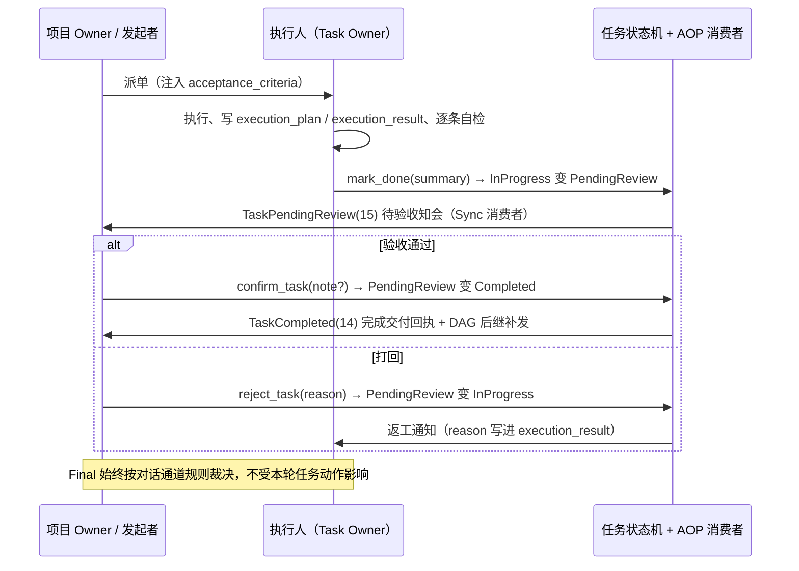

# 任务验收层与双通道路由模型

> 状态：现行 · 落地 2026-11-15。
>
> 本文是本次架构变更的**现状权威**：任务链路从「派单 → 干活 → 通知」补上**验收层**，同时把 **Final 对话通道**与**任务状态通道**解耦。被取代的旧任务系统设计文档（`task_design.md` / `project_management_design.md`）已标 `已废弃` 并保留原文——设计被取代不删旧文，历史本身是知识。

## 1. 一句话结论

「任务做完」不再等于「任务完成」。执行人只能**声明做完并提交验收**（`PendingReview`），必须由验收责任人**确认通过**才转 `Completed`；由此派生出「任务状态机多了第 6 态、多了 2 个工具、多了 1 个字段、多了 1 类消息」，并顺带把 Final 的抑制逻辑从「本轮做了什么动作」拉回到「入口消息是什么」，形成**各管各的两层通道**。

## 2. 任务状态：新增 `PendingReview = 5`

`TaskStatus` 由 5 态扩为 6 态。判别值 **追加**，不插中间：`0..=4` 的语义与存量 DB 值、serde 变体名、前端 `3 => 已完成` 一类硬编码全部保持稳定。

| 状态 | 值 | 语义 | 是否终态 |
|------|---|------|---------|
| `Cancelled` | 0 | 取消（相当于软删除） | 是 |
| `Pending` | 1 | 待处理 / 待启动 | 否 |
| `InProgress` | 2 | 进行中 | 否 |
| `Completed` | 3 | 已完成 | 是 |
| `Archived` | 4 | 已归档 | 是 |
| `PendingReview` | 5 | **待验收**：执行人已提交、等 Owner 核对 | **否** |

`PendingReview` 刻意**不是终态**：只有 `Completed` 才会触发「完成交付消息 + DAG 后继补发」。

### 转换边

| 从 | 到 | 触发 | 副作用 |
|----|----|------|--------|
| `InProgress` | `PendingReview` | `mark_done` | 写 `execution_result`（可选 summary）；**不**设 `progress=100`、**不**写 `end_at`、不解锁后继 |
| `PendingReview` | `Completed` | `confirm_task` | **唯一**触发完成交付消息（MessageType=14）+ DAG 后继补发；写 `end_at` / `progress=100` |
| `PendingReview` | `InProgress` | `reject_task` | 驳回原因追加到 `execution_result`；不解锁后继 |
| `PendingReview` | `Archived` | 归档动作 | 无交付 |
| 其余 | — | 既有状态机 | 同态 no-op，非法转换 `InvalidRequest` |

> **Agent 侧不能用 `update_task_status` 绕过验收**：后端对 Agent 调用方拦三条 —— 置 `Completed`、进入 `PendingReview`（提交只认 `mark_done`，校验承接人）、`PendingReview → InProgress`（打回只认 `reject_task`，校验验收责任人 + 必填原因）。`PendingReview → Archived` 仍放行。`project_management` 标签只说明「会用项目工具」，不说明「有权把这个任务判完成」。管理面（无 Agent 身份）保留直改状态的能力。

## 3. `mark_done` 语义变更：从「标记完成」到「提交验收」

| | 旧 | 新 |
|---|----|----|
| 语义 | 直接把任务置 `Completed` | 执行人声明做完 → `PendingReview` |
| 权限 | 无强约束 | **只有任务承接人**可调 |
| 来源状态 | — | **只从 `InProgress`** 提交 |
| `summary` | — | 可选，写入 `execution_result` 供验收人核对 |
| `progress` / `end_at` | 置 100 / 写结束时间 | **刻意都不动**，避免看板把未经确认的工作算成完成 |
| 完成交付消息 / DAG 后继 | 触发 | **都不触发**；要等 `confirm_task` |

也就是说：**「调用 `mark_done` 后任务完成 / 结束循环」不再成立**。提交后任务停在 `PendingReview`，等 Owner 验收；后继任务仍锁着。

## 4. `confirm_task` / `reject_task`：Owner 验收

两个工具同属 `project_management` 标签，共用 `review_guard` 身份守卫。

| 工具 | 入参 | 转换 | 权限 | 副作用 |
|------|------|------|------|--------|
| `confirm_task` | `task_id`, `note?` | `PendingReview → Completed` | **任务发起者 ∪ 项目 Owner** | 唯一触发完成交付消息 + DAG 后继补发；已 `Completed` 重复调用为 no-op；`note` 作为验收结论追加到 `execution_result` |
| `reject_task` | `task_id`, `reason` | `PendingReview → InProgress` | 同上 | `reason` 必填、追加到 `execution_result` 供执行人返工；不产生交付、不解锁后继 |

**权限细节**：允许集合 = `initiator_agent_id` ∪ `project.owner_agent_id`；两者都为空时放行（HTTP 管理面 / 系统触发走既有角色权限体系）。**无验收责任人**（既无项目 Owner 也无 initiator）的任务由 **Sync 消费者自动确认**，执行人无需等待，任务不会永远卡在 `PendingReview`。

**并发边界（已知，未做 CAS）**：`confirm_task` 的幂等是**读时状态**判据 —— 两个验收人*同时*确认仍可能各读到 `PendingReview`、各写一次状态事件（交付消息与 DAG 补发各来一份）。串行重复调用已被挡住。真正的原子占坑要在 `TaskDalImpl::update` 引入 `WHERE status = ?`，牵动「状态事件唯一发布点」，属独立基础设施改造，按 YAGNI 延后；将来要改时**不要**把重试逻辑堆在 handler 里。

**管理面入口**：任务详情页的「验收通过 / 驳回」按钮走 `PUT /api/v1/tasks/{task_id}/confirm` 与 `PUT /api/v1/tasks/{task_id}/reject`（task_id 在 path，body 只带 `note` / `reason`）。管理面 `ctx.agent_id()` 为空 ⇒ 跳过 `ensure_reviewer`。

**负责人是权限不是字段**：`project.owner_agent_id` 同时是「验收责任人」与「完成知会收件人」，因此交接走独立接口 / 工具 `transfer_project_owner`（`PUT /api/v1/projects/{project_id}/owner`），**不**塞进 `update_project`——否则任何能改项目描述的 Agent 都能顺手把验收权转给自己。守卫：管理面放行；Agent 必须是当前负责人，无主项目放行（否则负责人一旦被清空就再也补不回来）；目标 Agent 不存在直接 `NotFound`。交接即时生效（`ensure_reviewer` 每次按当前 Owner 判定），原负责人立刻失去验收权；已发出的待验收通知不会重投，原负责人点确认会被拒。

**责任人集合为空 = 拒绝（fail-closed）**：允许集合是「任务发起者 ∪ 项目 Owner」。集合为空说明这张工单没有任何可核对的验收主体，Agent 以任何身份确认都是自己给自己盖章 ⇒ 直接 `InvalidRequest`。这类任务（用户直建、项目行缺失的脏数据）由管理面确认或 `TaskPendingReviewConsumer` 自动确认收敛，都不经过 `ensure_reviewer`。项目查询**报错**（DB 故障 / 超时）同样拒绝，不能退化成「没有 Owner 所以放行」——这是把 `Ok(None)` 与 `Err` 分开处理的唯一理由。

**没有「一键完成」后门**：任务侧只有 `submit_for_review`（进 `PendingReview`）这一个执行人收尾入口，`transition_status(Completed)` 只服务 A2A / 框架路径。曾经并列存在的 `TaskManage::complete()` 能从任意状态直推 `Completed` 并发放完成交付，等于绕开整个验收层，已删除——不要以任何名义加回来（DAG 解锁、完成交付都必须发生在验收通过之后）。

## 5. `acceptance_criteria`（验收标准 / DoD）

任务新增独立字段 `acceptance_criteria`，随派单经 `Task::to_prompt_summary` 注入执行人的任务上下文（`- 验收标准: ...（提交前请逐条自检，并在执行结果中说明达成情况）`），是验收的**唯一对照基准**。

- **Owner 写法**：一条一个可验证、可判定的产出或条件（如「接口返回 200 且字段 X 非空」「单测覆盖率 ≥80%」「报告已 `create_text_artifact` 并关联 project_id + task_id」），写清产物 ID / 路径；与 `dependencies` 前置约定、`description` 需求边界一致，不写「尽量 / 完善一下」这类无法判定的措辞。
- **执行人自检（`mark_done` 前强制）**：逐条对照，在 `execution_result` 里写明每条「达成 / 未达成 + 证据」；未达成项先补做或明确列为遗留；`mark_done(summary)` 摘要与 `execution_result` 一致。
- **Owner 验收（`confirm_task` 前）**：`get_task(with_artifacts=true)` 读 `acceptance_criteria` / `execution_result` / 产物清单逐条核对；不达标用 `reject_task` 写明差在哪、要改什么，不要含糊打回。

## 6. 消息类型 `TaskPendingReview = 15`

| 值 | 类型 | 含义 | 时机 |
|----|------|------|------|
| 14 | `TaskCompleted` | 完成后交付回执 | `PendingReview → Completed`（验收通过） |
| 15 | `TaskPendingReview` | **任务待验收知会** | `→ PendingReview`（执行人提交） |

`TaskPendingReview` 与 `TaskCompleted` **严格分工**：15 是「请你来验收」的工作单，正文带验收标准 / 提交说明 / 产物清单，发给**项目 Owner → 发起者 fallback**，由 **Sync 消费者**投递；14 是「已验收通过」的交付回执。Owner 收到 15 的产出是 `confirm_task` / `reject_task` 工具调用，框架随后按工具结果发交付或驳回消息。

## 7. Final 路由解耦（本次最关键的边界修正）

**删除** `task_completed_this_round` 静态规则与整条 `task_completed` 粘滞信号链。Final **完全按对话通道自己的规则**走：

- `NO_REPLY` 哨兵
- `AgentNotify`（知会语义）
- `ReplyObligation`（Expected / NotifyOnly）
- 小脑 `chain_reply` 决策
- 硬墙「知会收口」（`CloseChainAsNotify`，最后一轮照常送达、链必然终止）

**不再因为「本轮调了 `mark_done`」就被吞掉**。任务侧规则只按**入口消息类型**判定（`message_type == TaskCompleted` / `message_type == TaskPendingReview` → Discard，因为交付/驳回已由工具产出，Final 再回发只是空洞转发）。

### 原则：「各管各的」

| 判据 | 是否合法 | 例 |
|------|---------|----|
| 按「**入口消息是什么**」判定 | ✅ 合法（对侧规则） | 入口是任务完成回执 / 待验收知会 → 该轮 Final 丢弃 |
| 按「**本轮做了什么动作**」判定 | ❌ 越界 | 本轮调用了 `mark_done` → 抑制 Final（旧 `task_completed_this_round`） |

后一类把任务状态通道的动作事实渗进对话通道的回执裁决，导致「按状态位 / 动作位」误伤被完成知会唤醒的发起者那一轮（它仍要推进自己的编排收尾）。解耦后，两条通道互不抢路由。

## 8. 两层通道模型

| | 任务通道 | 对话通道 |
|---|---------|---------|
| 载体 | 任务状态机 + AOP 确定性消费者 + 交付消息 | Agent Final 回执 |
| 关心 | 状态流转、权限、产物、DAG 后继 | 本轮要不要回、回给谁、链深 / 疲劳度 |
| 输出 | 结构化字段 + `execution_result` + 产物清单的**交付消息** | 面向人的自然语言回复 |
| 判据 | 入口消息类型 / 状态转换 | `NO_REPLY` / `AgentNotify` / `ReplyObligation` / 小脑 / 硬墙 |
| 谁做摘要 | 不负责 | **「层层摘要」由对话通道承担** |

任务交付消息承载**结构化字段 / 执行结果 / 产物**，不做层层摘要；对话通道的 Final 承担对人可读的摘要与回执。两者互不代替、互不抢路由。

## 9. 端到端链路

## 10. 相关代码路径

- 枚举：`common/src/enums/task.rs`（TaskStatus 6 态）、`common/src/enums/message.rs`（14 / 15）
- 字段与注入：`src/models/task.rs`（`acceptance_criteria`、`submit_for_review`、`to_prompt_summary`）
- 工具：`src/handlers/project/task/mark_done.rs` / `confirm_task.rs` / `reject_task.rs` / `review_guard.rs` / `update_task_status.rs`
- 消费者：`src/consumer/task_pending_review_consumer.rs`（15 投递 + 无责任人自动确认）、`task_completion_consumer.rs`（14 交付）、`task_event_consumer.rs`（DAG 后继补发）、`task_dispatch_consumer.rs`（首次派单）
- 路由：`src/consumer/message_route_policy.rs`（任务侧按入口消息类型的静态规则、Final 对话通道规则集）

## 11. 消息三身份模型（派单身份去中继，2026-11-15）

### 11.1 问题：所属用户占了派发者的位置

`messages` 表原本只有 `from_*` / `to_*` 两组身份列，而一条消息实际涉及三个身份。为了让被唤醒 Agent 的 `ctx.user_id` 有值（工具凭据 / 画像 / `AI_ORZ_USER_ID` 的唯一来源），派单与通知把**归属用户**写进了 `from_id`（`from_role=User`），史称「用户身份中继」。

代价是可观测的：

- 前端气泡把派单显示成「用户发的」，真实派发者在消息上不可见；
- `ReplyObligation::of` 只对 `from_role=Agent` 生效 ⇒ 派单拿不到 `Expected` 回复仲裁；
- Final 路由必须打补丁：`task_initiator_handoff`（执行者 ≠ initiator → 改道回发起者）+ `task_initiator_closing`（initiator → 交归属用户），且因为「带 `task_id` 就加载 initiator」还得叠一层 `message_type` 白名单；
- 同一套中继在 `create_task` / `task_event_consumer` / `scheduler` 各写一遍。

### 11.2 模型：三列各就各位

| 身份 | 载体 | 写入 | 消费 |
|---|---|---|---|
| 派发者 | `from_id` + `from_role` | 真实发送者（Agent / 用户 / 系统） | Final 路由、前端气泡 |
| 接收者 | `to_id` + `to_role` | 不变 | 唤醒目标 |
| 所属用户 | `root_user_id`（新列，`NOT NULL DEFAULT ''`） | 投递时快照：用户发来 → 发送者；Agent 发给用户 → 收件人；Agent 发给 Agent → ctx 用户（派单用任务行 `root_user_id`） | 工具凭据、画像、`AI_ORZ_USER_ID`、`DeliveryToRootUser` |

`rebuild_context` 三档回落：消息行 `root_user_id` → `from_role=User` 时 `from_id`（存量中继消息）→ `base`（`ContextCarrier` 继承）。回填迁移：`UPDATE messages SET root_user_id = from_id WHERE from_role = 0`。

### 11.3 派发者推导：`task_sender_identity`

`initiator_agent_id` → `root_user_id` → `system`（`consumer/mod.rs`，首次派单与 DAG 后继共用）。
⚠️ 有发起者时**不得**用归属用户兜底 —— 那正是旧中继的行为，会让执行者的 Final 越过发起者。

### 11.4 路由收敛

| 规则 | 之前 | 之后 |
|---|---|---|
| 派单交付回执 | `task_initiator_handoff` → `ReplyToInitiator` | 删除：`from_id` 已是发起者，`Peer` 等价 |
| 发起者收尾 | `task_initiator_closing` → `DeliverToRootUser` | 删除：判据被自派与巡检两条规则覆盖 |
| 自派任务（`assignee == initiator`） | 中继后走 `user_origin` → Peer | `task_self_assignment` → `DeliverToRootUser`（Peer 会自唤醒、`self_trigger` 会丢结论） |
| 巡检 / 编排通知 | 中继后走 `user_origin` → Peer | `owner_briefing` → `DeliverToRootUser`（from 改为 System） |
| 普通 `Text` 带 `task_id` | 依赖白名单排除 | 不命中任务规则，天然回落 `user_origin` |

`RouteInput.initiator_agent_id` / `keys::INITIATOR_AGENT_ID` / `TASK_ROUTE_MESSAGE_TYPES` 随两条改道规则一并删除。
