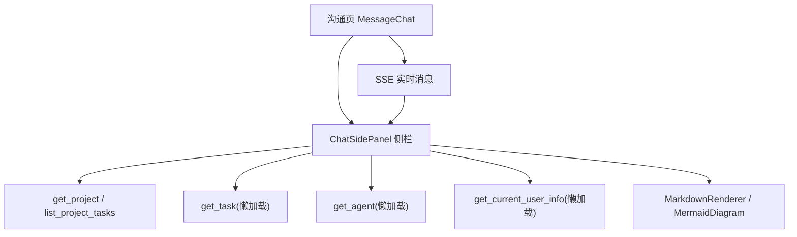
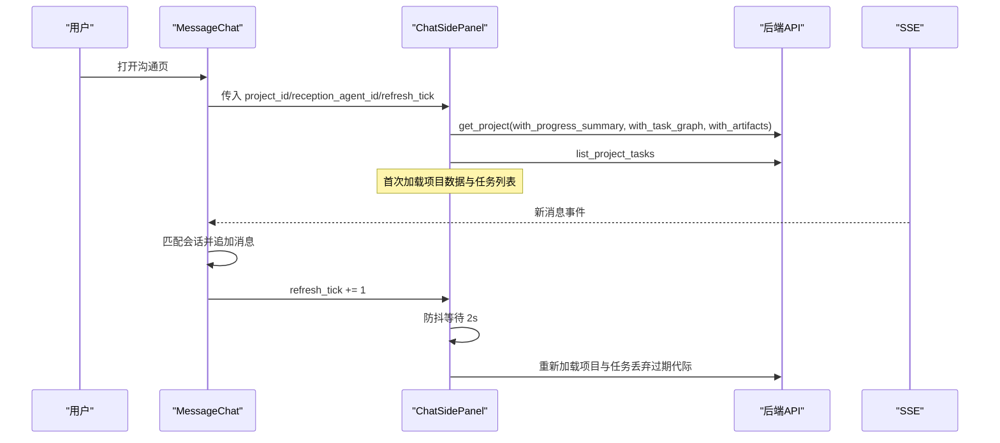
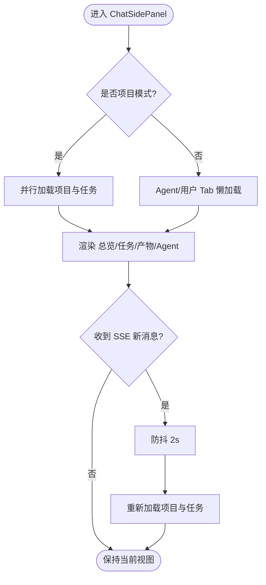
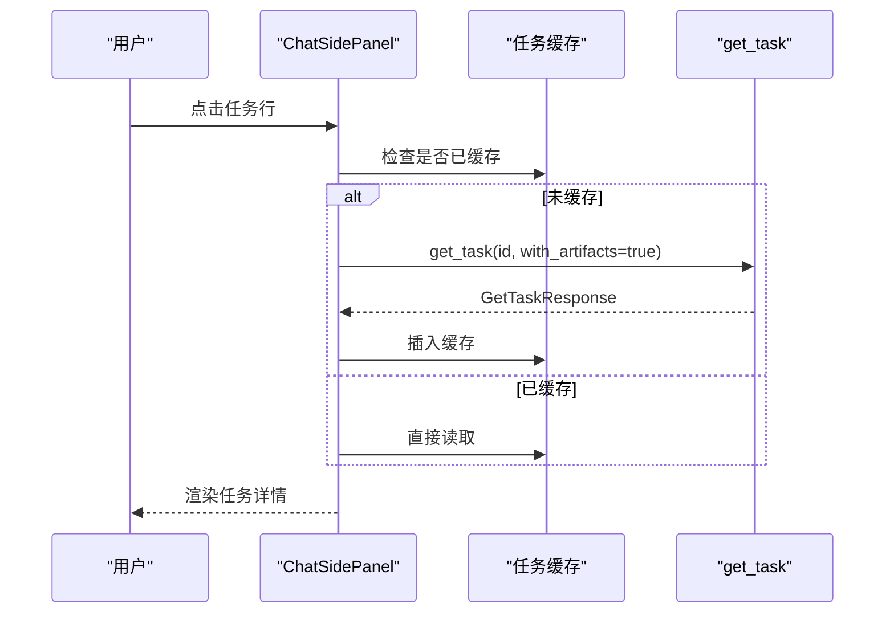
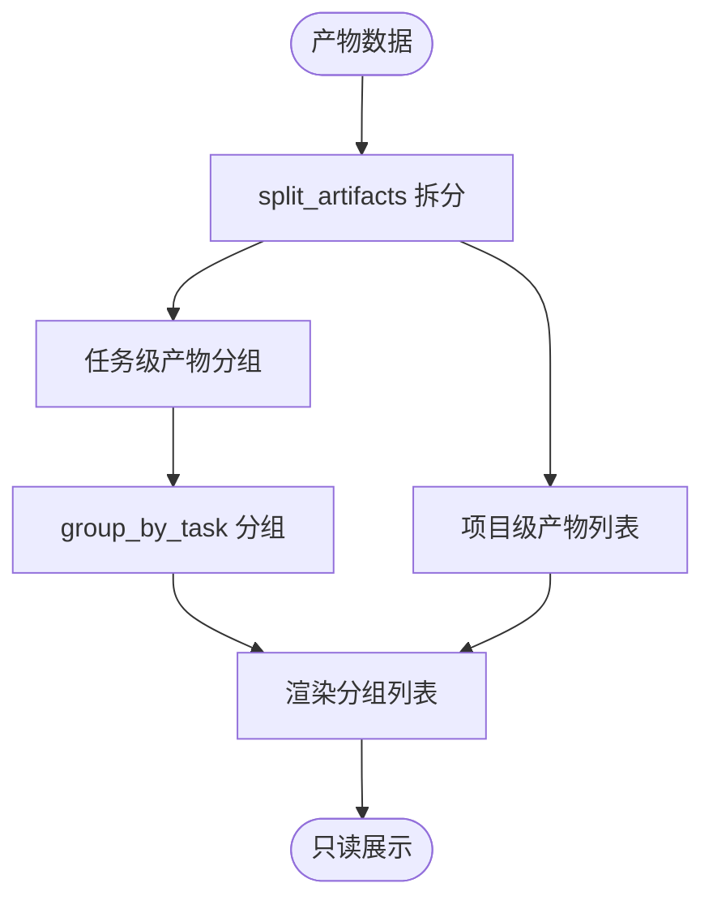
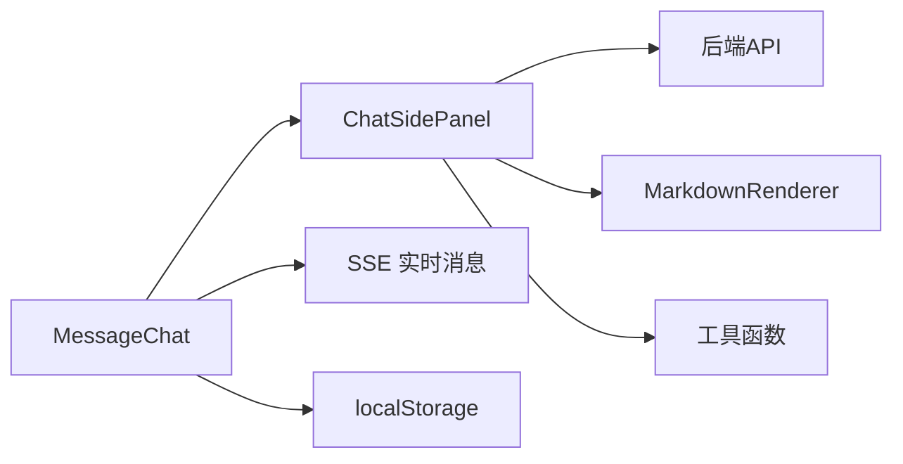

# 聊天侧面板

<cite>
**本文引用的文件**
- [chat_side_panel.rs](frontend/src/components/chat/chat_side_panel.rs)
- [chat.rs](frontend/src/pages/message/chat.rs)
- [avatar_bubble.rs](frontend/src/components/avatar_bubble.rs)
- [identity_chip.rs](frontend/src/components/identity_chip.rs)
- [project.rs](frontend/src/api/project.rs)
- [mod.rs（chat 组件）](frontend/src/components/chat/mod.rs)
- [markdown.rs](frontend/src/components/markdown.rs)
- [input.css](frontend/styles/input.css)
- [stats.rs](frontend/src/components/stats.rs)
- [line_chart.rs](frontend/src/components/charts/line_chart.rs)
- [hud_palette.rs](frontend/src/components/hud_palette.rs)
- [聊天页引入只读信息侧栏（ChatSidePanel）聚合项目上下文](docs/modules/05-任务与项目/C-知识/聊天页引入只读信息侧栏（ChatSidePanel）聚合项目上下文/聊天页引入只读信息侧栏（ChatSidePanel）聚合项目上下文.md)
- 【2026-09-18 追加】[模型提供商信息气泡：浮层定位工具复用 + ModelProviderBubble 懒加载卡片](docs/modules/12-基础设施与部署/C-知识/模型提供商信息气泡：浮层定位工具复用 + ModelProviderBubble 懒加载卡片/模型提供商信息气泡：浮层定位工具复用 + ModelProviderBubble 懒加载卡片.md) — 浮层定位工具 pub(crate) 复用的首个消费方
</cite>

## 目录
1. [简介](#简介)
2. [项目结构](#项目结构)
3. [核心组件](#核心组件)
4. [架构总览](#架构总览)
5. [详细组件分析](#详细组件分析)
6. [依赖关系分析](#依赖关系分析)
7. [性能与交互特性](#性能与交互特性)
8. [故障排查指南](#故障排查指南)
9. [结论](#结论)

## 简介
本功能为沟通页面新增的“信息侧栏”，用于在项目对话或默认对话中提供只读上下文：项目总览、任务列表与详情、产物分组展示、Agent 信息与当前用户信息。支持手动刷新与 SSE 消息触发的防抖自动刷新，展开状态通过 localStorage 持久化，桌面端以右侧列显示，移动端以抽屉覆盖层呈现。

## 项目结构
该功能由以下关键文件协作实现：
- 侧栏主组件：`ChatSidePanel`，负责 Tab 切换、数据加载、子 Tab 渲染
- 沟通页集成：在 `MessageChat` 中挂载侧栏、处理 SSE 刷新信号、localStorage 记忆
- API 客户端：补全项目查询参数，确保进度汇总、任务图、产物等字段可被读取
- Markdown 渲染：统一将执行计划/结果、描述等 Markdown 内容渲染为 HTML，并支持 Mermaid 图
- 样式：Tailwind + DaisyUI 主题，Markdown 容器样式与紧凑模式



图表来源
- [chat.rs:76-84](frontend/src/pages/message/chat.rs#L76-L84)
- [chat_side_panel.rs:102-185](frontend/src/components/chat/chat_side_panel.rs#L102-L185)
- [project.rs:35-59](frontend/src/api/project.rs#L35-L59)
- [markdown.rs:61-112](frontend/src/components/markdown.rs#L61-L112)

章节来源
- [chat_side_panel.rs:1-793](frontend/src/components/chat/chat_side_panel.rs#L1-L793)
- [chat.rs:76-84](frontend/src/pages/message/chat.rs#L76-L84)
- [project.rs:35-59](frontend/src/api/project.rs#L35-L59)
- [markdown.rs:61-112](frontend/src/components/markdown.rs#L61-L112)

## 核心组件
- ChatSidePanel：主容器，管理项目/默认两种模式的 Tab 集合、数据加载、防抖刷新、缓存与 UI 状态
- AgentInfoTab：懒加载并展示 Agent 详情（名称、类型、生命周期状态、运行时状态、角色、能力、描述、工具数量）
- UserInfoTab：懒加载当前用户信息（显示名/用户名、邮箱、角色、状态），并提供设置页跳转
- MarkdownRenderer/MermaidDiagram：统一 Markdown 渲染与 Mermaid 图渲染，支持紧凑模式与 DOM 注入安全

章节来源
- [chat_side_panel.rs:95-269](frontend/src/components/chat/chat_side_panel.rs#L95-L269)
- [chat_side_panel.rs:602-728](frontend/src/components/chat/chat_side_panel.rs#L602-L728)
- [markdown.rs:61-112](frontend/src/components/markdown.rs#L61-L112)

## 架构总览
侧栏遵循“只读展示”的设计原则，所有数据均通过现有后端 API 获取，不引入写操作；通过 Dioxus 的信号与 effect 管理状态，结合异步任务进行懒加载与防抖刷新。



图表来源
- [chat.rs:192-216](frontend/src/pages/message/chat.rs#L192-L216)
- [chat_side_panel.rs:123-185](frontend/src/components/chat/chat_side_panel.rs#L123-L185)
- [project.rs:35-59](frontend/src/api/project.rs#L35-L59)

## 详细组件分析

### ChatSidePanel 主组件
- 职责：根据对话模式动态组装 Tab，管理项目/任务/产物/Agent/我 的数据加载与展示
- 数据加载策略：
  - 项目模式：并行请求项目详情（含进度汇总、任务图、产物）与任务列表
  - 默认模式：Agent/用户 Tab 各自懒加载
- 防抖刷新：SSE 触发时递增计数器，内部使用代际计数丢弃过期请求，sleep 2s 后重新加载
- 状态管理：active_tab、expanded_task_id、task_cache、loading、load_gen、prev_project_id、prev_tick
- 布局：头部标题+刷新按钮+收起按钮；DaisyUI tabs-boxed 小号样式；内容区滚动



图表来源
- [chat_side_panel.rs:102-185](frontend/src/components/chat/chat_side_panel.rs#L102-L185)
- [chat_side_panel.rs:194-234](frontend/src/components/chat/chat_side_panel.rs#L194-L234)

章节来源
- [chat_side_panel.rs:95-269](frontend/src/components/chat/chat_side_panel.rs#L95-L269)

### 总览 Tab（仅项目模式）
- 展示项目基础信息（状态徽标、优先级、标签、负责人）
- 项目目标（Markdown 渲染）
- 进度汇总（整体百分比条与各状态计数）
- 执行计划/执行结果（Markdown 渲染）
- 任务依赖图（Mermaid 图）

章节来源
- [chat_side_panel.rs:286-353](frontend/src/components/chat/chat_side_panel.rs#L286-L353)
- [markdown.rs:61-87](frontend/src/components/markdown.rs#L61-L87)
- [markdown.rs:89-112](frontend/src/components/markdown.rs#L89-L112)

### 任务 Tab（仅项目模式）
- 任务列表项：标题、状态徽标、进度条、负责人
- 点击展开单任务详情（懒加载 + 缓存到 HashMap）
- 展开内容：描述、开始/截止时间、进度百分比、执行计划/结果、产物名称列表、跳转详情页链接



图表来源
- [chat_side_panel.rs:355-452](frontend/src/components/chat/chat_side_panel.rs#L355-L452)
- [chat_side_panel.rs:454-511](frontend/src/components/chat/chat_side_panel.rs#L454-L511)

章节来源
- [chat_side_panel.rs:355-511](frontend/src/components/chat/chat_side_panel.rs#L355-L511)

### 产物 Tab（仅项目模式）
- 数据源：项目详情中的 artifacts（with_artifacts）
- 分组逻辑：
  - split_artifacts：按 task_id 是否为 None 拆分为项目级/任务级
  - group_by_task：任务级产物按 task_id 分组，组标题优先取任务名，否则截断 ID
- 每行展示：名称、来源类型徽标、文件大小、创建时间、跳转链接（只读）



图表来源
- [chat_side_panel.rs:65-93](frontend/src/components/chat/chat_side_panel.rs#L65-L93)
- [chat_side_panel.rs:513-579](frontend/src/components/chat/chat_side_panel.rs#L513-L579)

章节来源
- [chat_side_panel.rs:513-600](frontend/src/components/chat/chat_side_panel.rs#L513-L600)

### Agent 与用户 Tab
- AgentInfoTab：懒加载 Agent 详情，展示名称、类型、生命周期状态、运行时状态、角色、能力、描述、工具数量，跳转详情页。**2026-09-10 增量**：新增运行统计子块（见下文）
- UserInfoTab：懒加载当前用户信息，展示显示名/用户名、邮箱、角色、状态，跳转设置页

**Agent 运行统计增量（caf7bb02→HEAD）**：
- 位置：Agent Info Tab 底部，位于「描述」字段后，首次加载完成后渲染
- 统计卡片：唤醒次数（Agent 总调用 + 瞬时 QPS）+ 模型调用次数 + 输入 Token + 输出 Token
- 三线趋势图：input/output tokens + call_count，HudPalette 三色（主/次/第三），320x180 紧凑 Canvas 尺寸
- **窗口与粒度对齐工作台运行时口径**（2026-09-15 修正）：固定取**最近 60 分钟**（与工作台顶栏 `RUNTIME_METRICS_WINDOW_MINUTES` 同源思路），粒度用**分钟桶**。此前这里写死 `stats_interval=daily` 且不传时间范围，落到后端默认 7 天 + 天桶，X 轴必然画出一排日期；若该 Agent 只有一天有调用，7 天里只出 1 个桶，整图只剩一个点。面板标题右侧标注「最近 60 分钟」，避免读数被误读为历史累计。
- 独立拉取：共享轮询主链路不带 stats 参数（零额外开销），统计仅在 Agent Tab 挂载时触发 get_agent（with_stats=true + with_model_call_stats=true + stats_interval=minutely + stats_time_start/end=最近 60 分钟）
- 防抖刷新：refresh_tick 变化时 debounce 2s + stats_gen 代际号丢弃过期请求（复用 ToolCallsTab 机制）
- 首次挂载守卫：切换 Agent 时 stats_pair 重置为 None，避免新请求返回前闪现上一个 Agent 的数据

章节来源
- [chat_side_panel.rs:602-728](frontend/src/components/chat/chat_side_panel.rs#L602-L728)

### 沟通页集成（MessageChat）
- 新增 panel_open 信号，从 localStorage 初始化并回写
- 新增 refresh_tick 信号，SSE 命中当前会话时递增
- 两种对话 Header 右侧追加“信息面板”切换按钮
- 布局：桌面端右侧静态列，移动端固定抽屉 + 背景遮罩

章节来源
- [chat.rs:76-84](frontend/src/pages/message/chat.rs#L76-L84)
- [chat.rs:192-216](frontend/src/pages/message/chat.rs#L192-L216)
- [chat.rs:483-490](frontend/src/pages/message/chat.rs#L483-L490)

## 依赖关系分析
- ChatSidePanel 依赖：
  - API：get_project、list_project_tasks、get_task、get_agent、get_current_user_info
  - 组件：MarkdownRenderer、MermaidDiagram
  - 工具：format_file_size、progress_bar_class、project_status_badge/text、task_status_badge/text
- MessageChat 依赖：
  - SSE 连接与消息处理
  - localStorage 读写
  - ChatSidePanel 组件



图表来源
- [chat_side_panel.rs:16-29](frontend/src/components/chat/chat_side_panel.rs#L16-L29)
- [chat.rs:76-84](frontend/src/pages/message/chat.rs#L76-L84)

章节来源
- [chat_side_panel.rs:16-29](frontend/src/components/chat/chat_side_panel.rs#L16-L29)
- [chat.rs:76-84](frontend/src/pages/message/chat.rs#L76-L84)

## 性能与交互特性
- 防抖刷新：SSE 触发后等待 2s，避免频繁请求；使用代际计数丢弃过期请求结果
- 懒加载：任务详情与 Agent/用户信息按需加载，减少初始负载
- 缓存：任务详情缓存到 HashMap，重复展开直接命中
- 只读设计：无写操作，降低复杂度与风险
- 响应式布局：桌面端右侧列，移动端抽屉覆盖层
- Markdown 渲染：紧凑模式适配卡片/气泡场景，Mermaid 图支持任务依赖可视化

### 刷新只跟着「看得见的东西」走（2026-11-03）

侧栏收起时外层容器只是 `hidden`，`ChatSidePanel` 与各 Tab 仍挂载 —— 原先 SSE 每来一条消息都会替一个看不见的面板重拉「项目详情 + 任务列表」。现在刷新分三层收紧：

1. **面板收起零请求**：`ChatSidePanel` 新增 `visible: Signal<bool>`（由 chat 页的 `panel_open` 传入）。收起时 `tab_tick` 冻结不再前进，各 Tab 收不到 tick 变化；`do_load` effect 也直接早退且**不写回** `prev_*`，展开时按「首次可见 / 换过项目 / 换过 Tab」重判一次，该补的刷新一次性完成。chat 页 3s 主轮询的 `stats_poll_tick` 同样只在 `panel_open()` 时推进。
2. **Tab 维度裁剪**：`tab_data_needs(is_project_mode, tab)` 声明每个 Tab 真正消费的数据，SSE 到达时只刷当前 Tab 消费的那份，工具/思考 Tab 不再陪跑项目请求。

   判定按 Tab **名**而非索引：Tab 序列由 `tab_names(is_project_mode)` 唯一定义（渲染的 `tab_labels` 也取自它），两个判定函数经 `tab_name()` 取值，增删或重排 Tab 不会静默错位。单测 `tab_judgements_follow_tab_names_not_indexes` 遍历真实序列核对，且**遇到不认识的 Tab 名直接 panic**，逼着判定表同步更新。

   ⚠️ 同名 Tab 在两种模式下消费的数据不同，两个分支都带 `is_project_mode` 条件：产物在项目模式要「详情 + 任务」（按任务标题分组），默认对话却是硬编码空态「暂无产物」（产物硬绑定真实项目，游离任务不可能有产物）；Agent 在项目模式要两份（成员由任务 assignee 推导），默认对话走 `reception_agent_id` + chat 主链路共享轮询，两份都不消费。
3. **Agent Tab 子视图**：点进某个 Agent 详情子页后列表不在屏上，`ProjectAgentsTab` 不再因 tick 变化批量重取 Agent 列表；详情子页的刷新由 `AgentInfoTab` 承担，且 `load_stats` 现在顺带用响应刷新详情本身 —— 非 owner Agent 吃不到 chat 主链路的 3s 共享轮询，状态徽章只能靠这次 30s 统计刷新才更新。
4. **工具 / 思考 Tab 低频轮询**：这两个 Tab 的数据源（工具调用记录、`think_trace` JSONL）变化不产生会话消息、没有 SSE 可等，只能拉。`ChatSidePanel` 内单起一条 `LIVE_REFRESH_SECS = 6` 秒的循环，**仅当面板可见且当前 Tab 是这两个之一**时推进 `live_tick`；切走或收起立刻停摆、切回来重新计时。叠加两个 Tab 各自的 2s 防抖后实际约 8s 一刷，足以看到新增工具调用与思考轮次（配合「两段式落盘」的半成品轨迹，运行中的 run 也能逐轮长出来）。不复用 chat 主链路 3s 循环，是因为那是给置底状态气泡用的，频率对这两份数据太浪费。

轨迹条目**折叠态**即显示轮数与 token / 耗时 / 强度的累计值（由 `rounds` 现算），布局与展开后每一轮的顶行同构：左轮次 / 中 token 2×2 / 右强度+耗时，三栏各占两行高（见 [ThinkTrace 轮级轨迹](<../../02-Agent运行时/C-知识/ThinkTrace 轮级轨迹：JSONL 落盘 + query_think_traces 作用域守门 + 轮次时间线与轨迹面板/ThinkTrace 轮级轨迹：JSONL 落盘 + query_think_traces 作用域守门 + 轮次时间线与轨迹面板.md>) §3.5）。所以轮询带来的增长不用展开就能看到，展开前后也不必重新认位置。

   ⚠️ 这条循环只起**一个**：effect 的依赖在同步闭包体建立，`spawn` 内异步读取的 `visible()` / `project_id()` / `active_tab()` 不进依赖表，所以 `live_tick.set` 不会反触发 effect 重跑再 spawn 一个（否则每 6s 翻倍）。与 chat 页 3s 主轮询同写法，改之前先确认 Dioxus 仍保持该语义。

5. **进行中轨迹可见**：`ThinkTraceListItem.finished=false` 表示 run 未收尾（只有逐轮增量行）。`ThinkTracesTab` 用 `utils::status::think_trace_running_badge()` 给这类条目挂一个「进行中」徽章（HUD `badge-warning`，与 Agent 运行时「忙碌」同色阶，表达还在跑而非异常）；已结束是常态，不额外标注以免噪音 —— 该函数在已结束时返回 `None`，调用方用 `if let Some(class)` 承接，不散写颜色类。

配套变化：项目详情与任务列表拆成 `do_load_project` / `do_load_tasks` 两个加载函数，代际计数随之拆为 `project_gen` / `tasks_gen`（共用一代会让并发两请求互相判过期）；顶部 spinner 改用 `pending: u32` 在途计数，避免先完成的一方提前关掉。切 Tab 会**立即**（不防抖）补刷它消费的数据，等同局部手动刷新，裁剪不会让人看到陈旧数据。

### ⚠️ tick 驱动必须用 `use_reactive` 声明依赖

上述所有 `refresh_tick` 都靠 effect 内比较 tick 变化来触发刷新，但 `use_effect` **只对信号依赖重跑**，`project_id` / `agent_id` / `refresh_tick` 这类普通 prop 只写进闭包是订阅不上的 —— 值变了 effect 不会重跑。此前 `ToolCallsTab` / `ThinkTracesTab` / `ProjectAgentsTab` / `AgentInfoTab` 四处都漏了这一步，导致「SSE tick 驱动侧栏刷新」事实上一直是断的（只有挂载那一次与手动刷新按钮有效）。现在统一改为：

```rust
use_effect(use_reactive(
    (&project_id, &agent_id, &refresh_tick),
    move |(pid, aid, tick)| { /* 比较 prev_* 决定是否 load */ },
));
```

`AgentInfoTab` 另有两点顺带修正：① 懒加载 effect 用 `shared_info.peek()` 而非读取（读取会让 chat 主链路每 3s 重写 shared_info 时带着它重发自身请求）；② `load_stats` 的 agent id 改为调用方传参（原来闭包捕获挂载时的 id，项目内切到另一个 Agent 会拉到上一个的统计）。

章节来源
- [chat_side_panel.rs:1-60](frontend/src/components/chat/chat_side_panel.rs#L1-L60)
- [chat_side_panel.rs:364-460](frontend/src/components/chat/chat_side_panel.rs#L364-L460)
- [chat_side_panel.rs:123-185](frontend/src/components/chat/chat_side_panel.rs#L123-L185)
- [chat_side_panel.rs:390-412](frontend/src/components/chat/chat_side_panel.rs#L390-L412)
- [markdown.rs:61-112](frontend/src/components/markdown.rs#L61-L112)

## 故障排查指南
- 项目数据加载失败：检查 get_project 与 list_project_tasks 返回错误，查看 toast 提示
- 任务详情加载失败：检查 get_task 请求参数 with_artifacts，查看缓存是否命中
- Agent/用户信息加载失败：检查对应 API 可用性，查看 failed 状态与空提示
- SSE 连接失败：检查 EventSource 初始化与 onerror 回调，确认实时消息无法接收
- 防抖刷新异常：检查 `tab_tick` 是否前进（侧栏收起时它会冻结，属预期）、以及 `project_gen` / `tasks_gen` 的代际比较
- Markdown 渲染异常：检查 content 是否为空，compact 模式样式是否正确应用

章节来源
- [chat_side_panel.rs:147-154](frontend/src/components/chat/chat_side_panel.rs#L147-L154)
- [chat_side_panel.rs:402-411](frontend/src/components/chat/chat_side_panel.rs#L402-L411)
- [chat_side_panel.rs:614-618](frontend/src/components/chat/chat_side_panel.rs#L614-L618)
- [chat.rs:254-296](frontend/src/pages/message/chat.rs#L254-L296)

## 结论
聊天侧面板以只读方式增强沟通页面的上下文信息，通过项目总览、任务详情、产物分组、Agent 与用户信息提升用户体验。防抖刷新与懒加载优化了性能，Markdown 与 Mermaid 支持提升了可读性与可视化能力。整体设计简洁、可扩展，符合前端组件化与状态管理的最佳实践。

---

## 更新摘要（2026-09-10，base caf7bb02→HEAD）

**变更 commit**：3f6872c8（聊天侧栏 Agent Tab 运行统计）

### AgentInfoTab 扩展（Agent 运行统计子块）
- **渲染条件**：`stats_loaded()` 为 true 时渲染（首次加载完成）；统计数据独立加载，与 Agent 基本信息并行
- **状态信号**：`stats_pair: Option<(AgentStats, ModelCallStats)>` + `stats_loaded` + `stats_gen`（代际计数器）+ `prev_stats_tick`/`prev_stats_agent`（变化检测）
- **防抖刷新守卫**：
  - Agent 切换（`prev_stats_agent` 变化）→ 重置 stats_pair 为 None + 立即加载（debounce=false）
  - refresh_tick 变化 → 防抖 2s 后加载（debounce=true）
- **请求参数**：`GetAgentRequest { id, with_stats: Some(true), with_model_call_stats: Some(true), stats_time_start/stats_time_end: 最近 60 分钟, stats_interval: Some("minutely") }`
  （2026-09-15 起：窗口与粒度对齐工作台运行时口径；此前为 `stats_interval: "daily"` + 隐式 7 天窗口）
- **渲染组件**：`AgentStatsPanelCompact`（stats.rs 提供的紧凑面板，320x180 Canvas）

### 相关组件变化
| 组件 | 角色 | 来源 |
|------|------|------|
| AgentStatsPanelCompact | 聊天侧栏专用无外壳紧凑面板 | stats.rs 新增 |
| LineChart (多曲线版) | 三线趋势渲染（input/output 左轴 + call_count 右轴） | line_chart.rs 扩展 |
| HudPalette | HUD_PRIMARY(#fa520f) + HUD_SECONDARY(#22d3ee) + HUD_TERTIARY(#a78bfa) | hud_palette.rs 扩展 |

### 相关变更详见
- [Canvas HUD 可视化 RAG 卡](docs/modules/08-搜索/C-知识/Canvas HUD 可视化：GraphCanvas 知识图谱 + 图表场景LineDonut + 仪表盘Gauge双版 + HudPalette橙光光晕/Canvas HUD 可视化：GraphCanvas 知识图谱 + 图表场景LineDonut + 仪表盘Gauge双版 + HudPalette橙光光晕.md) — LineChart 多曲线 + HudPalette 扩展色
- [图表组件.md](docs/modules/11-前端应用/C-知识/图表组件.md) — LineChart 组件扩展详细说明

---

## 更新摘要（2026-09-17，负责人展示改为身份 chip）

**问题**：总览 Tab 与任务 Tab 的「负责人」直接渲染 ID（`负责人：0a3f9c21…`）——
`GetProjectResponse.owner_agent_id` / `TaskListItem.assignee_id` 都只带 ID、不带展示名。
现统一改为**头像 + 展示名**的身份 chip，点头像展开信息卡（与聊天页消息气泡同一实现）。

### 新增组件 `IdentityChip`（[identity_chip.rs](frontend/src/components/identity_chip.rs)）
- 入参：`id` + `tone`（`AvatarTone::Agent` / `User`，决定配色、名称目录与卡片形态）+ `align`
- 展示名取自全局名称目录 `store::directory`（App 根部预载 Agent + 用户全量）；
  **未命中回退短 ID**（前 6 后 4），不回退完整 ID —— 目录拉取失败 / 实体已删除时界面仍可读
- 卡片复用 [avatar_bubble.rs](frontend/src/components/avatar_bubble.rs)（浮层定位、懒加载、
  卡片内容全在那一处），chip 自身只负责「ID → 展示名 + 行内布局」

### `AvatarBubble` 增加尺寸档位 `AvatarSize`
- `Md`（40px，默认）→ 聊天页消息气泡口径**完全不变**；`Sm`（24px）→ 紧凑列表场景
- 圆盒的 Tailwind 类**同源于该枚举**，避免「改了类名忘改锚点常量」的错位；浮层锚点计算后改为触发盒实测 DomRect（2026-09-18 resolve_anchor 泛化，AvatarSize::px() 已删除），头像盒与文本 chip 统一处理
- 新增 `user_subtitle`：聊天气泡的用户卡仍是「当前用户」，侧栏/列表里的用户卡改为
  「组织成员」—— 同一张卡在两处语境不同，不能沿用同一句话

### 同一缺陷的其余落点（一并修掉）
| 位置 | 原展示 | 现展示 |
|------|--------|--------|
| 侧栏 · 总览 Tab | `负责人：{owner_agent_id}` | IdentityChip(Agent) |
| 侧栏 · 任务 Tab | `负责人：{assignee_id}` | IdentityChip(AssigneeType) |
| 任务列表页 · 负责人列 | `用户: {id}` / `Agent: {id}` | IdentityChip(AssigneeType) |
| 任务详情页 · 分配对象 | `用户: {id}` | IdentityChip(AssigneeType) |

归属判定收敛为 `AvatarTone::from(AssigneeType)`（0=用户 / 1=Agent），不再在各调用点各写一遍。

## 更新摘要（2026-09-18，浮层定位工具开放复用）

**变更**：avatar_bubble.rs 的浮层定位工具（`BubbleAnchor` / `resolve_anchor` / `viewport_size` /
`focused_element` / `scroll_ancestor_rect` / `BubbleAlign::dropdown_class`）改为 `pub(crate)`
开放复用；`resolve_anchor` 签名从「头像边长 avatar_px」泛化为**触发盒实测矩形**
（`box_rect: &web_sys::DomRect`，总 5 参），`AvatarSize::px()` 删除。首个消费方为
ModelProviderBubble（Agent 页模型提供商信息气泡）——头像盒（正方形）与文本 chip（长条）
统一走同一套锚点算法，本文描述的浮层定位/懒加载行为不变，仅定位入参形态升级。

**关联 RAG 卡**：[模型提供商信息气泡：浮层定位工具复用 + ModelProviderBubble 懒加载卡片](docs/modules/12-基础设施与部署/C-知识/模型提供商信息气泡：浮层定位工具复用 + ModelProviderBubble 懒加载卡片/模型提供商信息气泡：浮层定位工具复用 + ModelProviderBubble 懒加载卡片.md)

章节来源
- [identity_chip.rs](frontend/src/components/identity_chip.rs)
- [avatar_bubble.rs](frontend/src/components/avatar_bubble.rs)
- [chat_side_panel.rs](frontend/src/components/chat/chat_side_panel.rs)
