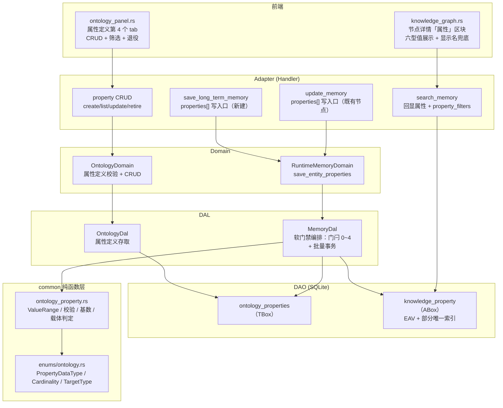
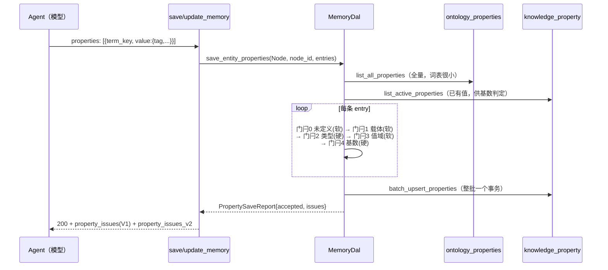
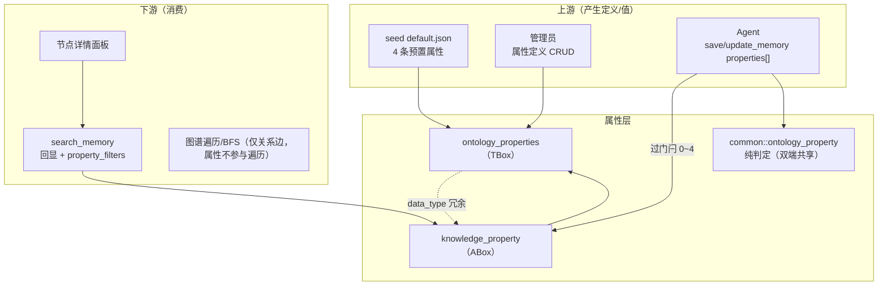

# 本体属性管理

<cite>
**本文引用的文件**
- [migrations/20261011000001_create_ontology_properties.sql](migrations/20261011000001_create_ontology_properties.sql)
- [common/src/ontology_property.rs](common/src/ontology_property.rs)
- [common/src/enums/ontology.rs](common/src/enums/ontology.rs)
- [common/src/api/ontology.rs](common/src/api/ontology.rs)
- [common/src/api/neural_tools.rs](common/src/api/neural_tools.rs)
- [common/src/error/code.rs](common/src/error/code.rs)
- [src/models/ontology.rs](src/models/ontology.rs)
- [src/models/memory.rs](src/models/memory.rs)
- [src/service/dao/ontology/mod.rs](src/service/dao/ontology/mod.rs)
- [src/service/dao/ontology/sqlite.rs](src/service/dao/ontology/sqlite.rs)
- [src/service/dao/memory/mod.rs](src/service/dao/memory/mod.rs)
- [src/service/dao/memory/sqlite/properties.rs](src/service/dao/memory/sqlite/properties.rs)
- [src/service/dal/ontology.rs](src/service/dal/ontology.rs)
- [src/service/dal/memory/properties.rs](src/service/dal/memory/properties.rs)
- [src/service/domain/hr/ontology.rs](src/service/domain/hr/ontology.rs)
- [src/service/domain/runtime/memory.rs](src/service/domain/runtime/memory.rs)
- [src/handlers/hr/ontology/mod.rs](src/handlers/hr/ontology/mod.rs)
- [src/handlers/hr/ontology/create_property.rs](src/handlers/hr/ontology/create_property.rs)
- [src/handlers/hr/ontology/update_property.rs](src/handlers/hr/ontology/update_property.rs)
- [src/handlers/hr/ontology/retire_property.rs](src/handlers/hr/ontology/retire_property.rs)
- [src/handlers/hr/ontology/list_properties.rs](src/handlers/hr/ontology/list_properties.rs)
- [src/handlers/hr/agent/mod.rs](src/handlers/hr/agent/mod.rs)
- [src/handlers/hr/agent/save_long_term_memory.rs](src/handlers/hr/agent/save_long_term_memory.rs)
- [src/handlers/hr/agent/update_memory.rs](src/handlers/hr/agent/update_memory.rs)
- [src/handlers/hr/agent/search_memory.rs](src/handlers/hr/agent/search_memory.rs)
- [src/router.rs](src/router.rs)
- [src/service/domain/system/seed/default.json](src/service/domain/system/seed/default.json)
- [frontend/src/pages/hr/ontology_panel.rs](frontend/src/pages/hr/ontology_panel.rs)
- [frontend/src/pages/hr/knowledge_graph.rs](frontend/src/pages/hr/knowledge_graph.rs)

### 本文关联的三类文档

#### ① Design 决策快照
- [ontology_knowledge_sedimentation_design.md](docs/design/ontology_knowledge_sedimentation_design.md) — 本体与知识图谱合一（TBox/ABox 分层）、软门禁哲学、退役不等于删除（属性层沿用同一口径）

#### ② Plan 落地快照
- （暂无独立 plan；属性层随「知识图谱本体化升级」系列任务直接落地）

#### ④ RAG 原子知识卡
- [本体属性层：TBox 第四张词表 + EAV 版本化 ABox + 软门禁写入 + 结构化反查](docs/wiki/knowledge/zh/本体属性层：ontology_properties%20TBox%20第四张词表%20+%20knowledge_property%20EAV%20版本化%20ABox%20+%20四类型列软门禁写入%20+%20property_filters%20结构化反查/本体属性层：ontology_properties%20TBox%20第四张词表%20+%20knowledge_property%20EAV%20版本化%20ABox%20+%20四类型列软门禁写入%20+%20property_filters%20结构化反查.md) — 本长文对应的 RAG 原子卡
- [本体词表漂移治理与 Prompt 注入](docs/wiki/knowledge/zh/本体词表漂移治理与%20Prompt%20注入：OntologyDal%20load_lexicon_summary%20+%20common%20纯函数解析%20+%20写后认证%20+%20DuckDB%20漂移记账/本体词表漂移治理与%20Prompt%20注入：OntologyDal%20load_lexicon_summary%20+%20common%20纯函数解析%20+%20写后认证%20+%20DuckDB%20漂移记账.md) — **兄弟卡（Level 3 同域双视角）**：该卡管类/关系/同义三张词表与漂移治理，本卡管属性维度（TBox 属性定义 + ABox 属性值）
- [知识图谱联想与关系边补写](docs/wiki/knowledge/zh/知识图谱联想与关系边补写：update_memory%20relations%20唯一建边入口%20+%20正文引用对遍历不可达%20+%20沉淀探索引导/知识图谱联想与关系边补写：update_memory%20relations%20唯一建边入口%20+%20正文引用对遍历不可达%20+%20沉淀探索引导.md) — 属性与建边共用同一批写入口（save/update_memory）与逐项回执哲学
</cite>

> **更新摘要 2026-10-11（本体属性维度落地）**：本体从此前三张词表（实体类 / 关系类型 / 同义映射）扩展出**属性维度**——TBox 新增第 4 张词表 `ontology_properties`（属性定义：数据类型 / 值域 / 基数 / 适用载体），ABox 新增通用属性值表 `knowledge_property`（EAV 行存储、四个类型化值列、status 软取代版本化）。属性随 `save_long_term_memory` / `update_memory` 的 `properties[]` 参数写入，经「类型硬拦 + 值域/载体/未定义软门禁」编排后批量落库，以 `property_issues`（V1 字符串，过渡保留）/ `property_issues_v2`（结构化 `{code,message,field}`）双版本回执返回；`search_memory` 回显生效属性并支持 `property_filters` 按值精确/范围反查。同期修复 `value_range` 读侧键不对称（`enum_values` 主键 + `enum` 兼容）与属性回读 status=0 过滤。

## 目录
1. [简介](#简介)
2. [项目结构](#项目结构)
3. [核心组件](#核心组件)
4. [架构总览](#架构总览)
5. [详细组件分析](#详细组件分析)
6. [依赖关系分析](#依赖关系分析)
7. [性能与优化](#性能与优化)
8. [故障排查指南](#故障排查指南)
9. [结论](#结论)
10. [附录：API 接口](#附录api-接口)

## 简介

本体此前只有三张词表，缺失属性维度，导致两个问题：

1. `ontology_classes.required_fields` 只是字段名字符串数组——无类型、无值域、无基数，且**零消费者**，不参与任何写后校验；
2. ABox 侧知识节点**没有属性落点**，属性只能用 `attribute_of` / `value_of` 两条关系词「用边模拟属性」——值不可索引、无数据类型、无值域，无法做「查所有 model=xxx 的节点」这类结构化过滤。

属性层补齐这块短板，沿用本体域的 TBox/ABox 分层：

- **TBox（属性是什么）**：`ontology_properties` 定义属性语义——六型数据类型（string/number/boolean/date/reference/enum）、取值约束（`value_range`：数值区间或枚举白名单）、基数（single/many）、适用载体（node/relation）与适用实体类、计量单位、是否必填。
- **ABox（这个实体的该属性是什么值）**：`knowledge_property` 通用 EAV 行表，靠 `target_type + target_id` 同时承载节点属性与边属性；四个类型化值列由 `data_type` 指派读写；status 软取代实现「修正留历史」。

**属性与关系怎么分**：判据是「**另一端有没有独立生命**」——另一端本身是值得成为图谱节点的实体 → 用关系边；只是一个字面量事实（置信度、生效时间、来源、状态）→ 用属性。

**软门禁哲学**：与漂移治理同口径——`类型错`是写错（值形态与声明不符，没有解释空间）**硬拦不写库**；值域越界 / 枚举不在白名单 / 载体不符 / 属性未定义属于认知分歧或脏定义，**记录告警后照写**，不阻断、不回滚、不 panic。批量写入语义恒为「部分成功」：一条坏条不连累一批，也不让整批 Err。

## 项目结构



**图表来源**
- [migrations/20261011000001_create_ontology_properties.sql](migrations/20261011000001_create_ontology_properties.sql)
- [src/service/dal/memory/mod.rs](src/service/dal/memory/mod.rs)
- [src/handlers/hr/agent/mod.rs#L216-L283](src/handlers/hr/agent/mod.rs#L216-L283)
- [frontend/src/pages/hr/knowledge_graph.rs#L563-L580](frontend/src/pages/hr/knowledge_graph.rs#L563-L580)

**章节来源**
- [src/service/domain/hr/ontology.rs](src/service/domain/hr/ontology.rs)
- [src/service/domain/runtime/memory.rs](src/service/domain/runtime/memory.rs)
- [common/src/ontology_property.rs](common/src/ontology_property.rs)

## 核心组件

- **两张表 + 一个迁移**：`ontology_properties`（TBox 属性定义，第 4 张本体词表）与 `knowledge_property`（ABox 通用属性值）由 [20261011000001_create_ontology_properties.sql](migrations/20261011000001_create_ontology_properties.sql) 一次建立，含 3 个关键索引（活跃词唯一 / 载体反查 / 值反查 / 数值范围）
- **common 纯函数层**（[common/src/ontology_property.rs](common/src/ontology_property.rs)）：`PropertyValue` 六型枚举与四值列互转、`ValueRange` 解析与提示串渲染、`validate_property_value` 纯判定、`allows_append` 基数判定、`allows_target` 载体门闩、`PropertyFilter` 结构化反查条件；前端复用同一套判定做编辑器即时反馈
- **三层枚举**（[common/src/enums/ontology.rs](common/src/enums/ontology.rs)）：`PropertyDataType`（六型，lowercase 与 DDL CHECK 逐字对齐）、`Cardinality`（single/many）、`PropertyTargetType`（node/relation），均带 `parse_or_default` 脏数据兜底
- **MemoryDal 软门禁编排**（[src/service/dao/memory/sqlite/properties.rs](src/service/dao/memory/sqlite/properties.rs)）：全量取属性定义 → 逐条过门闩 0~4（未定义 / 载体 / 类型+值域 / 基数）→ 整批一个事务 `batch_upsert_properties`，返回 `PropertySaveReport{accepted, issues}`
- **Handler 共享回执**（[src/handlers/hr/agent/mod.rs#L216-L283](src/handlers/hr/agent/mod.rs#L216-L283)）：`save_node_properties` 被 save/update 两个写入口共用；`property_issue_strings`（V1）与 `property_issue_entries`（V2，错误码取自平台 error 词表属性域 6 码）双版本翻译
- **属性 CRUD Handler**：`create/list/update/retire_property` 四端点挂在 `/api/v1/hr/ontology/properties`；`list_ontology_properties` 注册为 `neural + ontology_management,ontology` 工具（任何 Agent 可自查词表），写侧三个工具仅挂 `ontology_management`（需管理员授权）
- **前端两处消费**：本体面板新增「属性定义」管理 tab（[ontology_panel.rs](frontend/src/pages/hr/ontology_panel.rs)）；知识图谱节点详情面板新增「属性」区块（[knowledge_graph.rs#L1029-L1060](frontend/src/pages/hr/knowledge_graph.rs#L1029-L1060)）

## 架构总览

### 写入时序：部分成功的独立一步

属性是**独立于记忆主体**的一步写入——节点已建好/改好后才写属性，属性整批失败既不回滚节点，也不让调用 Err；但回执必须回给模型（静默吞掉会让它以为写成功，下次不再补）。



**图表来源**
- [src/service/dal/memory/store.rs](src/service/dal/memory/store.rs)
- [src/handlers/hr/agent/save_long_term_memory.rs#L83-L110](src/handlers/hr/agent/save_long_term_memory.rs#L83-L110)
- [src/handlers/hr/agent/update_memory.rs#L155-L191](src/handlers/hr/agent/update_memory.rs#L155-L191)

### 版本化：软取代而非覆盖

单值属性重写 = `旧行 status=0 + 插入新行 status=1`（与知识边 status 口径完全一致）：部分唯一索引 `uq_knowledge_property_active(target_type, target_id, term_key, ordinal) WHERE status=1` 把「一实体一属性一槽位只有当前值」从应用约定升级为数据库约束；历史行全留，可回答「当时这个值是多少」。status 三态：1 生效 / 0 被取代 / 2 显式软删除（可恢复）。

**章节来源**
- [migrations/20261011000001_create_ontology_properties.sql#L110-L137](migrations/20261011000001_create_ontology_properties.sql#L110-L137)
- [src/service/dao/memory/sqlite/properties.rs](src/service/dao/memory/sqlite/properties.rs)

## 详细组件分析

### §5.1 TBox：属性定义表

`ontology_properties` 字段组：

| 字段组 | 字段 | 语义 |
|---|---|---|
| 锚点 | `term_key` | snake_case 规范词，创建后不可改（改 key = 退役旧词 + 新建）；仅活跃词唯一索引，退役后允许同名重建 |
| 展示 | `display_name` / `description` | 管理页、属性编辑器与详情面板使用 |
| 适用面 | `domain_classes`（JSON 数组） | 适用实体类 term_key；空数组 = 不限实体类 |
| 适用面 | `applies_to`（JSON 数组） | 允许挂载的载体，取值 `node` / `relation`；空 = 两者皆可。同一 term_key 挂节点与挂边语义可能不同（如「生效时间」），故 TBox 侧显式声明 |
| 值约束 | `data_type` | `string` / `number` / `boolean` / `date` / `reference` / `enum` 六型，DDL CHECK 兜底 |
| 值约束 | `value_range`（JSON） | 数组 = 枚举白名单；对象 = `{min,max}` 数值区间 / `{enum_values:[...]}`；空对象 = 无约束 |
| 基数 | `cardinality` | `single`（ordinal 恒 0）/ `many`（ordinal 递增） |
| 辅助 | `unit` / `required` | 计量单位（仅 number 有意义）；必填标记（写后校验判据之一） |
| 生命周期 | `status` | 1 正常 / 0 退役。**退役 ≠ 删除**：存量值照常可读可解释（`data_type` 冗余在值行），写侧不再允许新引用 |

Domain 写侧 [`validate_property_definition`](src/service/domain/hr/ontology.rs#L65-L103) 对管理员输入做**显式严格校验**（与 common 层静默兜底刻意相反）：`data_type` / `cardinality` 非法值、`applies_to` 拼错载体名、`value_range` 非数组/对象形态一律 400——静默兜底会让管理员以为写的是 number，实际落 string，之后数值属性全写不进 `value_num` 且极难排查。

**章节来源**
- [migrations/20261011000001_create_ontology_properties.sql#L48-L84](migrations/20261011000001_create_ontology_properties.sql#L48-L84)
- [src/models/ontology.rs#L215-L270](src/models/ontology.rs#L215-L270)
- [src/service/domain/hr/ontology.rs#L65-L103](src/service/domain/hr/ontology.rs#L65-L103)

### §5.2 ABox：通用 EAV 属性值表

`knowledge_property` 关键设计：

1. **EAV 行存储而非宿主表加 properties JSON 列**：数值型才能 `WHERE value_num > ?` 走索引；才能按 `(target_type,target_id,term_key)` 做版本化；属性数量级个位数/实体，行放大可接受。
2. **四个类型化值列而非一个 value_json**：`value_text`（text/date/enum 承载）/ `value_num`（REAL，整型浮点共用）/ `value_bool`（0/1）/ `value_ref`（引用另一节点 id 或外部标识），由 `data_type` 指派读写，未用列落 NULL。
3. **通用形态（target_type + target_id）而非按载体分表**：节点属性与边属性是同一套语义，一张表承载，未来新增载体只动枚举与 CHECK；`target_id` 裸列无外键（ABox 表既有惯例，归属由应用层解释）。⚠️ 作用域边界：白名单只含图谱域内载体 node/relation，**不扩展到 agent/task/project**——那些表带 organization_id，而图谱与本体表一律不带（部署单元即作用域）。
4. **data_type 冗余落 ABox**：属性定义退役后，存量值仍可解释，与「退役 ≠ 删除」同口径。
5. **量化指标不进 DuckDB**：属性是 ABox 事实，需事务性点查 + 与节点 JOIN + 行级版本化，归 SQLite；指标的历史时分析走既有事件流旁路。

三个索引：`uq_knowledge_property_active`（版本化唯一约束）、`idx_knowledge_property_target`（取实体全部属性）、`idx_knowledge_property_term` / `idx_knowledge_property_num`（按属性反查载体 / 数值范围查询）。

**章节来源**
- [migrations/20261011000001_create_ontology_properties.sql#L86-L137](migrations/20261011000001_create_ontology_properties.sql#L86-L137)
- [src/models/memory.rs#L374-L440](src/models/memory.rs#L374-L440)
- [common/src/ontology_property.rs#L34-L110](common/src/ontology_property.rs#L34-L110)

### §5.3 common 纯函数：值模型与软门禁判定

| API | 职责 | 退化口径 |
|---|---|---|
| `PropertyValue` / `PropertyColumns` | 六型枚举 ↔ 四值列互转；`from_columns` 只认指派列，残留旧列值忽略，缺失返 None | 不 panic 不猜默认值 |
| `parse_value_range` | 数组→枚举白名单；对象→`{min,max,enum_values}` | 非法 JSON / 空串 / 形态不符 → 无约束（脏定义不拖垮写值链） |
| `validate_property_value` | 判定顺序：类型匹配 → 数值区间（NaN/无穷显式排除）→ 枚举白名单 | 纯函数，同输入同结论 |
| `allows_append` / `allows_target` | 基数判定（取数由调用方做）/ 载体门闩（空清单 = 不限） | — |
| `PropertyFilter` / `PropertyFilterOp` | 结构化反查：Eq/Gt/Gte/Lt/Lte，多条件 AND；非数值只支持 Eq | 不匹配由调用方决定拦或返空 |

`ValueRange::to_hint()` 把约束渲染成提示词短串（`0~1`、`>=0`、`取值取其一: a|b|…(共N项)`，枚举最多展示 8 项防吃词表预算）。读侧枚举白名单主键为 `enum_values`（与 DTO 序列化产物同构），旧键 `enum` 仅防御性兼容。

**章节来源**
- [common/src/ontology_property.rs#L140-L229](common/src/ontology_property.rs#L140-L229)
- [common/src/ontology_property.rs#L247-L323](common/src/ontology_property.rs#L247-L323)

### §5.4 写侧五道闸门与双版本回执

`MemoryDal::save_entity_properties` 对每条 entry 依次判：

| 闸门 | 判定 | 不通过的处理 |
|---|---|---|
| 0 未定义 | 本体有无该 term_key | 软：记 `property_undefined`，按值自身类型兜底照写（不丢数据） |
| 1 载体 | `applies_to` 是否含当前 target_type | 软：记 `property_target_not_allowed` 后照写 |
| 2 类型 | 值变体与声明 data_type 是否一致 | **硬：记 `property_type_mismatch` 并跳过本条** |
| 3 值域 | 数值区间 / NaN / 枚举白名单 | 软：记码后照写（认知分歧不裁决） |
| 4 基数 | 单值已有其他槽位 / 重复占用 | **硬：`property_cardinality_exceeded` 跳过**（无法安置） |

单值属性的槽位恒为 0：新值取代旧值正是版本化修正的本意，不算冲突。通过的条目由 `KnowledgePropertyPo::new` 统一构造（禁止手拼 PO），整批一个事务 `batch_upsert_properties`，不留「一半新版一半旧版」。

回执经 handler 翻译两版：`property_issues: ["term_key: 原因"]`（V1 过渡并存）与 `property_issues_v2: [{code, message, field}]`（V2 对齐平台 `Error{code,msg,field}`，`field` 至少带 `term_key`，类型不符另带 `expected`；6 个错误码定义在 [common/src/error/code.rs](common/src/error/code.rs)）。两版均 `skip_serializing_if`——无问题时不出现在载荷里。

**章节来源**
- [src/service/dal/memory/properties.rs](src/service/dal/memory/properties.rs)
- [src/handlers/hr/agent/mod.rs#L216-L283](src/handlers/hr/agent/mod.rs#L216-L283)
- [common/src/ontology_property.rs#L340-L425](common/src/ontology_property.rs#L340-L425)

### §5.5 读侧：回显与结构化反查

- **回显**：`search_memory` 结果装配尾部 [`attach_properties`](src/handlers/hr/agent/search_memory.rs#L261-L296) 批量调 `list_active_properties_batch`，把每个节点的生效属性（status=1，软取代旧值不回带）挂到 `MemoryResult.properties`；前端详情面板直接消费。
- **结构化反查**：`search_memory` 的 `property_filters[]` 参数经 `query_entities_by_properties` 下推到 DAO `query_properties_by_value`（Eq 走 `value_text/value_ref`，大小比较只走 `value_num`），先反查命中载体 id 再做主查询。约束：`property_filters` 与 `seed_node_ids` 互斥（点名种子恒返回，过滤无法生效）。
- **空值语义**：指派列缺失的脏行 `PropertyValue::from_columns` 返 None，跳过该属性，不猜默认值。

**章节来源**
- [src/handlers/hr/agent/search_memory.rs#L54-L133](src/handlers/hr/agent/search_memory.rs#L54-L133)
- [src/service/dao/memory/sqlite/properties.rs](src/service/dao/memory/sqlite/properties.rs)

### §5.6 属性定义 CRUD（管理侧）

四个 REST 端点（`/api/v1/hr/ontology/properties`）走与类/关系类型完全一致的薄 handler → Domain → DAL → DAO 分层；列表支持 status / domain_class / target_type / keyword 四个筛选 + 分页。工具注册分层（由 `src/pkg/tool_registry/builtin.rs` 三条护栏测试锁死）：

| 工具 | tags | 可达性 |
|---|---|---|
| `list_ontology_properties`（读侧） | `neural` + `ontology_management` + `ontology` | 任何 Agent 出生可达（写记忆前能自查词表），也在 ontology 主题包内 |
| `create/update/retire_ontology_property`（治理侧） | `ontology_management` | 仅管理员 Agent 装包后可达——词表是蜂巢共享约定，任何 Agent 都能改 = 一个错误用词污染全组织图谱 |

**章节来源**
- [src/handlers/hr/ontology/list_properties.rs#L11-L18](src/handlers/hr/ontology/mod.rs)
- [src/handlers/hr/ontology/create_property.rs#L11-L19](src/handlers/hr/ontology/create_property.rs#L11-L19)
- [src/router.rs#L786-L800](src/router.rs#L786-L800)

### §5.7 前端：管理 tab + 节点详情区块

- **本体面板「属性」tab**（[ontology_panel.rs#L220-L274](frontend/src/pages/hr/ontology_panel.rs#L220-L274)）：分页表格 + 状态/关键词筛选 + 新建/编辑 Modal（data_type、cardinality、applies_to、value_range 等表单）+ 退役操作，与类/关系/同义三 tab 同构。
- **节点详情「属性」区块**（[knowledge_graph.rs#L1029-L1060](frontend/src/pages/hr/knowledge_graph.rs#L1029-L1060)）：挂载时拉一次 `list_ontology_properties` 建立 term_key → display_name 缓存（显示名读缓存即渲染订阅，词表到达自动刷新；查无定义则兜底显示 term_key 原文）；`format_property_value` 六分支格式化——直读型行展示，Enum 走徽标，引用型折叠区 + 等宽字体（本期不做点击跳转）。

**章节来源**
- [frontend/src/pages/hr/ontology_panel.rs#L220-L460](frontend/src/pages/hr/ontology_panel.rs#L220-L460)
- [frontend/src/pages/hr/knowledge_graph.rs#L215-L296](frontend/src/pages/hr/knowledge_graph.rs#L215-L296)

### §5.8 预置属性与神经技能

seed 快照（[default.json](src/service/domain/system/seed/default.json) 的 `ontology.properties`）随组织初始化与手动同步注入 4 条预置属性：`confidence`（number 0~1，节点+边）、`effective_from`（date，节点+边）、`source`（string 多值，节点+边）、`status`（enum：draft/active/blocked/done/archived，仅 task/project 类节点）。新增神经技能 **TEMPLATE_ONTOLOGY_COGNITION（本体认知）** 在写图谱前教模型四选一判别（实体类/节点/关系/属性）、选词四规与软退役守则；记忆认知技能同步补充「哪些事实进 properties 而非正文、property_issues 回执必读、单值软取代更正、property_filters 过滤」。

**章节来源**
- [src/service/domain/system/seed/default.json](src/service/domain/system/seed/default.json)
- [src/service/domain/system/seed/skills/TEMPLATE_ONTOLOGY_COGNITION/skill.md](src/service/domain/system/seed/skills/TEMPLATE_ONTOLOGY_COGNITION/skill.md)

## 依赖关系分析



关键边界：属性**不参与图谱遍历**（遍历只沿关系边表，与「正文引用不可达」同一硬边界）；属性行不带 organization_id，不向 agent/task/project 载体泛化。

**章节来源**
- [migrations/20261011000001_create_ontology_properties.sql#L30-L46](migrations/20261011000001_create_ontology_properties.sql#L30-L46)
- [src/service/dal/memory/mod.rs](src/service/dal/memory/mod.rs)

## 性能与优化

1. **定义全量加载**：属性定义与三张词表同量级（个位数十条），写前 `list_all_properties` 一次性拉到内存建 HashMap，不做按需 SQL 查询。
2. **端点批量预检式读**：回显走 `list_active_properties_batch`（IN 列表一次查齐），避免按节点 N+1；建边侧的端点存在性预检同为一次查询核全部。
3. **数值过滤走索引**：`idx_knowledge_property_num(term_key, value_num)` 支撑量化指标范围查询；文本反查走 `idx_knowledge_property_term(term_key, target_type, value_text)`。
4. **整批单事务**：通过条目一次性 `batch_upsert_properties`（先降级旧行后插新行，顺序不能反——会撞部分唯一索引），事务数与条数无关。
5. **纯函数双端复用**：类型/值域判定无 IO，前端编辑器即时反馈与后端写侧门禁共用同一份实现，零双端漂移。

**章节来源**
- [src/service/dao/memory/sqlite/mod.rs](src/service/dao/memory/sqlite/mod.rs)
- [common/src/ontology_property.rs](common/src/ontology_property.rs)

## 故障排查指南

### 常见问题与排查路径

| # | 症状 | 排查路径 |
|---|------|---------|
| 1 | Agent 写属性收到 `property_type_mismatch` 被拒 | 核对入参 `value` 的枚举标签是否与属性定义 `data_type` 一致（如 number 型传了 `"0.5"` 字符串）；V2 回执 `field.expected` 给出声明类型；前端编辑器应对照六型切换输入控件 |
| 2 | 枚举属性写值后提示 `property_not_in_enum_value` 但值确实在列表里 | 先查管理页 value_range 用的是 `enum_values` 键（旧键 `enum` 仅防御兼容）；再核对大小写与空白——值按字符串严格相等比较；该问题是软门禁（值已落库），修正定义后重写一次即可软取代 |
| 3 | 同一属性重写后旧值仍被读出来 | 查 DAO 回读是否漏加 `status=1` 过滤（2026-10-12 回归点）；软取代旧行 status=0 必须在所有读侧过滤；`supersede_properties` 顺序必须是先降级后插入 |
| 4 | 定义了属性但 Agent 写值总报 `property_undefined` | 核对 term_key 是否完全一致（写入侧 trim + ASCII 小写归一）；定义是否已退役（退役定义不参与门闩 0 命中）；Agent 查词表走 `list_ontology_properties`（neural 常驻），检查该工具是否被误摘 neural tag（builtin.rs 护栏测试会红） |
| 5 | 数值属性过滤（property_filters 的 gt/lt）不生效或报错 | 大小比较仅支持 number 型且值必须走 `{number: x}` 标签；`property_filters` 不能与 `seed_node_ids` 同用；确认列是 `value_num`（定义 data_type 被管理页误建为 string 时值落在 value_text） |
| 6 | 节点详情面板不显示属性区块 | 确认该节点经 search_memory 路径打开（面板数据来自搜索结果 `properties` 回显，get_knowledge_graph 全量端点不带属性）；区块在「标签」之后；无属性节点整个区块不渲染 |
| 7 | 多值属性第二条被拒 `property_cardinality_exceeded` | 该属性 cardinality=single 时一槽位只允许一条生效；要存多个值（如多个来源）需管理页把定义改为 many，写入时给递增 ordinal |

### 诊断命令（后端）

```bash
# 属性写入门闩与版本化的全部单测（含 NaN 穿防、批内占位、软取代回读）
cargo test -p ai_orz --lib memory_tests -- properties --nocapture
# common 纯函数层（值域解析 / 六型互转 / 过滤操作符）
cargo test -p common -- ontology_property --nocapture
```

**章节来源**
- [src/service/dal/memory/properties_test.rs](src/service/dal/memory/properties_test.rs)
- [common/src/ontology_property_tests.rs](common/src/ontology_property_tests.rs)

## 结论

本体属性层把「用边模拟属性」升级为**有类型、有值域、有基数、可索引、可版本化**的结构化事实通道：TBox 第 4 张词表管「属性是什么」，通用 EAV 值表管「实体的属性是什么值」，common 纯函数层让双端共用同一套软门禁判定，写侧以「类型硬拦、分歧软放、整批部分成功」平衡数据质量与认知包容，读侧以回显 + 结构化反查让属性真正可消费。它与词表漂移治理构成本体域的双视角：词表管「叫什么」，属性管「是什么值」；与关系边各守边界——另一端有独立生命就建边，只是字面量事实就写属性。

## 附录：API 接口

### 属性定义 CRUD（挂在 Admin 鉴权路由 + 工具注册表）

| 路由 | 方法 | 用途 | 工具 tag | 文件 |
|------|------|------|---------|------|
| `/api/v1/hr/ontology/properties` | GET | 属性定义分页列表（status/domain_class/target_type/keyword 筛选） | neural,ontology_management,ontology | list_properties.rs |
| `/api/v1/hr/ontology/properties` | POST | 创建属性定义（严格校验，非法值 400） | ontology_management | create_property.rs |
| `/api/v1/hr/ontology/properties/{id}` | PUT | 更新属性定义（term_key 不可改） | ontology_management | update_property.rs |
| `/api/v1/hr/ontology/properties/{id}` | DELETE | 软退役（status=0，存量值仍可解释） | ontology_management | retire_property.rs |

### 属性值写入/读取（神经工具，随记忆接口）

| 入口 | 参数 / 字段 | 用途 |
|------|------------|------|
| `save_long_term_memory` | `properties[]` + 响应 `property_issues` / `property_issues_v2` | 新建节点同时写属性（独立一步，节点不因属性失败而回滚） |
| `update_memory` | 同上；短期记忆不接受 properties | 既有节点补/改属性的唯一入口；单值重写即软取代更正 |
| `search_memory` | 请求 `property_filters[]`；响应行内 `properties` | 按值精确/范围反查 + 结果回显生效属性 |

**章节来源**
- [common/src/api/ontology.rs#L116-L260](common/src/api/ontology.rs#L116-L260)
- [common/src/api/neural_tools.rs](common/src/api/neural_tools.rs)（KnowledgePropertyParam / KnowledgePropertyItem / PropertyFilterParam / PropertyIssueEntry / RelationWriteResult）
- [src/router.rs#L786-L800](src/router.rs#L786-L800)
